# Vista dinámica y de concurrencia

Cómo se comporta Orquídea en el tiempo: los objetos activos, los carriles, y las secuencias que demuestran cada ASR con su camino de fallo. Responde la vista dinámica y de concurrencia que pidió BCR.

## DG-SEQ-001 · Acuse temprano

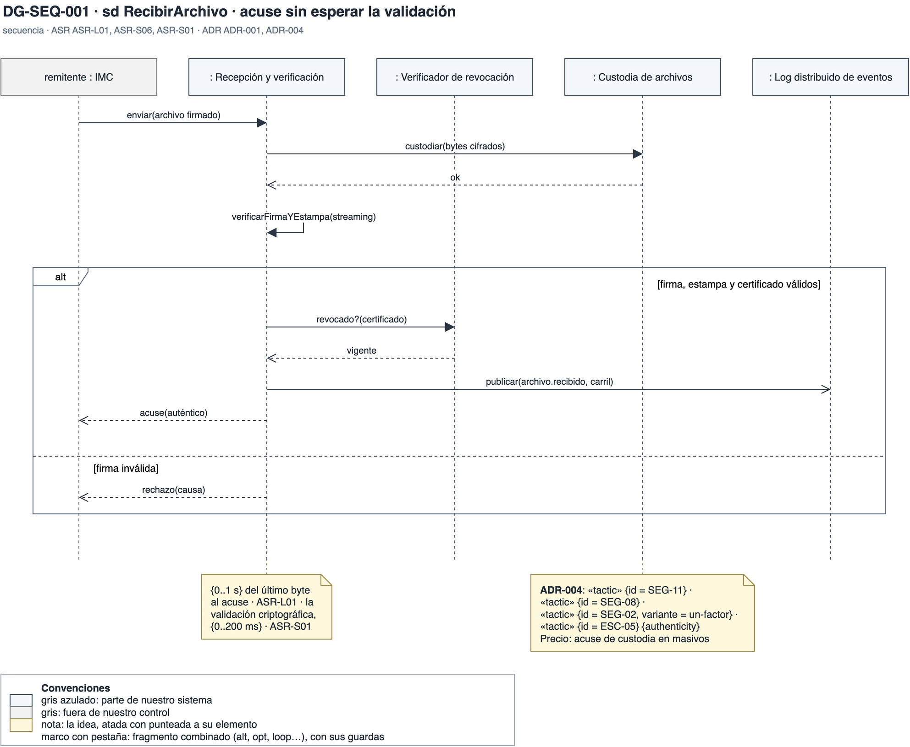

- **Qué muestra:** El envío de un archivo hasta su acuse: custodia, verificación, consulta de revocación y publicación, con la rama de firma inválida.
- **Decisión que refleja:** ADR-001 y ADR-004: el acuse sale sin esperar la validación ni a los sistemas externos, en {0..1 s}.
- **Qué no muestra:** El procesamiento posterior al acuse.

## DG-CON-001 · Carriles y bloques

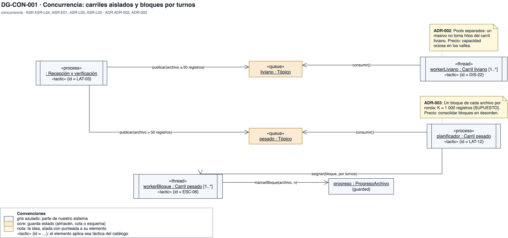

- **Qué muestra:** Los objetos activos: la recepción que clasifica, los dos tópicos, el pool del carril liviano, el planificador del carril pesado y su pool de bloques.
- **Decisión que refleja:** ADR-002 (carriles aislados) y ADR-003 (bloques por turnos entre archivos).
- **Qué no muestra:** El dimensionamiento de cada pool, que fija la prueba de concepto.

## DG-SEQ-002 · Aislamiento de carga

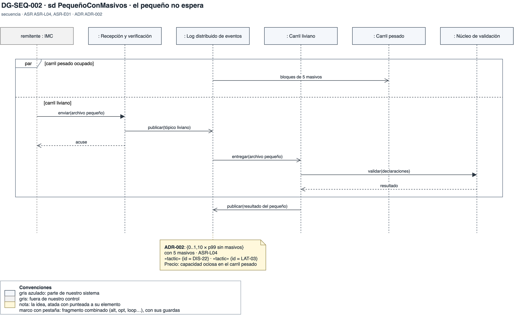

- **Qué muestra:** Un archivo pequeño que se procesa en su carril mientras el carril pesado está ocupado con cinco masivos.
- **Decisión que refleja:** ADR-002: el p99 de los pequeños con masivos sube como máximo 10 %.
- **Qué no muestra:** Qué pasa con un sexto masivo, que sigue abierto con BCR.

## DG-SEQ-003 · Mediano entre masivos

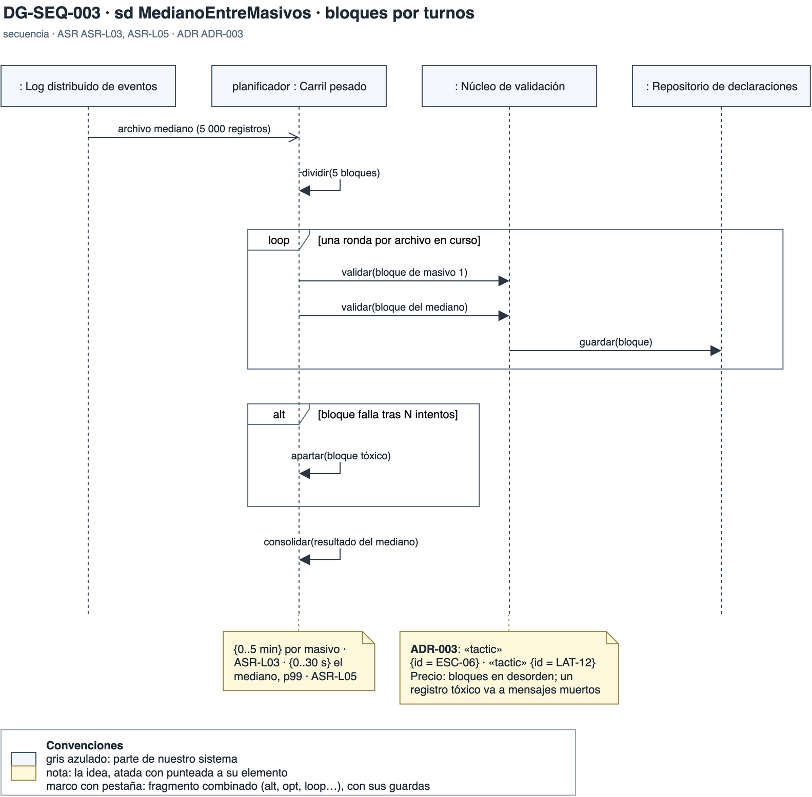

- **Qué muestra:** Un archivo mediano que avanza un bloque por ronda entre los bloques de los masivos, con la rama del bloque tóxico.
- **Decisión que refleja:** ADR-003: el mediano termina en {0..30 s} y cada masivo en {0..5 min}.
- **Qué no muestra:** El tamaño de bloque definitivo, que es un supuesto.

## DG-CST-002 · Carril pesado (caja blanca)

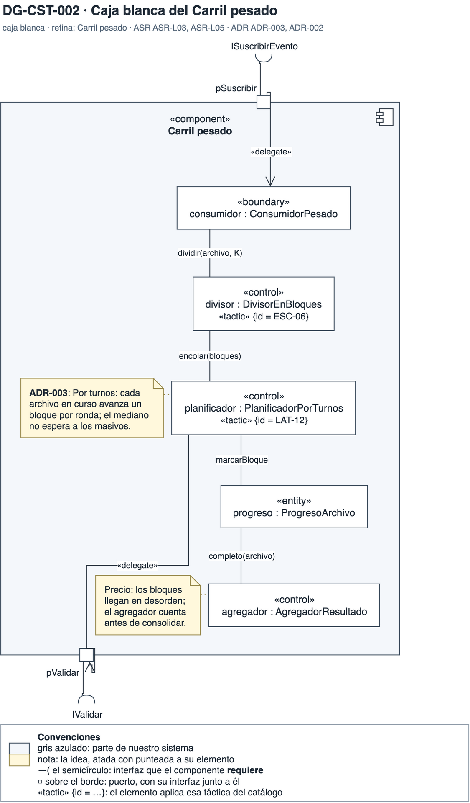

- **Qué muestra:** El consumidor, el divisor en bloques, el planificador por turnos, el progreso por archivo y el agregador del resultado.
- **Decisión que refleja:** ADR-003: la planificación por turnos da a cada archivo una fracción del carril desde que llega.
- **Qué no muestra:** El núcleo de validación, que el carril usa como biblioteca.

## DG-SEQ-102 · Carril pesado (secuencia interna)

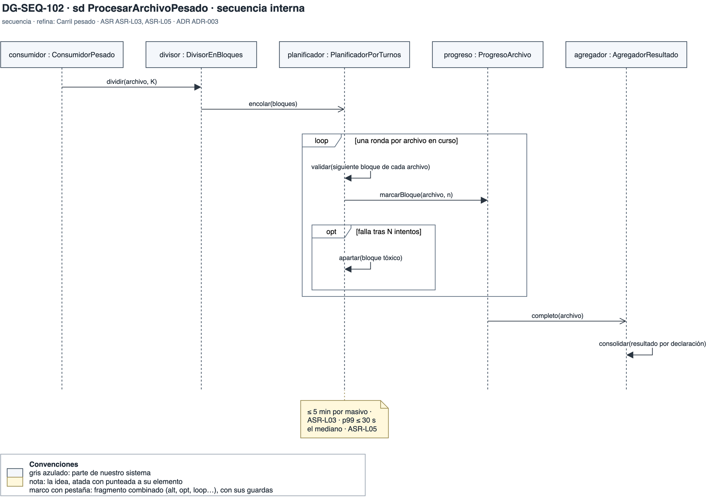

- **Qué muestra:** El procesamiento de un archivo pesado: división, rondas por archivo, marca de progreso y consolidación, con el bloque que se aparta tras N intentos.
- **Decisión que refleja:** ADR-003: los bloques llegan en desorden y el agregador cuenta antes de consolidar.
- **Qué no muestra:** La persistencia de cada bloque.

## DG-SEQ-004 · ECD caída

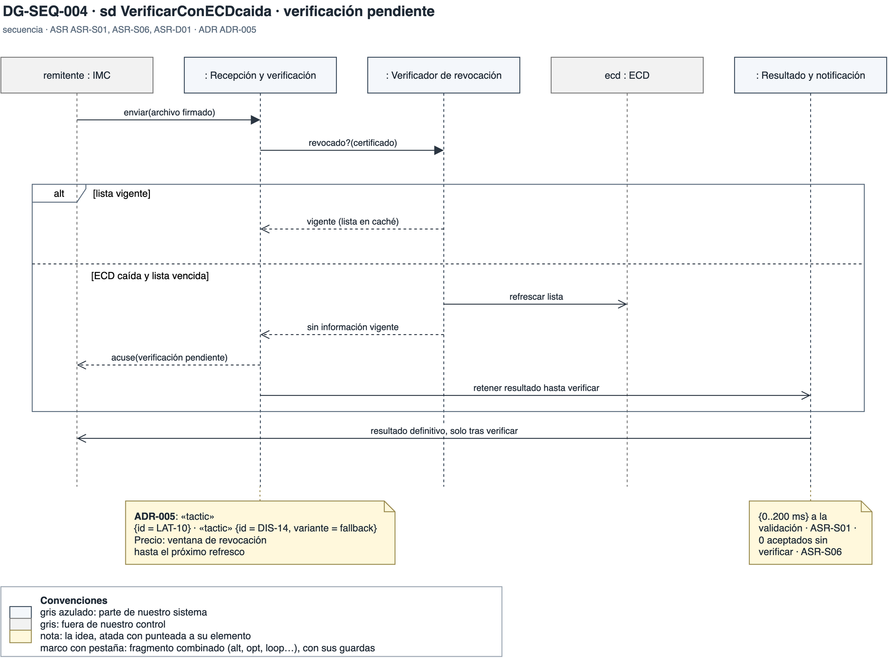

- **Qué muestra:** La verificación con información de revocación vigente y la rama con la ECD caída y la lista vencida, que deja el archivo en verificación pendiente.
- **Decisión que refleja:** ADR-005: ningún archivo se acepta sin verificar, y el acuse no espera a la ECD.
- **Qué no muestra:** Cuánto puede durar la verificación pendiente, que es pregunta a BCR.

## DG-SEQ-005 · Sistema externo caído

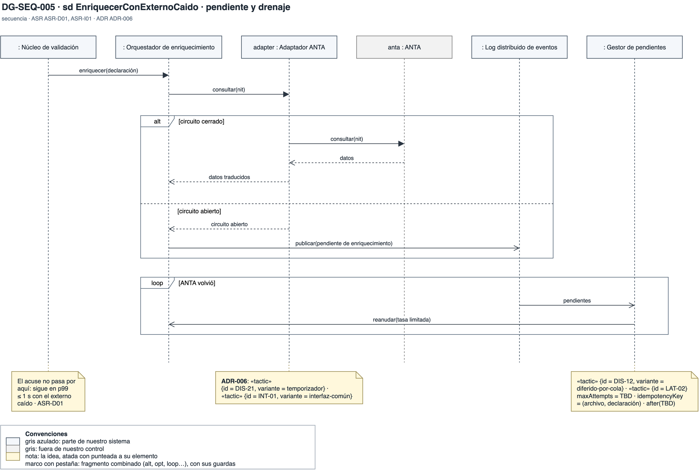

- **Qué muestra:** El enriquecimiento con el circuito cerrado, la rama con el circuito abierto que publica la declaración como pendiente, y el drenaje con tasa limitada cuando el externo vuelve.
- **Decisión que refleja:** ADR-006: la falla del externo se queda en su adaptador.
- **Qué no muestra:** El ritmo de drenaje, que es pregunta a BCR.

## DG-SEQ-006 · Nodo caído

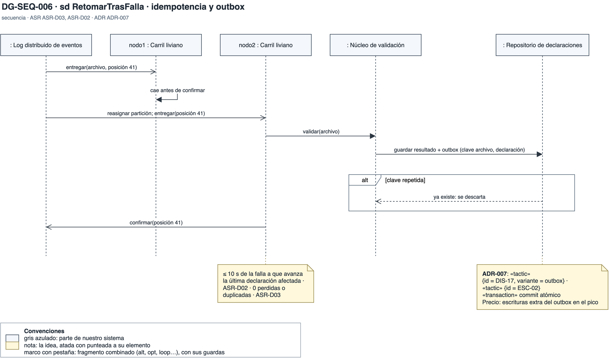

- **Qué muestra:** Un nodo que cae antes de confirmar, el log que reasigna la partición, y el repositorio que descarta el resultado repetido por su clave.
- **Decisión que refleja:** ADR-007: cada declaración termina con exactamente un resultado, y otro nodo retoma en {0..10 s}.
- **Qué no muestra:** La purga del outbox.

## DG-SEQ-007 · Regla en caliente

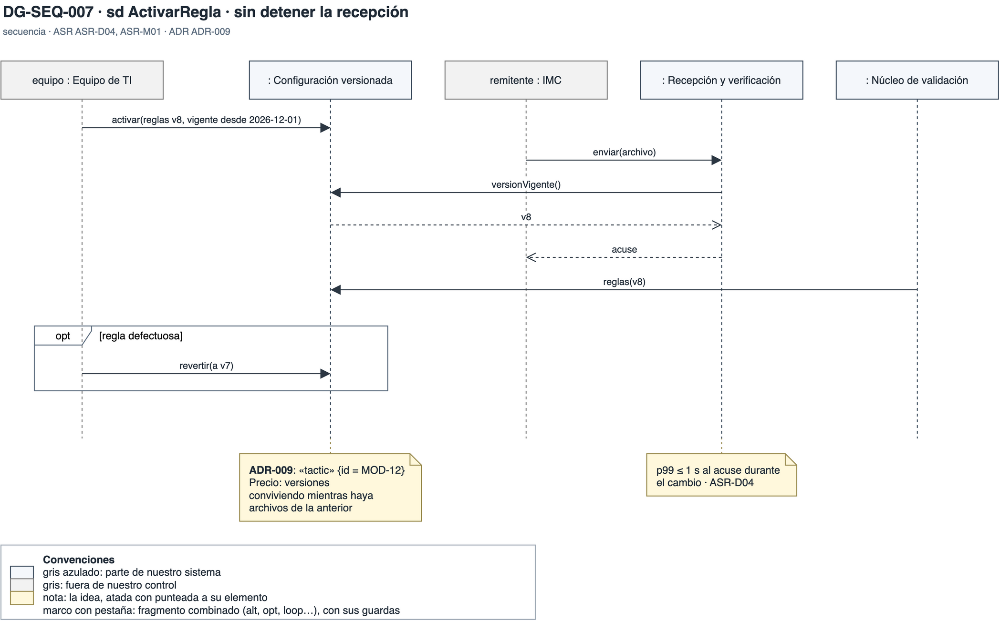

- **Qué muestra:** La activación de una regla mientras siguen llegando archivos, con la reversión si la regla es defectuosa.
- **Decisión que refleja:** ADR-009: el acuse sigue en {0..1 s} durante el cambio, y cada archivo queda con una sola versión.
- **Qué no muestra:** El despliegue de código nuevo, que sigue otra estrategia.

## DG-SEQ-008 · Acceso cruzado

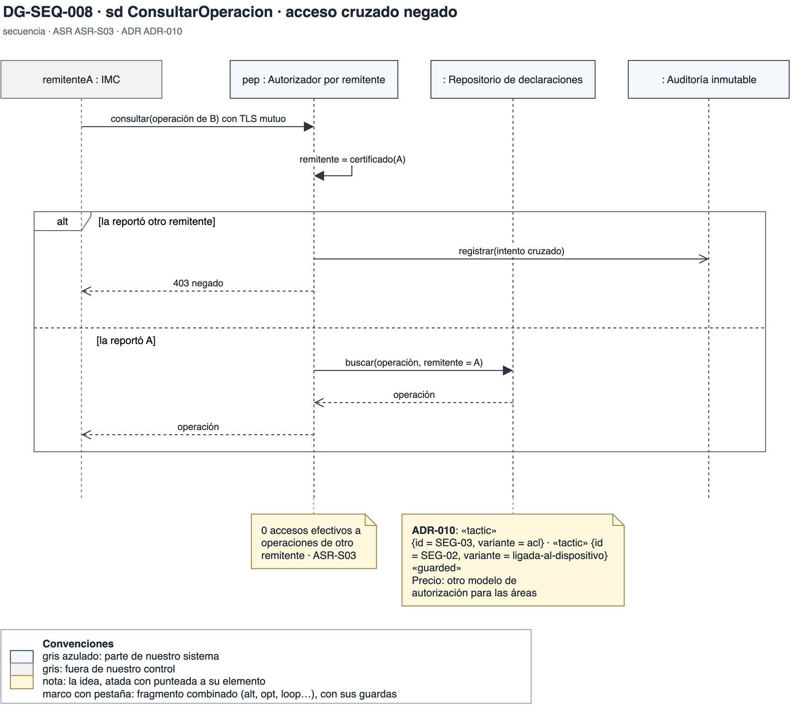

- **Qué muestra:** Un remitente que pide una operación que reportó otro: se niega y se audita; y la consulta de una operación propia.
- **Decisión que refleja:** ADR-010: la identidad sale del certificado y el filtro está en el acceso a datos.
- **Qué no muestra:** El modelo de autorización de las áreas internas.

## DG-SEQ-009 · Auditoría alterada

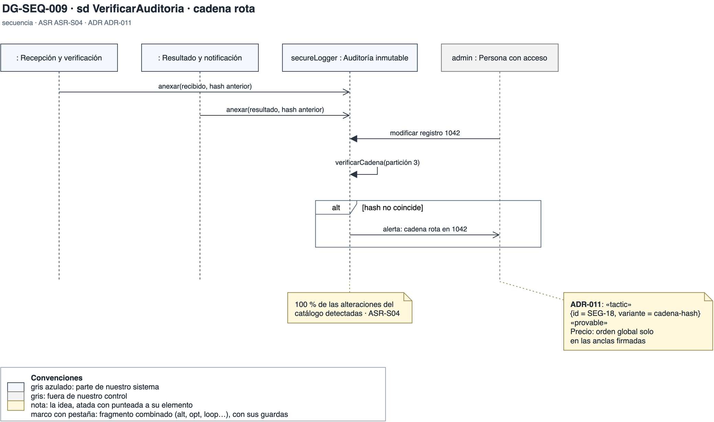

- **Qué muestra:** La escritura encadenada de la auditoría y la verificación que detecta la cadena rota.
- **Decisión que refleja:** ADR-011: una cadena de hash por partición, con anclas firmadas.
- **Qué no muestra:** La firma de las anclas en detalle.
