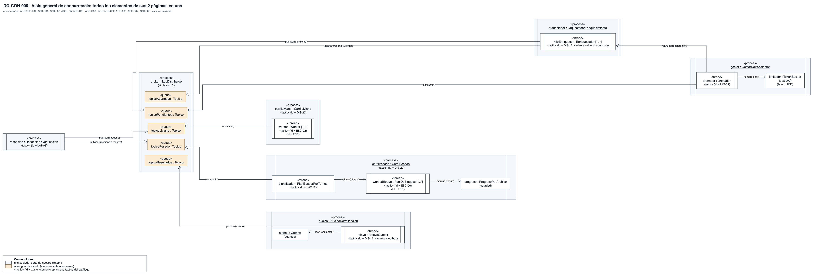
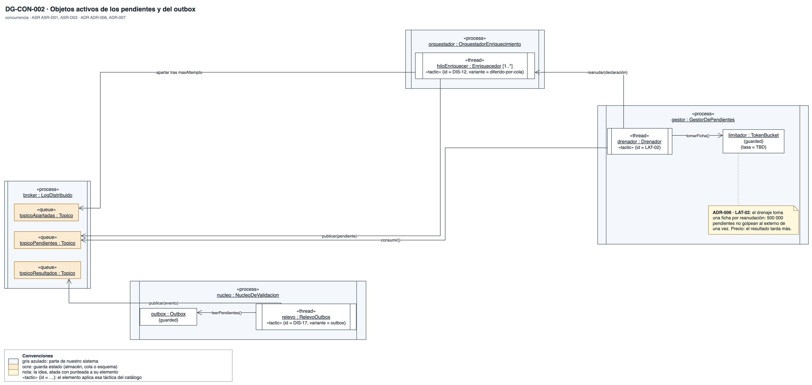
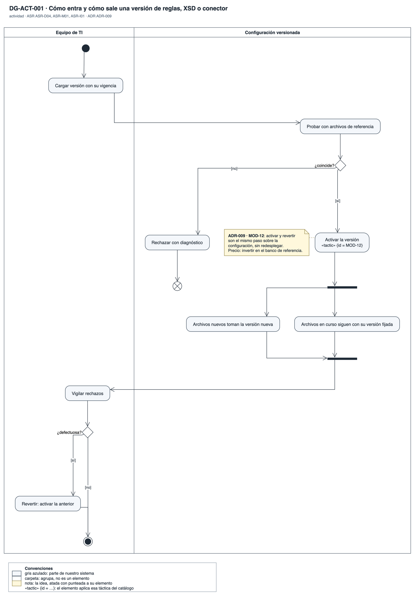
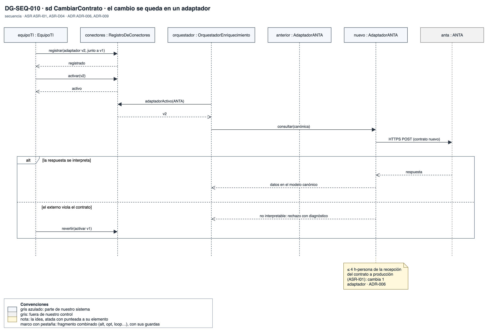
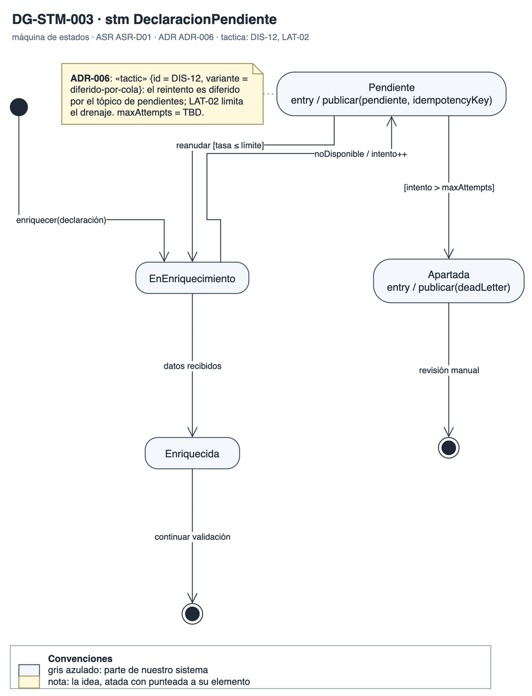

# Vista dinámica y de concurrencia

Cómo se comporta Orquídea en el tiempo. La primera parte muestra los objetos activos: qué corre en paralelo, por qué colas se comunica y qué se sincroniza. La segunda parte trae una secuencia por ASR, cada una con su camino de fallo y su medida anotada. Responde la vista dinámica y de concurrencia que pidió BCR.

## Objetos activos

### DG-CON-000 · Concurrencia de Orquídea

- **Qué muestra:** La unión de las dos vistas de concurrencia: los procesos, sus hilos y los tópicos del broker.
- **Decisión que refleja:** ADR-002, ADR-003, ADR-006 y ADR-007.
- **Qué no muestra:** El dimensionamiento de cada pool, que fija la prueba de concepto.

### DG-CON-001 · Carriles y bloques

- **Qué muestra:** La recepción que publica en dos tópicos, el pool del carril liviano y, en el carril pesado, el planificador, su pool de bloques y el progreso por archivo, que se escribe con exclusión mutua.
- **Decisión que refleja:** ADR-002 (dos pools que no comparten hilos), ADR-003 (bloques por turnos) y ADR-007 (workers sin estado).
- **Qué no muestra:** Qué pasa con un sexto masivo, que sigue abierto con BCR.

### DG-CON-002 · Pendientes y drenaje

- **Qué muestra:** Los hilos que difieren declaraciones al tópico de pendientes, el drenador con su limitador de tasa y el relevo del outbox que publica los resultados.
- **Decisión que refleja:** ADR-006: el drenaje toma una ficha por reanudación. ADR-007: el relevo lee el outbox, que es estado compartido protegido.
- **Qué no muestra:** La tasa de drenaje, que es pregunta a BCR.

## Secuencias de los ASR

### DG-SEQ-001 · Acuse temprano

- **Qué muestra:** El envío de un archivo hasta su acuse: custodia, verificación, revocación y publicación asíncrona al log, con la rama de firma inválida.
- **Decisión que refleja:** ADR-001 y ADR-004: el acuse sale en {0..1 s} sin esperar la validación ni a los sistemas externos.
- **Qué no muestra:** El procesamiento posterior al acuse.

### DG-SEQ-002 · Aislamiento de carga

- **Qué muestra:** En paralelo, cinco masivos en el carril pesado y un pequeño en su propio carril.
- **Decisión que refleja:** ADR-002: el p99 de los pequeños con masivos sube como máximo 10 %.
- **Qué no muestra:** El dimensionamiento del pool liviano para la carga pico.

### DG-SEQ-003 · Mediano entre masivos

- **Qué muestra:** Un mediano que recibe un bloque por ronda entre los bloques de los masivos, con la rama del bloque tóxico.
- **Decisión que refleja:** ADR-003: el mediano termina en {0..30 s} y cada masivo en {0..5 min}.
- **Qué no muestra:** El tamaño de bloque definitivo, que es un supuesto.

### DG-SEQ-004 · ECD caída

- **Qué muestra:** La verificación con la copia vigente y la rama con la ECD caída, que da un acuse de custodia y libera el resultado cuando la ECD vuelve.
- **Decisión que refleja:** ADR-005: ningún archivo se acepta sin verificar, y el acuse no espera a la ECD.
- **Qué no muestra:** Cuánto puede durar la verificación pendiente, que es pregunta a BCR.

### DG-SEQ-005 · Sistema externo caído

- **Qué muestra:** El enriquecimiento con el circuito cerrado, la rama con el circuito abierto que publica la declaración como pendiente, y el drenaje con tasa limitada.
- **Decisión que refleja:** ADR-006: la falla del externo se queda en su adaptador.
- **Qué no muestra:** El ritmo de drenaje.

### DG-SEQ-006 · Nodo caído

- **Qué muestra:** Un nodo que cae antes de confirmar su posición, el log que reasigna la partición y el repositorio que descarta el resultado repetido por su clave.
- **Decisión que refleja:** ADR-007: cada declaración termina con exactamente un resultado, y otro nodo retoma en {0..10 s}.
- **Qué no muestra:** El tiempo de sesión del consumidor, que es el supuesto SUP-08.

### DG-SEQ-007 · Regla en caliente

- **Qué muestra:** La activación de una regla mientras siguen llegando archivos, con la reversión si la regla resulta defectuosa.
- **Decisión que refleja:** ADR-009: el acuse sigue en {0..1 s} durante el cambio, y cada archivo queda con una sola versión.
- **Qué no muestra:** El despliegue de código nuevo, que sigue otra estrategia.

### DG-ACT-001 · Activar y revertir una versión

- **Qué muestra:** El camino de una versión: cargar, probar con archivos de referencia, activar, convivir con la versión anterior y revertir si sale defectuosa.
- **Decisión que refleja:** ADR-009: activar y revertir son el mismo paso sobre la configuración, sin redesplegar.
- **Qué no muestra:** Quién aprueba la versión dentro de BCR.

### DG-SEQ-008 · Acceso cruzado

- **Qué muestra:** Un remitente que pide corregir una operación: si es suya, se corrige; si la reportó otro, se niega y se audita.
- **Decisión que refleja:** ADR-010: la identidad sale del certificado y el filtro está en el acceso a datos.
- **Qué no muestra:** El modelo de autorización de las áreas internas.

### DG-SEQ-009 · Auditoría alterada

- **Qué muestra:** La escritura encadenada de la auditoría y la verificación que detecta la cadena rota.
- **Decisión que refleja:** ADR-011: una cadena de hash por partición, con anclas firmadas.
- **Qué no muestra:** La firma de las anclas en detalle; está en DG-SEQ-109.

### DG-SEQ-010 · Contrato nuevo de un externo

- **Qué muestra:** El adaptador nuevo que se registra junto al anterior, se activa en el registro de conectores y se revierte si el externo viola el contrato.
- **Decisión que refleja:** ADR-006 y ADR-009: un contrato nuevo cambia un adaptador, en ≤ 4 h-persona.
- **Qué no muestra:** Cómo se obtiene la especificación del contrato nuevo.

### DG-STM-003 · Declaración pendiente de enriquecimiento

- **Qué muestra:** Una declaración que pasa a pendiente cuando el externo no responde, se reanuda bajo el límite de tasa y se aparta tras el máximo de intentos.
- **Decisión que refleja:** ADR-006: reintento diferido por cola, con límite.
- **Qué no muestra:** El máximo de intentos, que BCR no ha fijado.
