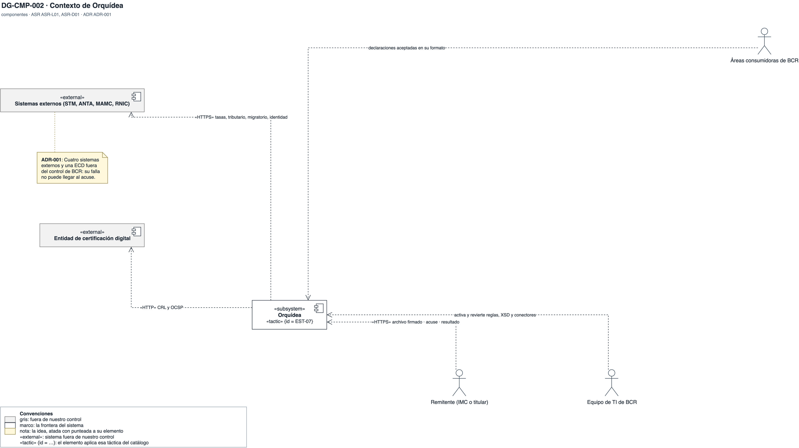

# Vista de contexto

Con quién habla Orquídea y qué intercambia con cada uno. Responde la vista de contexto que pidió BCR.

## DG-CMP-002 · Contexto de Orquídea

- **Qué muestra:** Orquídea como caja negra frente a los remitentes, los cuatro sistemas externos, la ECD, las áreas de BCR y el equipo de TI, con lo que intercambia con cada uno.
- **Decisión que refleja:** ADR-001: los sistemas externos y la ECD quedan detrás de una etapa, fuera del camino del acuse.
- **Qué no muestra:** Cómo está construido Orquídea por dentro; eso lo abre la vista general.
