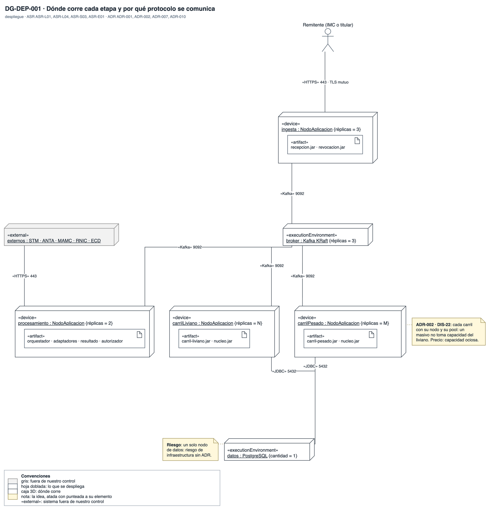

# Vista de despliegue

Dónde corre cada etapa, cuántas réplicas tiene y por qué protocolo se comunica. Responde la vista de despliegue y topología de red que pidió BCR. Aquí se ven las tácticas que son topología: el bulkhead entre carriles, los nodos sin estado replicados y el TLS mutuo en la entrada.

## DG-DEP-001 · Despliegue y topología de red

- **Qué muestra:** Los nodos de ingesta, de cada carril, de procesamiento, del broker y de datos, con sus réplicas, sus artefactos, los sistemas externos y el protocolo y puerto de cada ruta.
- **Decisión que refleja:** ADR-002: cada carril con su nodo (bulkhead). ADR-007: nodos sin estado replicados. ADR-010: TLS mutuo en la entrada.
- **Qué no muestra:** La alta disponibilidad entre zonas ni la de la base de datos: el nodo de datos único es un riesgo de infraestructura sin ADR.
