# Vista funcional

Qué componentes tiene Orquídea y dónde vive cada táctica. Abre con la vista general. Cada componente clave para un ASR se abre después en su caja blanca, que muestra sus partes, y en su secuencia interna, que muestra la operación crítica paso a paso. Las tácticas que son un patrón de clases, como el adaptador y la API del motor de reglas, tienen además su diagrama de clases.

## DG-CMP-001 · Vista general

- **Qué muestra:** Los componentes de Orquídea en cinco paquetes, el log distribuido como bus con sus tópicos, los externos a la izquierda y los actores a la derecha. Cada componente lleva la marca de la táctica principal que aloja.
- **Decisión que refleja:** ADR-001 (pipeline asíncrono), ADR-002 (carriles) y ADR-006 (adaptadores). Las marcas remiten a los doce ADR.
- **Qué no muestra:** El orden de los mensajes ni los tiempos; eso está en las secuencias. Para que la página se lea, omite quién más publica en el bus y quién más escribe en la auditoría; esas relaciones están en cada caja blanca.

Componentes clave que se eclosionan, con el ASR que los hace clave:

| Componente | ASR | Por qué es clave |
|---|---|---|
| Recepción y verificación | ASR-L01, ASR-S06, ASR-S01 | Aloja SEG-02, SEG-11, SEG-08 y LAT-03, y está en el camino del acuse |
| Verificador de revocación | ASR-S01, ASR-S06, ASR-D01 | Aloja LAT-10 y DIS-14, y está en el camino de los 200 ms |
| Carril pesado | ASR-L03, ASR-L05, ASR-L04 | Aloja ESC-06, LAT-12 y DIS-22 |
| Núcleo de validación | ASR-M01, ASR-M02, ASR-D03, ASR-I02 | Aloja MOD-03, INT-04 y DIS-17 |
| Configuración versionada | ASR-M01, ASR-M02, ASR-D04 | Aloja MOD-09 y MOD-12 |
| Orquestador de enriquecimiento | ASR-D01 | Aloja DIS-12 |
| Adaptadores de sistemas externos | ASR-D01, ASR-I01 | Aloja INT-01 y DIS-21 |
| Autorizador por remitente | ASR-S03 | Aloja SEG-03 y SEG-02 (TLS mutuo) |
| Auditoría inmutable | ASR-S04 | Aloja SEG-18 |
| Proyectores por área | ASR-I02 | Aloja MOD-04 |

## Recepción y verificación

### DG-CST-001 · Recepción y verificación (caja blanca)

- **Qué muestra:** El receptor que parsea en streaming sin DTD, la parte que resume los bytes custodiados, el verificador de firma con sus anclas de confianza y la firma registrada, y el clasificador por tamaño.
- **Decisión que refleja:** ADR-004: se verifica el mismo hash que se custodia y se procesa. ADR-002: la clasificación por bytes elige el carril sin abrir el archivo.
- **Qué no muestra:** Cómo se responde la revocación; eso lo abre DG-CST-010.

### DG-SEQ-101 · Recepción y verificación (secuencia interna)

- **Qué muestra:** La verificación paso a paso, con la rama de firma alterada o envuelta que termina en rechazo.
- **Decisión que refleja:** ADR-004: el resultado de la verificación sale en {0..200 ms}, dentro del segundo del acuse.
- **Qué no muestra:** La publicación al log; eso está en DG-SEQ-001.

## Verificador de revocación

### DG-CST-010 · Verificador de revocación (caja blanca)

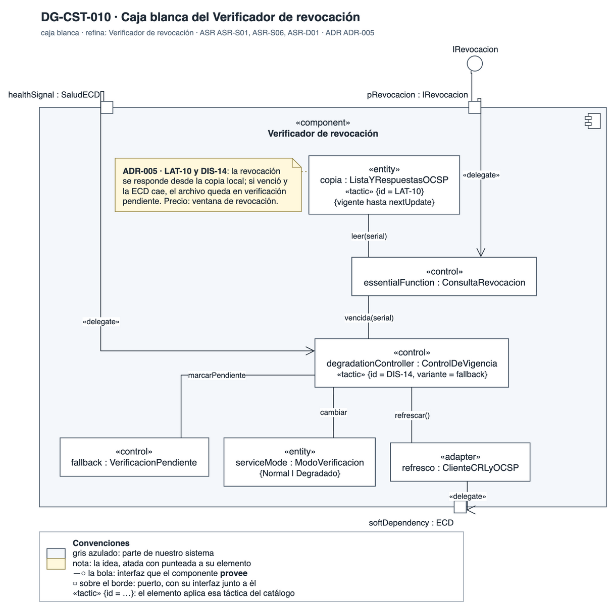

- **Qué muestra:** La consulta de revocación, la copia local de la lista y de las respuestas OCSP, el controlador de vigencia, el modo de verificación, la verificación pendiente y el cliente que refresca desde la ECD.
- **Decisión que refleja:** ADR-005: la revocación se responde desde la copia local y, si venció con la ECD caída, el archivo queda pendiente.
- **Qué no muestra:** Cada cuánto publica la ECD su lista, que sigue como pregunta a BCR.

### DG-SEQ-110 · Verificador de revocación (secuencia interna)

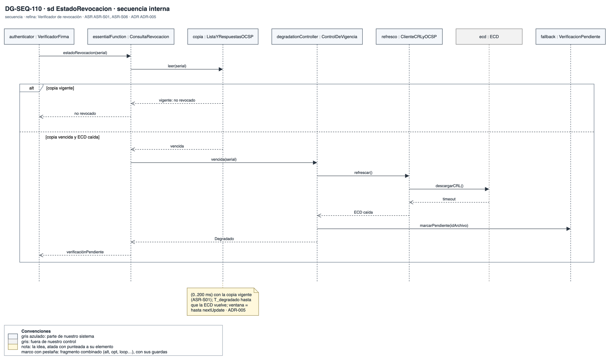

- **Qué muestra:** La consulta con la copia vigente y la rama con la copia vencida y la ECD caída, que pasa a modo degradado.
- **Decisión que refleja:** ADR-005: {0..200 ms} con la copia vigente; con la ECD caída, verificación pendiente y nunca aceptación.
- **Qué no muestra:** Cuánto dura la verificación pendiente.

## Carril pesado

### DG-CST-002 · Carril pesado (caja blanca)

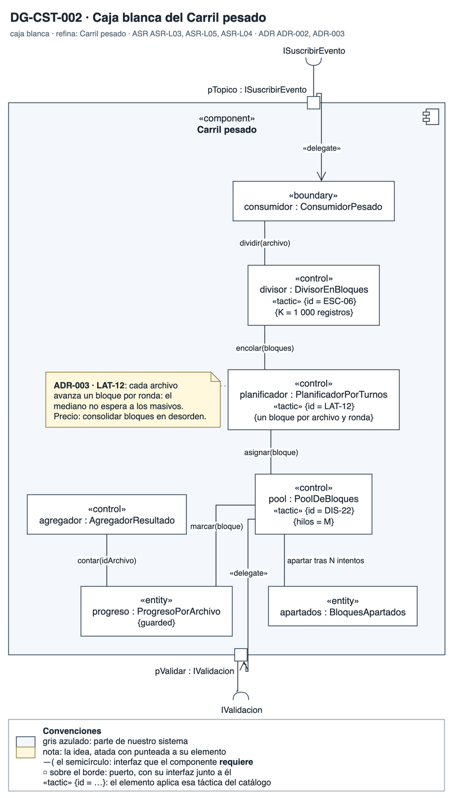

- **Qué muestra:** El consumidor, el divisor en bloques, el planificador por turnos, el pool de bloques, el progreso por archivo, el agregador y los bloques apartados.
- **Decisión que refleja:** ADR-003: cada archivo avanza un bloque por ronda. ADR-002: el pool es propio del carril.
- **Qué no muestra:** El núcleo de validación, al que el carril llama por IValidacion.

### DG-SEQ-102 · Carril pesado (secuencia interna)

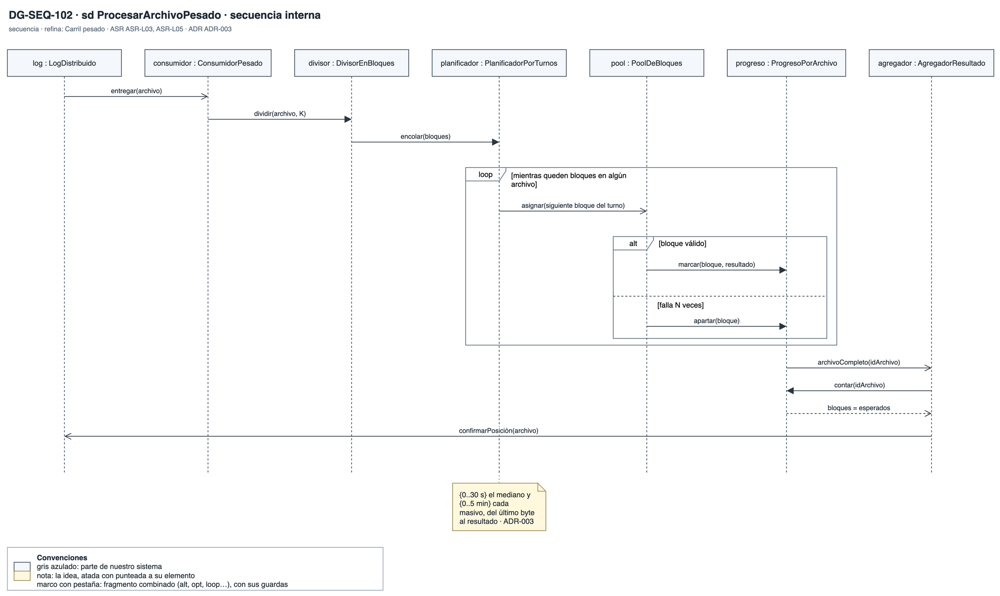

- **Qué muestra:** La división, las rondas, la marca de progreso y la consolidación, con el bloque que se aparta tras N intentos.
- **Decisión que refleja:** ADR-003: los bloques llegan en desorden y el agregador cuenta antes de consolidar.
- **Qué no muestra:** El tamaño definitivo de bloque, que fija la prueba de concepto.

## Núcleo de validación

El núcleo tiene dos cajas blancas con el mismo `refina`, una por pregunta: cómo valida y cómo registra el resultado.

### DG-CST-005 · Núcleo de validación: reglas y modelo canónico (caja blanca)

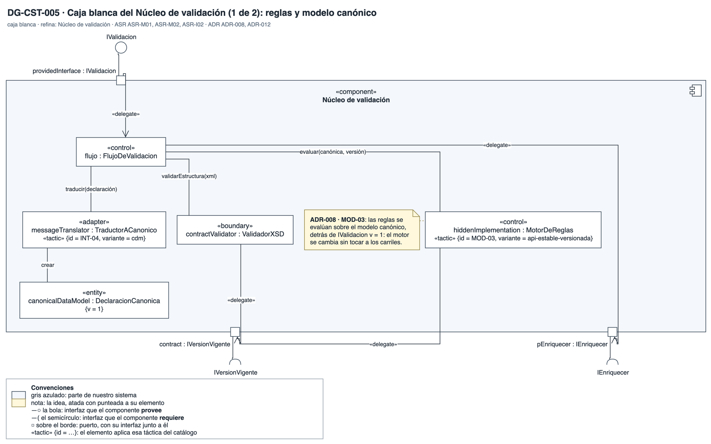

- **Qué muestra:** El flujo de validación, el validador XSD, el traductor al modelo canónico, la declaración canónica y el motor de reglas oculto detrás de IValidacion.
- **Decisión que refleja:** ADR-008: el motor queda detrás de una API versionada y lee la versión fijada al recibir. ADR-012: todo se evalúa sobre el modelo canónico.
- **Qué no muestra:** El lenguaje de reglas.

### DG-SEQ-105 · Núcleo de validación (secuencia interna, validar)

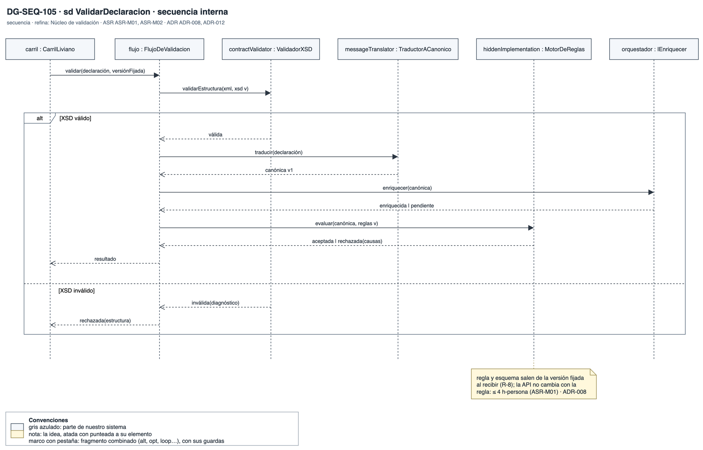

- **Qué muestra:** La validación estructural, la traducción, el enriquecimiento y la evaluación de reglas, con la rama de XSD inválido.
- **Decisión que refleja:** ADR-008: regla y esquema salen de la versión fijada al recibir.
- **Qué no muestra:** Qué pasa con una declaración pendiente; eso está en DG-SEQ-108.

### DG-CST-006 · Núcleo de validación: transacción y outbox (caja blanca)

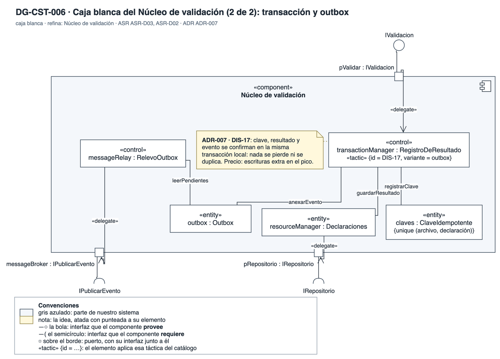

- **Qué muestra:** El registro del resultado, la clave de idempotencia, las declaraciones, el outbox y el relevo que publica al log.
- **Decisión que refleja:** ADR-007: clave, resultado y evento se confirman en una sola transacción local.
- **Qué no muestra:** La purga del outbox; su ciclo está en DG-STM-004.

### DG-SEQ-106 · Núcleo de validación (secuencia interna, outbox)

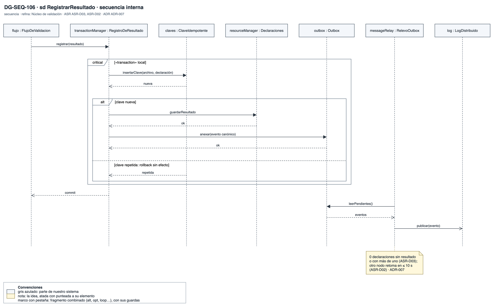

- **Qué muestra:** La transacción local en un fragmento `critical`, la rama de clave repetida y el relevo que publica después.
- **Decisión que refleja:** ADR-007: 0 declaraciones sin resultado o con más de uno.
- **Qué no muestra:** La caída de un nodo; eso está en DG-SEQ-006.

## Configuración versionada

### DG-CMP-003 · Reglas y esquemas

- **Qué muestra:** La configuración versionada provee la versión vigente al núcleo y la administración al equipo de TI; los carriles solo ven IValidacion.
- **Decisión que refleja:** ADR-008: una regla nueva es un dato con vigencia; los componentes afectados pasan de uno a ninguno.
- **Qué no muestra:** Cómo se activa una versión; eso está en DG-ACT-001 y DG-SEQ-007.

### DG-CLS-004 · Motor de reglas

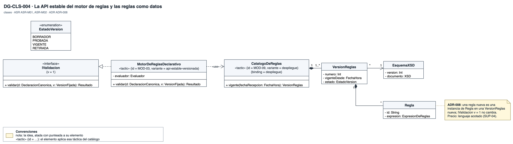

- **Qué muestra:** IValidacion versionada, el motor que la realiza, el catálogo con su vigencia, las versiones, las reglas y los esquemas.
- **Decisión que refleja:** ADR-008: la API no cambia cuando cambia una regla, porque la regla es una instancia, no código.
- **Qué no muestra:** La regla que el lenguaje no expresa, que exige código nuevo.

### DG-CST-004 · Configuración versionada (caja blanca)

- **Qué muestra:** El control de cambios, el banco de archivos de referencia, el catálogo de reglas, el registro de esquemas, el de conectores y el resolutor de vigencia.
- **Decisión que refleja:** ADR-008 y ADR-009: activar o revertir cambia la versión vigente, sin redesplegar.
- **Qué no muestra:** Quién aprueba una regla dentro de BCR.

### DG-SEQ-104 · Configuración versionada (secuencia interna)

- **Qué muestra:** La carga, la prueba con archivos de referencia y la activación, con la rama que rechaza la regla con diagnóstico.
- **Decisión que refleja:** ADR-008: una regla sobre datos que ya llegan cuesta ≤ 4 h-persona.
- **Qué no muestra:** La reversión en producción; eso está en DG-SEQ-007.

## Integración con los sistemas externos

### DG-CST-008 · Orquestador de enriquecimiento (caja blanca)

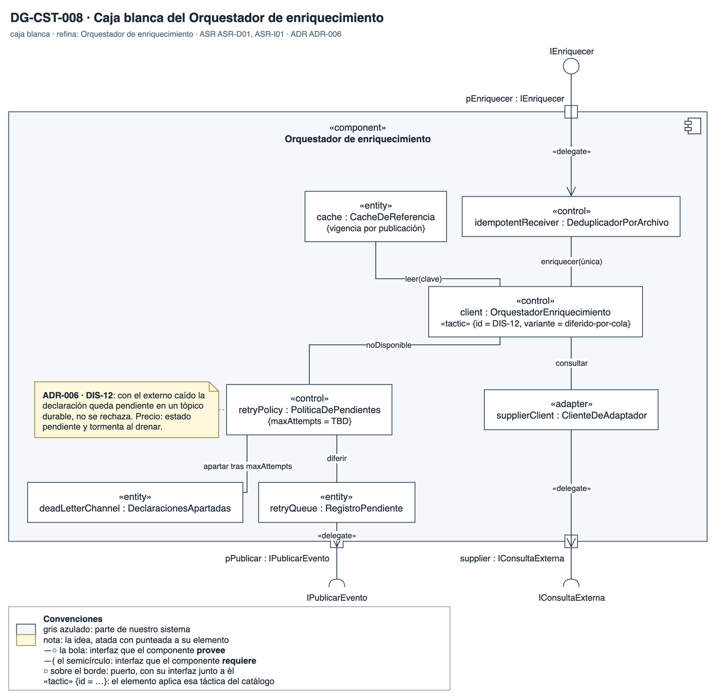

- **Qué muestra:** El deduplicador por archivo, el orquestador, la caché de referencia, la política de pendientes, el cliente de adaptador, el registro de pendientes y las declaraciones apartadas.
- **Decisión que refleja:** ADR-006: con el externo caído, la declaración queda pendiente en un tópico durable.
- **Qué no muestra:** El drenaje; eso está en DG-CON-002.

### DG-SEQ-108 · Orquestador de enriquecimiento (secuencia interna)

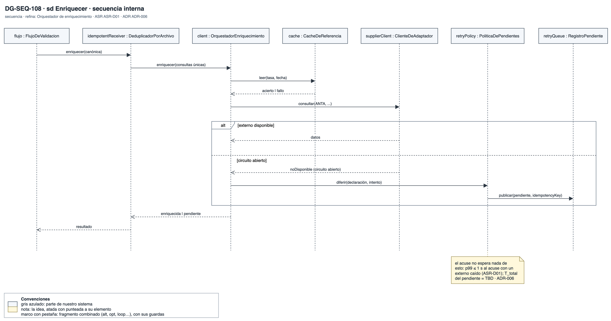

- **Qué muestra:** La consulta a la caché, al adaptador y la rama del circuito abierto que difiere la declaración.
- **Decisión que refleja:** ADR-006: el acuse no espera nada de esto.
- **Qué no muestra:** El ritmo de drenaje, que es pregunta a BCR.

### DG-CLS-002 · Adaptadores de sistemas externos

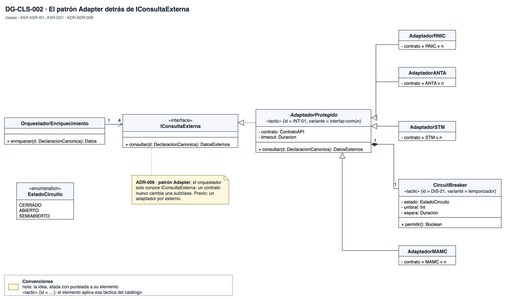

- **Qué muestra:** El patrón adaptador: el orquestador conoce solo IConsultaExterna; una clase abstracta protegida la realiza con su circuit breaker, y hay una subclase por externo.
- **Decisión que refleja:** ADR-006: un contrato nuevo cambia una subclase y nada más.
- **Qué no muestra:** El contenido de cada contrato de API.

### DG-CST-003 · Adaptadores de sistemas externos (caja blanca)

- **Qué muestra:** El adaptador de ANTA, la llamada protegida, el circuit breaker con su estado, el cliente HTTP y el puerto de eventos del circuito.
- **Decisión que refleja:** ADR-006: el contrato de API se queda en su adaptador, protegido por un circuit breaker.
- **Qué no muestra:** Los otros tres adaptadores, que tienen la misma estructura.

### DG-SEQ-103 · Adaptadores (secuencia interna)

- **Qué muestra:** Una consulta a ANTA con el circuito cerrado y la rama del circuito abierto, que responde sin llamar al externo.
- **Decisión que refleja:** ADR-006: la llamada al externo nunca está en el camino del acuse.
- **Qué no muestra:** El drenaje de los pendientes; eso está en DG-SEQ-005.

### DG-STM-002 · Circuito de un adaptador

- **Qué muestra:** Cerrado, abierto y semiabierto, con la espera antes de probar de nuevo.
- **Decisión que refleja:** ADR-006: con el circuito abierto, la declaración queda pendiente, no se rechaza.
- **Qué no muestra:** El umbral de fallas, que BCR no ha fijado.

## Consulta y auditoría

### DG-CST-007 · Autorizador por remitente (caja blanca)

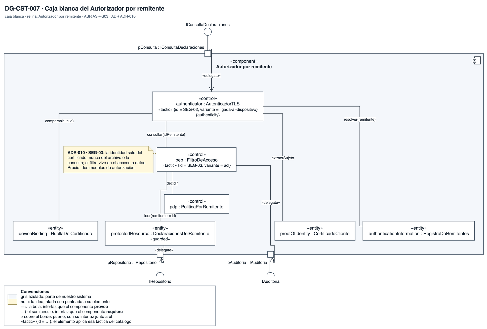

- **Qué muestra:** El autenticador TLS con el certificado, su huella y el registro de remitentes, y el filtro de acceso con su política y el recurso protegido.
- **Decisión que refleja:** ADR-010: la identidad sale del certificado y el filtro vive en el acceso a datos.
- **Qué no muestra:** La autorización de las áreas internas de BCR.

### DG-SEQ-107 · Autorizador por remitente (secuencia interna)

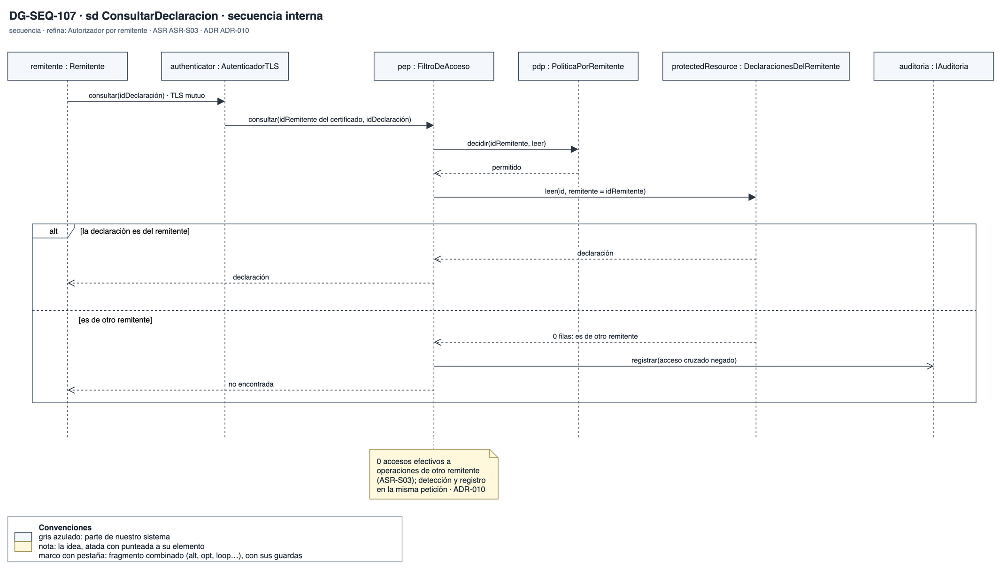

- **Qué muestra:** Una consulta propia y la rama de una operación ajena, que se niega y se audita.
- **Decisión que refleja:** ADR-010: 0 accesos efectivos a operaciones de otro remitente.
- **Qué no muestra:** La corrección y la anulación, que siguen el mismo camino.

### DG-CST-009 · Auditoría inmutable (caja blanca)

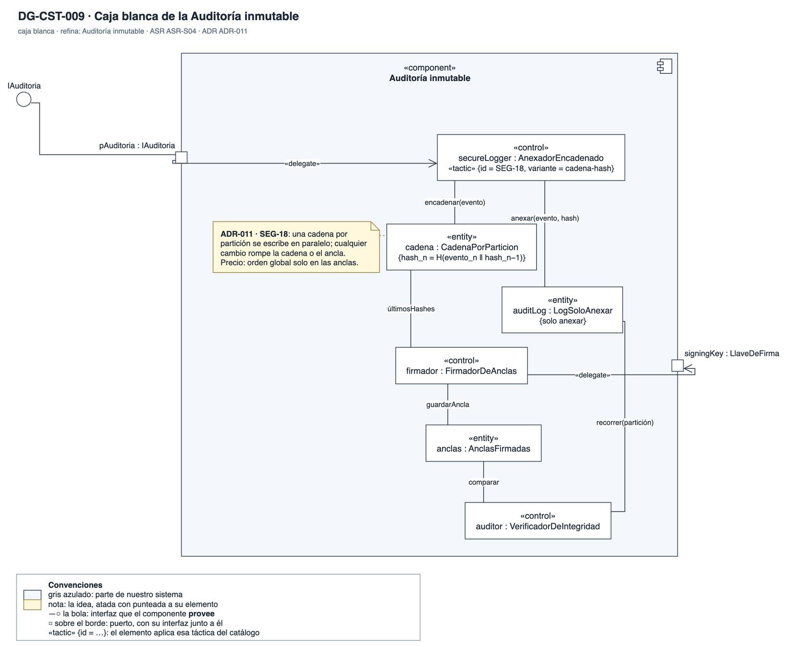

- **Qué muestra:** El anexador encadenado, la cadena por partición, el log de solo anexar, las anclas firmadas, su firmador y el verificador.
- **Decisión que refleja:** ADR-011: una cadena de hash por partición, con anclas firmadas.
- **Qué no muestra:** La custodia de la llave de firma.

### DG-SEQ-109 · Auditoría inmutable (secuencia interna)

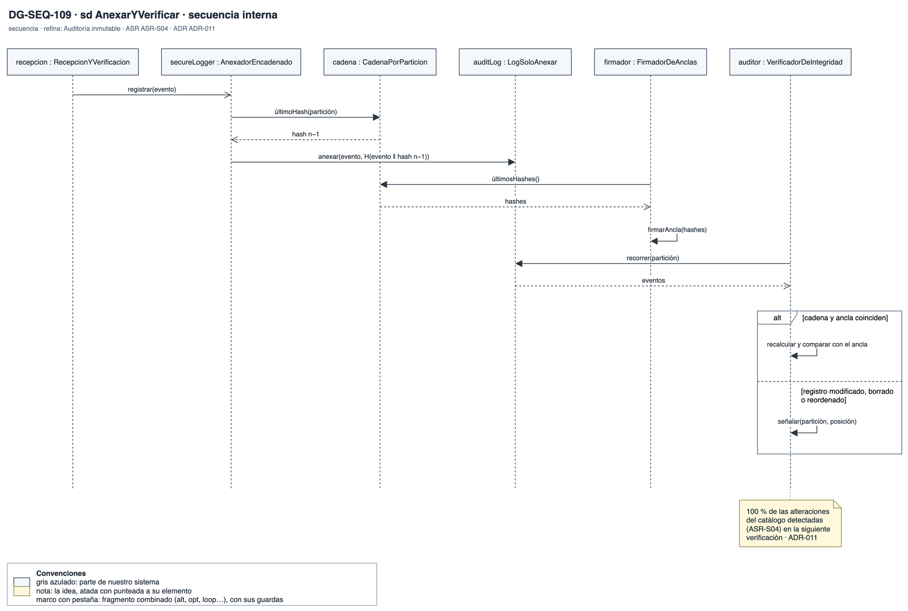

- **Qué muestra:** El anexo encadenado, la firma del ancla y la verificación que señala la alteración.
- **Decisión que refleja:** ADR-011: el 100 % de las alteraciones del catálogo se detecta.
- **Qué no muestra:** El período de las anclas.

## Entrega a las áreas

### DG-CMP-004 · Entrega a las áreas

- **Qué muestra:** El núcleo publica el evento canónico desde el outbox; los proyectores existentes y el de un área nueva solo se suscriben.
- **Decisión que refleja:** ADR-012: un área nueva es un proyector nuevo, sin tocar el flujo principal.
- **Qué no muestra:** Los formatos internos de cada área.

### DG-CST-011 · Proyectores por área (caja blanca)

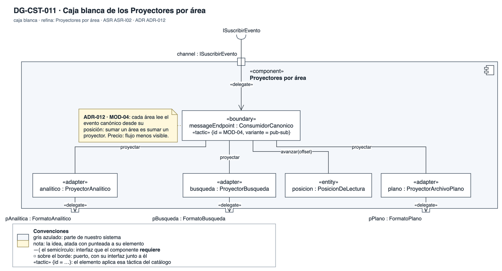

- **Qué muestra:** El consumidor canónico, la posición de lectura y un proyector por área.
- **Decisión que refleja:** ADR-012: cada área lee el evento desde su propia posición.
- **Qué no muestra:** El modelo canónico; eso está en DG-CLS-003.

### DG-SEQ-111 · Proyectores por área (secuencia interna)

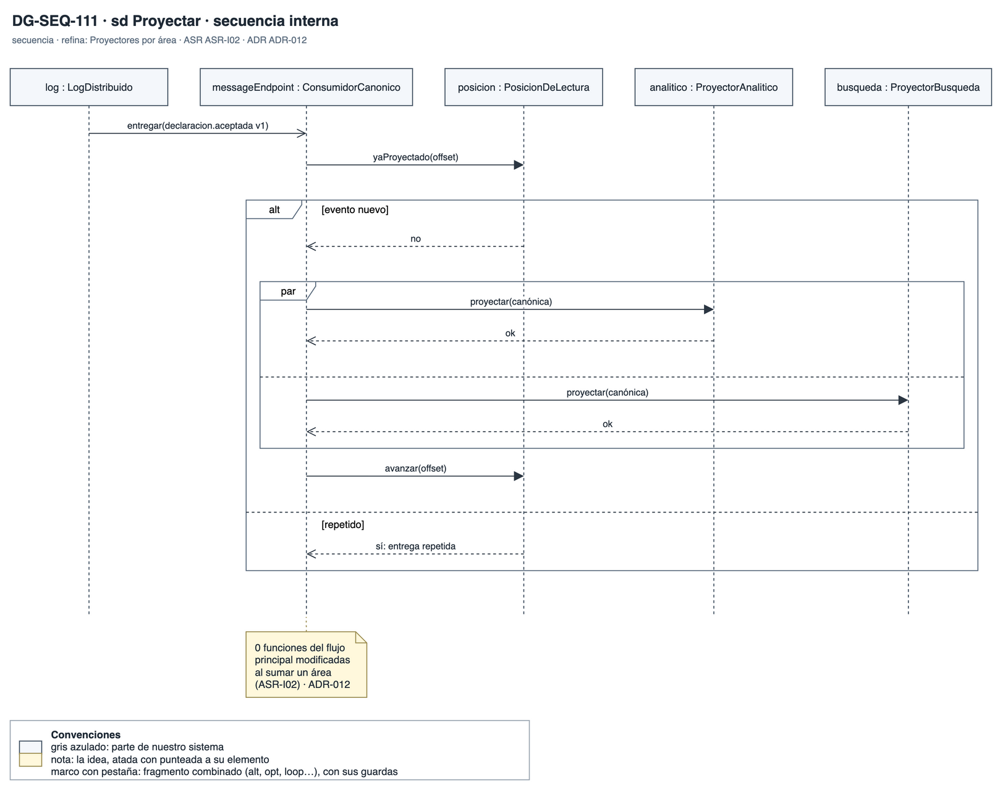

- **Qué muestra:** Un evento proyectado en paralelo a dos áreas y la rama de la entrega repetida.
- **Decisión que refleja:** ADR-012: 0 funciones del flujo principal modificadas al sumar un área.
- **Qué no muestra:** El retraso de cada proyección.
