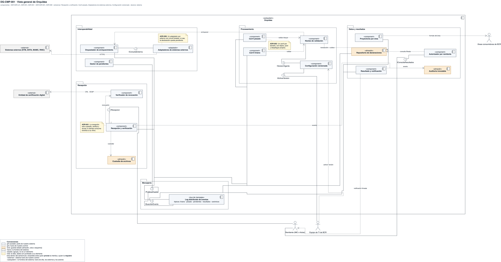
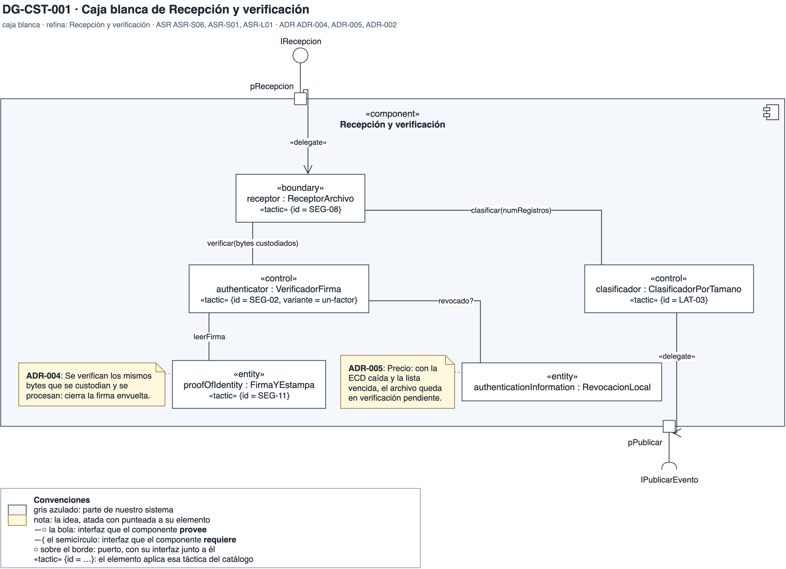
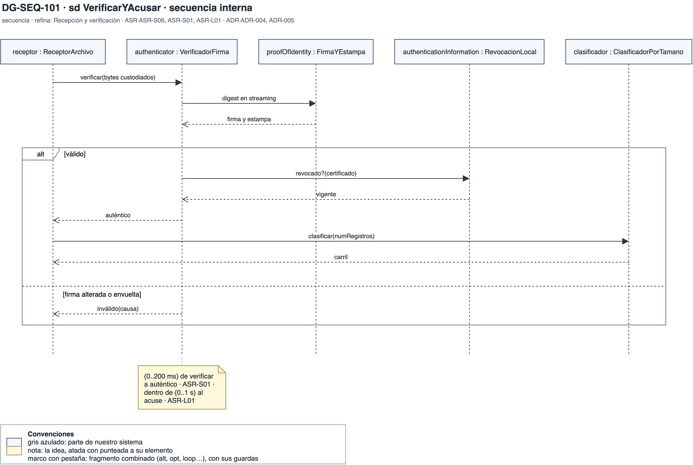
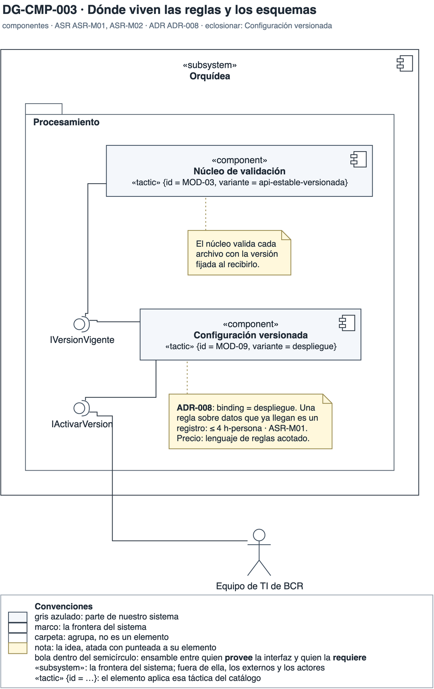
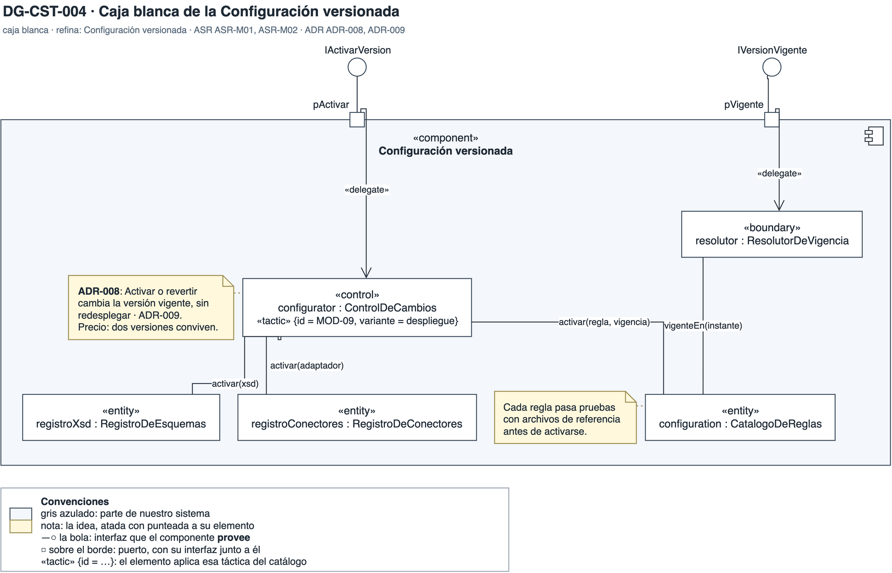
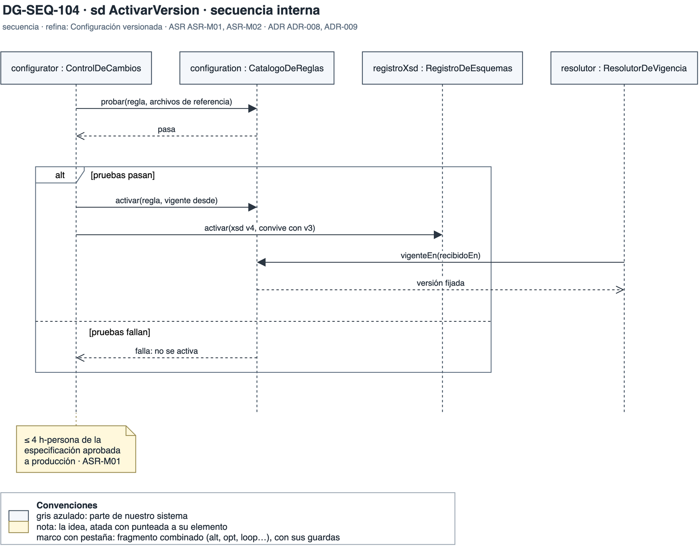
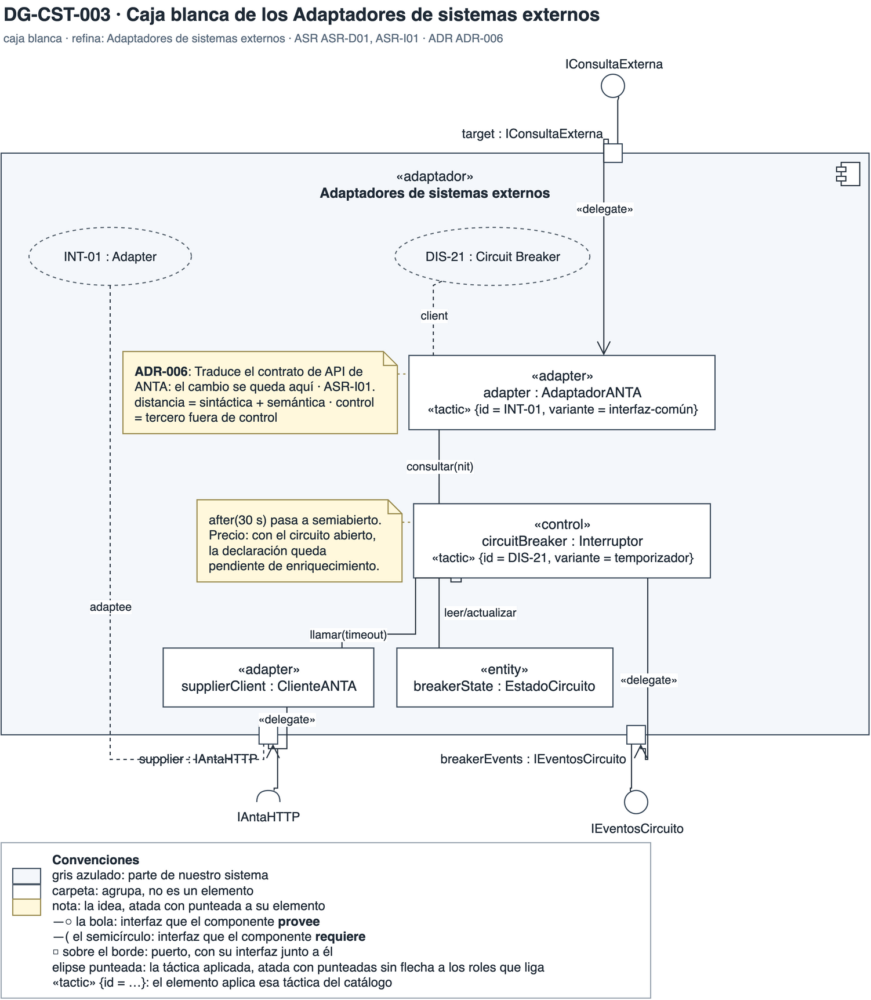
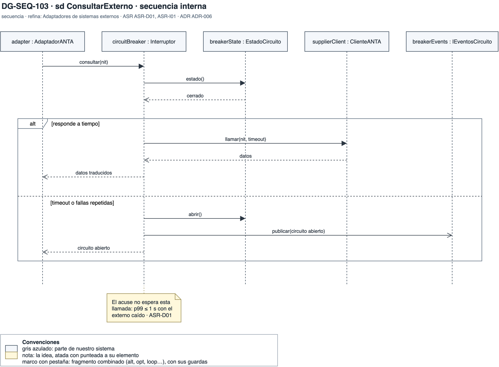
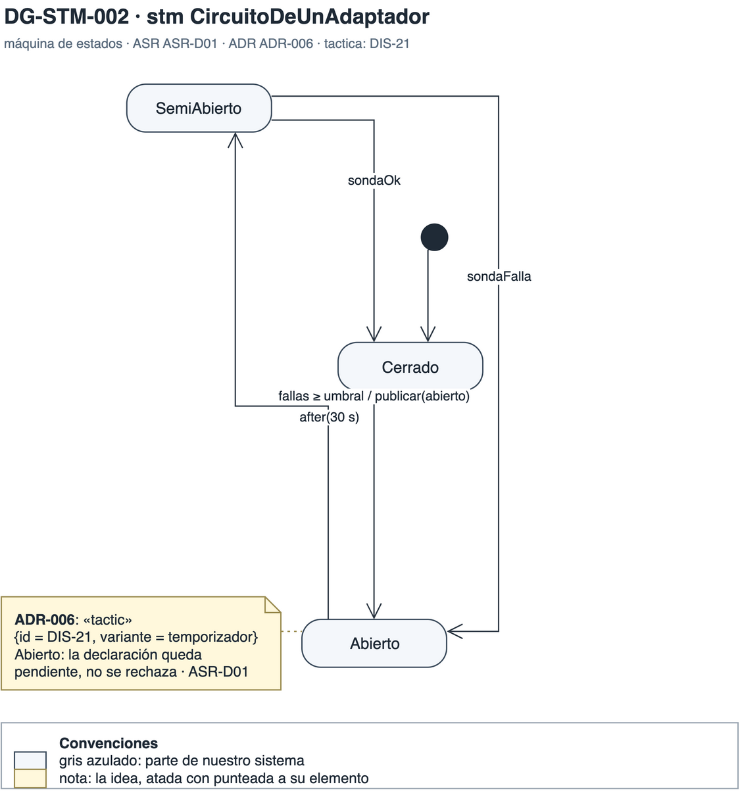
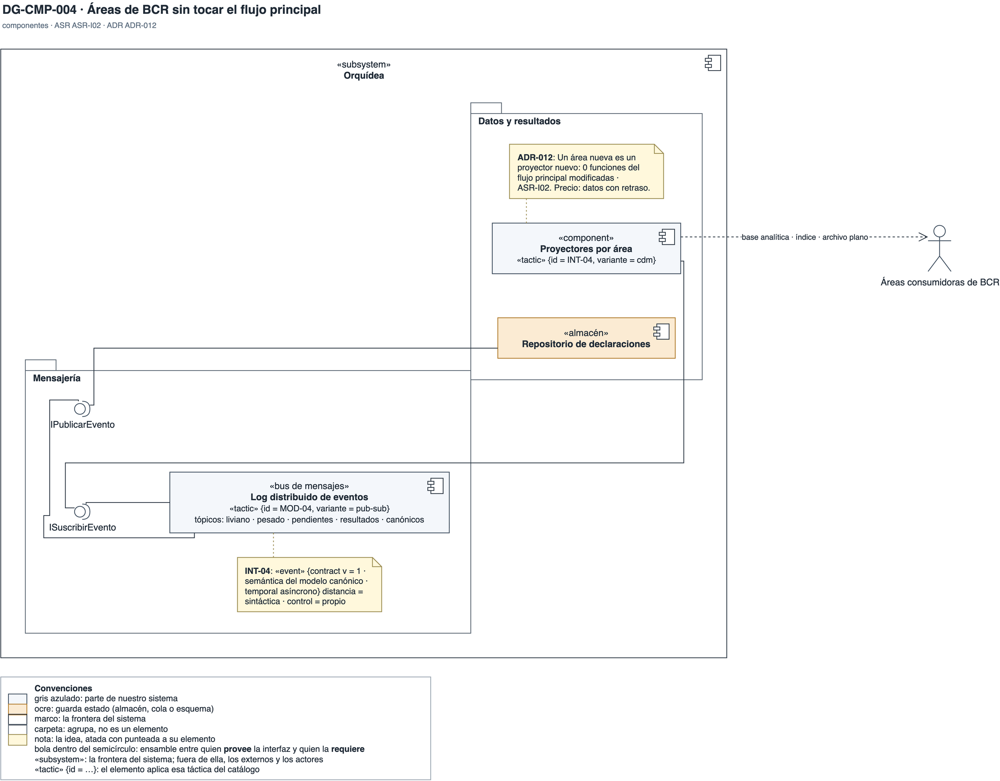

# Vista funcional

Qué etapas y componentes tiene Orquídea y dónde vive cada táctica. Abre con la vista general; cada componente clave para un ASR crítico se abre en su caja blanca y su secuencia interna.

## DG-CMP-001 · Vista general

- **Qué muestra:** Las etapas de Orquídea agrupadas en cinco paquetes, el log distribuido como bus con sus tópicos, los externos a la izquierda y los actores a la derecha.
- **Decisión que refleja:** ADR-001 (pipeline asíncrono), ADR-002 (carriles) y ADR-006 (adaptadores con circuit breaker).
- **Qué no muestra:** El orden de los mensajes ni los tiempos; eso está en las secuencias.

## DG-CST-001 · Recepción y verificación (caja blanca)

- **Qué muestra:** Las partes de la recepción: el receptor, el verificador de firma con su información de revocación, la firma y estampa verificadas y el clasificador por tamaño.
- **Decisión que refleja:** ADR-004: se verifican los mismos bytes que se custodian y procesan. ADR-005: la revocación se responde desde la información local.
- **Qué no muestra:** Qué pasa cuando la ECD está caída; eso está en DG-SEQ-004.

## DG-SEQ-101 · Recepción y verificación (secuencia interna)

- **Qué muestra:** La verificación paso a paso dentro de la recepción, con la rama de firma alterada o envuelta.
- **Decisión que refleja:** ADR-004: el resultado de la validación tiene que salir en {0..200 ms}, dentro del segundo del acuse.
- **Qué no muestra:** La custodia y la publicación al log; eso está en DG-SEQ-001.

## DG-CMP-003 · Reglas y esquemas

- **Qué muestra:** Dónde viven las reglas y los esquemas: la configuración versionada provee la versión vigente al núcleo de validación y la activación al equipo de TI.
- **Decisión que refleja:** ADR-008: reglas y XSD como datos versionados, ligados en despliegue.
- **Qué no muestra:** Cómo se activa una versión sin detener la recepción; eso está en DG-SEQ-007.

## DG-CST-004 · Configuración versionada (caja blanca)

- **Qué muestra:** El control de cambios, el catálogo de reglas, el registro de esquemas, el de conectores y el resolutor de vigencia.
- **Decisión que refleja:** ADR-008 y ADR-009: activar o revertir cambia la versión vigente, sin redesplegar.
- **Qué no muestra:** El lenguaje de reglas en detalle.

## DG-SEQ-104 · Configuración versionada (secuencia interna)

- **Qué muestra:** La activación de una regla: se prueba con archivos de referencia, se activa con su vigencia y la versión queda fijada a cada archivo.
- **Decisión que refleja:** ADR-008: una regla sobre datos que ya llegan cuesta ≤ 4 h-persona.
- **Qué no muestra:** La regla que el lenguaje no expresa, que exige código nuevo.

## DG-CST-003 · Adaptadores de sistemas externos (caja blanca)

- **Qué muestra:** El adaptador de ANTA con su circuit breaker, el estado del circuito, el cliente HTTP y los eventos del circuito, con los roles ligados por las dos tácticas.
- **Decisión que refleja:** ADR-006: el contrato de API del externo se queda en su adaptador, protegido por un circuit breaker.
- **Qué no muestra:** Los otros tres adaptadores, que tienen la misma estructura.

## DG-SEQ-103 · Adaptadores (secuencia interna)

- **Qué muestra:** Una consulta a ANTA con el circuito cerrado y la rama de timeout o fallas repetidas que abre el circuito.
- **Decisión que refleja:** ADR-006: la llamada al externo nunca está en el camino del acuse.
- **Qué no muestra:** El drenaje de los pendientes; eso está en DG-SEQ-005.

## DG-STM-002 · Circuito de un adaptador

- **Qué muestra:** Los estados del circuit breaker: cerrado, abierto y semiabierto, con la espera antes de probar de nuevo.
- **Decisión que refleja:** ADR-006: con el circuito abierto, la declaración queda pendiente, no se rechaza.
- **Qué no muestra:** El umbral de fallas, que BCR no ha fijado.

## DG-CMP-004 · Entrega a las áreas

- **Qué muestra:** El repositorio publica eventos del modelo canónico al log, y cada área tiene su proyector.
- **Decisión que refleja:** ADR-012: un área nueva es un proyector nuevo, sin tocar el flujo principal.
- **Qué no muestra:** Los formatos internos de cada área.
