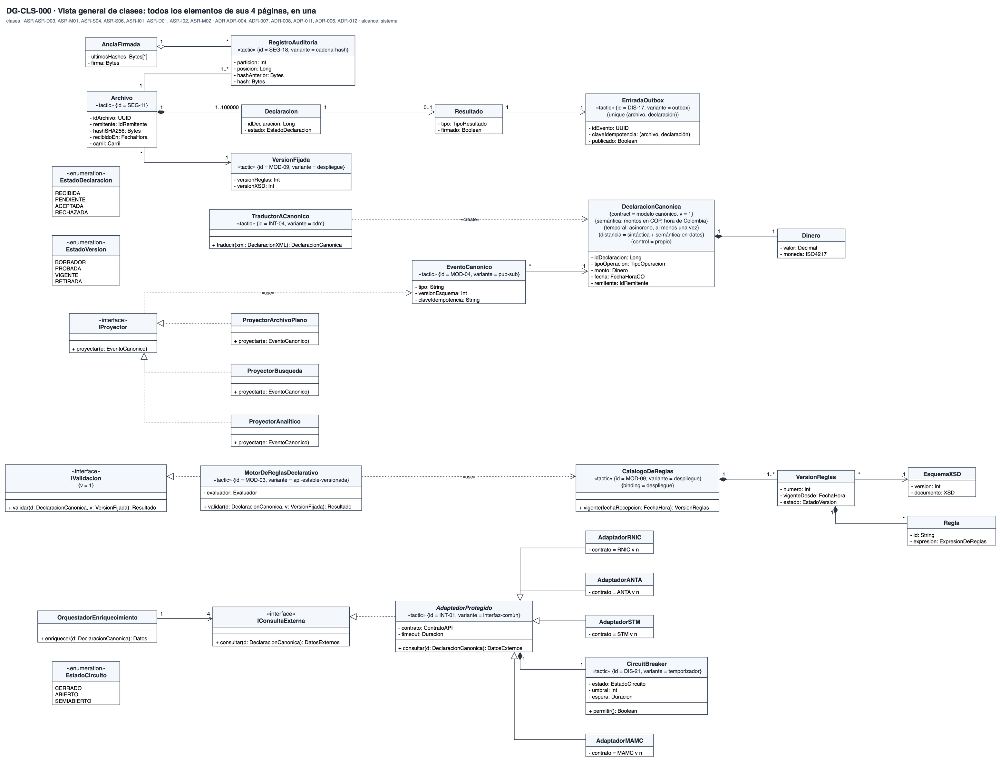
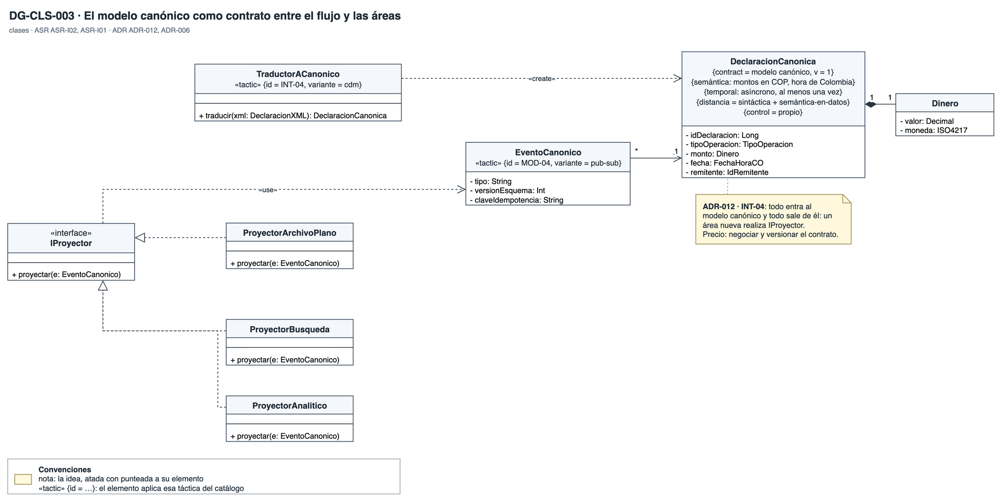
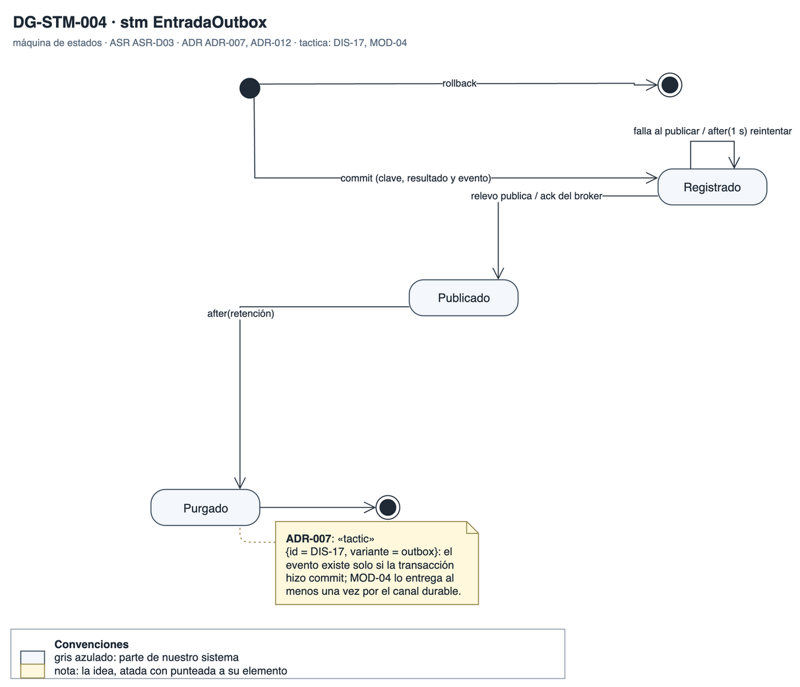
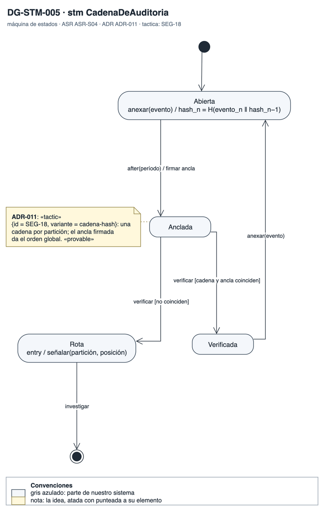

# Vista de información

Qué datos guarda Orquídea, cómo se atan a su versión, su resultado y su auditoría, y por qué estados pasan el archivo, el evento del outbox y la cadena de auditoría. Responde la vista de información que pidió BCR. Aquí se ven las tácticas que son estructura de datos: la clave de idempotencia, el hash del archivo, la cadena de auditoría y el modelo canónico.

## DG-CLS-000 · Clases de Orquídea

- **Qué muestra:** La unión de los cuatro diagramas de clases en una sola página.
- **Decisión que refleja:** ADR-006, ADR-007, ADR-008, ADR-011 y ADR-012.
- **Qué no muestra:** El esquema físico de la base de datos.

## DG-CLS-001 · Modelo de información

- **Qué muestra:** El archivo con su hash y sus declaraciones, la versión fijada al recibir, el resultado, la entrada del outbox con su clave única y el registro de auditoría encadenado con su ancla.
- **Decisión que refleja:** ADR-004 (el hash que se verifica), ADR-007 (idempotencia y outbox), ADR-008 (versión fijada) y ADR-011 (auditoría).
- **Qué no muestra:** El esquema físico ni la retención de 10 años.

## DG-CLS-003 · Modelo canónico

- **Qué muestra:** La declaración canónica con su contrato, su semántica y las distancias que cierra; el traductor que la crea; el evento que la lleva y la interfaz que realiza cada proyector.
- **Decisión que refleja:** ADR-012: un área nueva realiza IProyector sin tocar el flujo. ADR-006: los adaptadores traducen al mismo modelo.
- **Qué no muestra:** La lista completa de atributos de una declaración cambiaria.

## DG-STM-001 · Estados del archivo

- **Qué muestra:** Los estados de un archivo desde que llega: recibido, en verificación, verificación pendiente, en validación, pendiente de enriquecimiento, aceptado y rechazado.
- **Decisión que refleja:** ADR-004, ADR-005 y ADR-006: ningún camino llega a aceptado sin pasar por la verificación.
- **Qué no muestra:** El estado de cada declaración por separado; el de enriquecimiento está en DG-STM-003.

## DG-STM-004 · Evento del outbox

- **Qué muestra:** El evento que nace con el commit, se publica con el acuse del broker, se reintenta si falla y se purga tras la retención.
- **Decisión que refleja:** ADR-007: el evento existe solo si la transacción confirmó. ADR-012: se entrega al menos una vez.
- **Qué no muestra:** El período de retención.

## DG-STM-005 · Cadena de auditoría

- **Qué muestra:** Una cadena por partición que se anexa, se ancla con una firma periódica y se verifica, y que queda rota si alguien la altera.
- **Decisión que refleja:** ADR-011: cualquier cambio rompe la cadena o el ancla.
- **Qué no muestra:** El período de las anclas.
