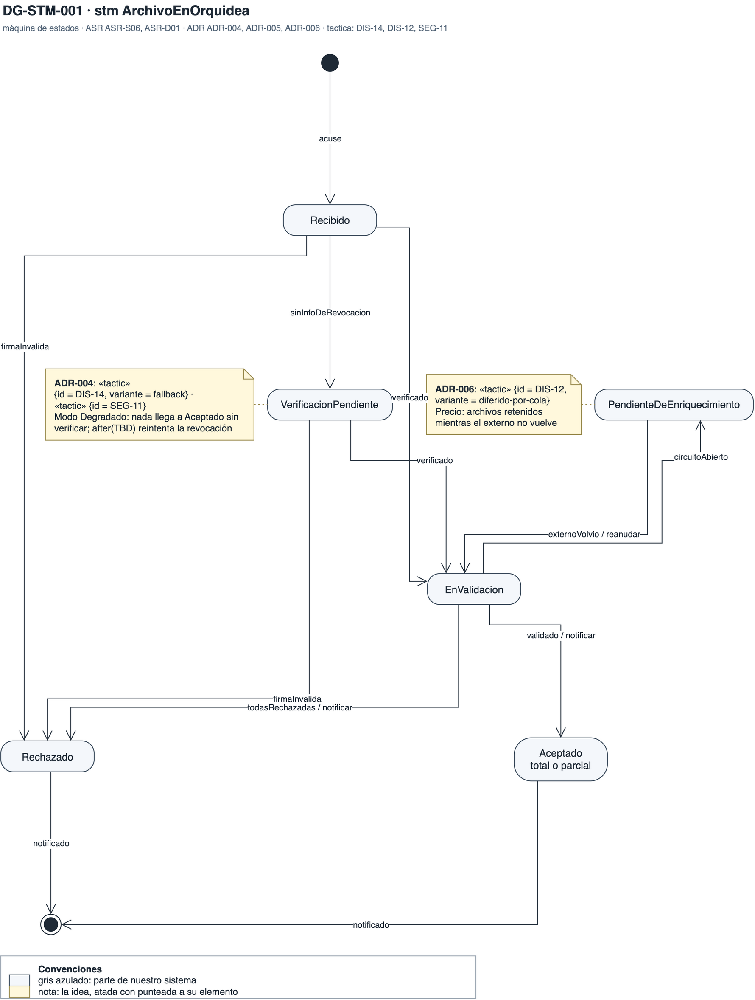
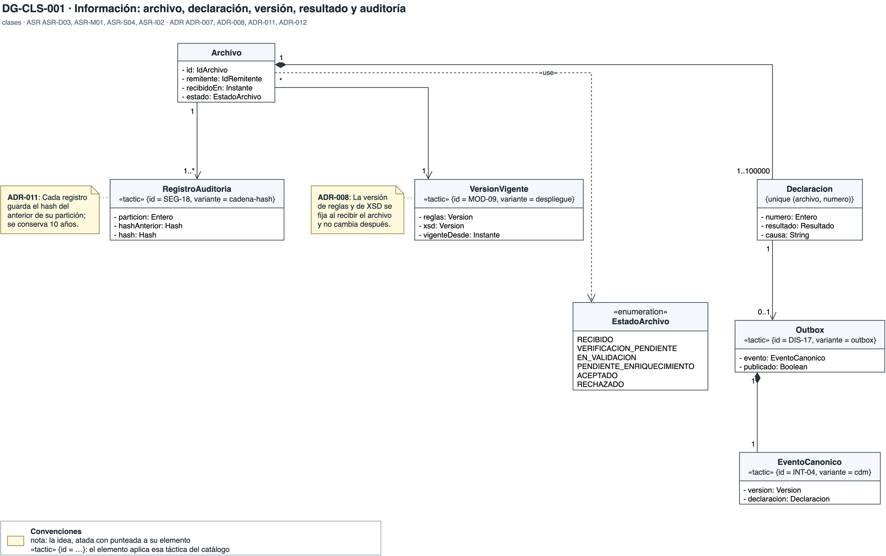

# Vista de información

Qué datos guarda Orquídea, cómo se atan a su versión, su resultado y su auditoría, y por qué estados pasa un archivo. Responde la vista de información que pidió BCR.

## DG-STM-001 · Estados del archivo

- **Qué muestra:** Los estados de un archivo desde que llega: recibido, verificación pendiente, en validación, pendiente de enriquecimiento, aceptado y rechazado.
- **Decisión que refleja:** ADR-004, ADR-005 y ADR-006: ningún camino llega a aceptado sin verificación completa.
- **Qué no muestra:** El estado de cada declaración por separado.

## DG-CLS-001 · Modelo de información

- **Qué muestra:** El archivo y sus declaraciones, la versión vigente fijada al recibir, el outbox con su evento canónico y el registro de auditoría encadenado.
- **Decisión que refleja:** ADR-007 (idempotencia y outbox), ADR-008 (versión fijada), ADR-011 (auditoría) y ADR-012 (modelo canónico).
- **Qué no muestra:** El esquema físico de la base de datos.
