# Los ASR de Orquídea: latencia, escalabilidad, disponibilidad, seguridad, modificabilidad e interoperabilidad

Un ASR, o requisito arquitectónicamente significativo, es el que obligaría a repensar la arquitectura si cambiara.

Los de Orquídea salen del enunciado del curso, del informe de consultoría del Grupo 1 y de la respuesta que BCR envió el 3 de noviembre de 2026. El enunciado manda, y la respuesta de BCR es vinculante donde fija una cifra. Las decisiones de arquitectura (ADR) que BCR aprobó responden a estos requisitos, no al revés.

Cada ASR tiene una sola medida y ninguno nombra componentes ni tecnologías. Cuando una medida se puede cumplir sin lograr lo que pide, la ficha lo advierte en una «nota de trampa».

Cuatro grupos de siglas se repiten en la página. BCR es la entidad que opera Orquídea. Los remitentes son los intermediarios del mercado cambiario (IMC) y los titulares de cuentas de compensación. STM, ANTA, MAMC y RNIC son los cuatro sistemas externos que aportan tasas, datos tributarios y aduaneros, datos migratorios e identidad. La ECD es la entidad de certificación digital que emite los certificados y las estampas cronológicas.

## 1. Los ASR

Van en orden de importancia, y cada ID lleva a su ficha. La columna «Amb.» dice dónde aplica la medida, con los ambientes de la sección 2. A es la operación normal, B el pico, C1 un sistema externo degradado, C2 una falla interna y E un cambio en producción. En modificabilidad e interoperabilidad, en cambio, dice cuándo entra el cambio.

| # | ID | Atributo | Qué exige | Amb. | Prioridad | Impacto | Origen |
|---|---|---|---|---|---|---|---|
| 1 | [ASR-D01](#asr-d01) | Disponibilidad · recuperación | **Ningún archivo se rechaza por la caída de un sistema externo.** 0 archivos válidos rechazados o sin resultado tras la ventana nocturna | C1 | Crítica | Alto | `enunciado` · BCR |
| 2 | [ASR-L04](#asr-l04) | Latencia | **Aislamiento de carga entre archivos masivos y pequeños.** Con 5 masivos, el p99 de los pequeños sube ≤ 10 % | A | Crítica | Alto | `enunciado` · BCR |
| 3 | [ASR-S06](#asr-s06) | Seguridad · prevención | **Ningún archivo se acepta sin validación criptográfica completa.** 0 aceptados sin verificar | A, C1 | Crítica | Alto | `enunciado` |
| 4 | [ASR-M01](#asr-m01) | Modificabilidad · adaptativo | **Regla cambiaria nueva en ≤ 4 h-persona.** Sin recompilar | Despliegue | Alta | Alto | `enunciado` · BCR |
| 5 | [ASR-S01](#asr-s01) | Seguridad · prevención | **Validación criptográfica en ≤ 200 ms.** p99 desde el último byte | A | Alta | Alto | `enunciado` |
| 6 | [ASR-E01](#asr-e01) | Escalabilidad | **Pico de pequeños con p99 ≤ 5 s.** 1 200 por minuto durante 45 min | B | Alta | Alto | `enunciado` |
| 7 | [ASR-I01](#asr-i01) | Interoperabilidad | **Nuevo contrato de API de un externo en ≤ 4 h-persona.** Con su significado intacto | Desarrollo | Alta | Alto | `enunciado` · BCR |
| 8 | [ASR-D03](#asr-d03) | Disponibilidad · prevención | **Cero pérdidas y cero duplicados tras el acuse.** Con un nodo caído en el pico | C2 sobre B | Alta | Alto | `enunciado` |
| 9 | [ASR-L01](#asr-l01) | Latencia | **Acuse en ≤ 1 s.** p99 desde el último byte | A | Alta | Alto | `enunciado` · BCR |
| 10 | [ASR-S03](#asr-s03) | Seguridad · prevención | **Aislamiento de datos entre remitentes.** 0 accesos a lo ajeno | A | Alta | Medio | `enunciado` |
| 11 | [ASR-D04](#asr-d04) | Disponibilidad · prevención | **Despliegue sin indisponibilidad.** Acuse en p99 ≤ 1 s durante el cambio | E | Alta | Medio | `enunciado` |
| 12 | [ASR-L03](#asr-l03) | Latencia | **Masivo en ≤ 5 min.** Con otros 4 masivos en proceso | A | Media | Alto | `enunciado` |
| 13 | [ASR-D02](#asr-d02) | Disponibilidad · reparación | **Recuperación de un nodo interno en ≤ 10 s.** Sin intervención | C2 | Media | Medio | `enunciado` |
| 14 | [ASR-L05](#asr-l05) | Latencia | **Mediano con p99 ≤ 30 s.** Con 5 masivos en proceso | A | Media | Medio | `enunciado` |
| 15 | [ASR-M02](#asr-m02) | Modificabilidad · adaptativo | **Versión nueva del XSD en ≤ 4 h-persona.** La anterior sigue validándose | Despliegue | Media | Medio | `enunciado` · BCR |
| 16 | [ASR-S04](#asr-s04) | Seguridad · detección | **Alteraciones de la auditoría detectadas.** 100 % de los casos | A | Media | Medio | `enunciado` · BCR |
| 17 | [ASR-I02](#asr-i02) | Integración | **Nuevo consumidor interno sin tocar el flujo principal.** 0 funciones modificadas | Desarrollo | Baja | Bajo | informe · BCR |

**Por qué este orden.** La prioridad es exposición al riesgo: qué tan probable es no cumplir, multiplicado por cuánto le duele a BCR. El impacto es la dificultad de diseño: cuánto pesa el requisito en la estructura.

Los tres primeros son **críticos**, y son los únicos que se desarrollan con táctica, decisión de arquitectura, vistas y experimento. BCR y el equipo los acotaron a tres en la reunión técnica del 6 de noviembre de 2026, para que la arquitectura y la experimentación quedaran centradas en ellos. La disponibilidad es el foco. Los demás ASR siguen documentados con su ficha, sin desarrollo propio.

- **D01 va primero** porque Orquídea depende de cuatro sistemas y una ECD que BCR no controla, y sus caídas pueden durar horas. La información es reportable a otras entidades: ningún archivo puede perderse ni descartarse por una falla ajena.
- **L04** es el reto tal como lo escribe el enunciado: procesar pequeños y masivos «sin generar encolamientos ni bloqueos mutuos». En la reunión se cerró como un requisito de latencia, no de disponibilidad: los archivos masivos de un remitente grande no pueden degradar la respuesta a los demás.
- **S06** protege lo que el enunciado exige del 100 % de los archivos: que ninguno sin verificar termine aceptado. Es lo que sostiene el no repudio, porque el remitente no puede negar un envío cuya firma, firmante y estampa se verificaron.
- **M01** fue crítico hasta el 6 de noviembre y ahora es alto: sigue entre los seis que BCR priorizó, pero no tiene táctica ni experimento en esta iteración.
- **S01, E01 e I01** completan los seis que BCR priorizó. S01 cronometra la verificación que S06 protege. E01 cuenta con un pico de 20 archivos por segundo, y el informe concluye que esa tasa no es la presión real. I01 comparte el problema de M01.

Del 8 al 11 son requisitos explícitos del enunciado que BCR no listó y que pesan en la estructura. Del 12 al 17 completan el alcance. BCR evalúa tres de ellos (M02, S04 e I02) con su propia inspección de código en la Fase 4 de la hoja de ruta.

Los plazos de procesamiento del enunciado (pequeños en 3 s, medianos en 30 s y masivos en 5 min) no son críticos, pero el experimento de L04 los mide como referencia, porque se obtienen de la misma prueba.

### De qué historia de usuario sale cada ASR

Cada escenario de calidad cuelga de una [historia de usuario](requirements.md): la historia dice qué necesita el stakeholder, y el ASR, con qué calidad.

| ASR | Historia |
|---|---|
| [ASR-D01](#asr-d01) | [HU-06](requirements.md) |
| [ASR-L04](#asr-l04) | [HU-03](requirements.md) |
| [ASR-S06](#asr-s06) | [HU-02](requirements.md) |
| [ASR-M01](#asr-m01) | [HU-11](requirements.md) |
| [ASR-S01](#asr-s01) | [HU-02](requirements.md) |
| [ASR-E01](#asr-e01) | [HU-03](requirements.md) |
| [ASR-I01](#asr-i01) | [HU-13](requirements.md) |
| [ASR-D03](#asr-d03) | [HU-07](requirements.md) |
| [ASR-L01](#asr-l01) | [HU-01](requirements.md) |
| [ASR-S03](#asr-s03) | [HU-09](requirements.md) |
| [ASR-D04](#asr-d04) | [HU-11](requirements.md) |
| [ASR-L03](#asr-l03) | [HU-04](requirements.md) |
| [ASR-D02](#asr-d02) | [HU-07](requirements.md) |
| [ASR-L05](#asr-l05) | [HU-03](requirements.md) |
| [ASR-M02](#asr-m02) | [HU-12](requirements.md) |
| [ASR-S04](#asr-s04) | [HU-14](requirements.md) |
| [ASR-I02](#asr-i02) | [HU-10](requirements.md) |

## 2. Ambientes

### Tiempo, disponibilidad y seguridad

| Variable | A — normal | B — carga pico | C1 — sistema externo degradado | C2 — falla interna | E — cambio en producción |
|---|---|---|---|---|---|
| Pequeños (1 a 50 registros) | 400/min (enunciado, Escalabilidad) | 1 200/min durante 45 min (enunciado) | Como A | Como A; como B para D03 | Como A |
| Medianos (51 a 5 000) | `[PREGUNTA → BCR]` ¿cuántos por minuto? | `[PREGUNTA → BCR]` | Como A | Como A | Como A |
| Masivos (hasta 100 000, hasta 50 MB) | 5 concurrentes (BCR, tabla de ASR) | 5 concurrentes (BCR, ADR-02) | Como A | Como A | Como A |
| Patrón de arribo | Estocástico `[SUPUESTO → BCR]` | Ráfaga en los cierres de mercado diario y los vencimientos regulatorios `[SUPUESTO → BCR]` | — | — | — |
| Estado | Sin fallas; externos y ECD disponibles; sin pendientes | Sin fallas | STM, ANTA, MAMC, RNIC o la ECD caído o con latencia extrema, por horas: 2, 5, 10, 20 h o más (respuesta de BCR y reunión del 6-nov) | Un nodo interno de procesamiento deja de funcionar con archivos en curso | Se activa o se revierte una regla, un XSD o el contrato de API de un sistema externo |
| Alcance | Dentro | Dentro | Dentro | Dentro: la falla de software. La redundancia física queda fuera | Dentro |

La caída de un sistema externo puede durar horas: BCR plantea un caso de 12 horas con 500 000 declaraciones acumuladas.

Con un sistema externo caído, BCR aceptó que los plazos de procesamiento de 3 s, 30 s y 5 min no apliquen. Nadie ha dicho qué latencia de un sistema externo cuenta como «extrema», y de eso depende cuándo empieza esa exención.

### Modificabilidad · momento de ligado

| Ligado | Qué cambios entran así |
|---|---|
| Despliegue | Una regla cambiaria nueva (M01) y una versión nueva del XSD (M02): entran a producción sin recompilar ni detener el resto del flujo, como pide el enunciado |
| Ejecución | Ninguno exigido: el enunciado habla de despliegue sin inactividad, no de cambios sin desplegar |

| Tipo | Cambio probable | Ligado | ASR o descarte |
|---|---|---|---|
| Correctivo | Corregir una regla que se activó con un error | Despliegue | Lo cubre [M01](#asr-m01): es el mismo cambio, por la misma vía |
| Preventivo | Ninguno probable: el sistema es nuevo y el enunciado no trae deuda técnica del que reemplaza | — | — |
| Adaptativo | Una regla de la Circular cambia · el XSD de las declaraciones cambia · un sistema externo cambia su contrato de API | Despliegue · despliegue · desarrollo | [M01](#asr-m01) · [M02](#asr-m02) · [I01](#asr-i01) (interoperabilidad) |
| Aditivo | Un área de BCR pide los datos en un formato nuevo | Desarrollo | [I02](#asr-i02) (integración, socio propio) |

### Interoperabilidad · socios

| Socio | Fase | Cómo se le conoce | Grado de control |
|---|---|---|---|
| STM, ANTA, MAMC, RNIC | Desarrollo | Conocidos de antemano | Tercero fuera de control: cambian su contrato de API por su cuenta |
| ECD | Desarrollo | Conocida de antemano | Tercero fuera de control, con protocolos estándar |
| Remitentes | Desarrollo | Conocidos de antemano | Tercero bajo control: BCR fija el XSD |
| Áreas de BCR | Desarrollo | Conocidas de antemano | Propio |

## 3. Matrices de cobertura

### Seguridad: STRIDE

El eje es el flujo de datos del dominio; el stakeholder va como columna auxiliar.

| STRIDE | Flujo de datos del dominio | Stakeholder | Modo | Amb. | Resultado |
|---|---|---|---|---|---|
| **S** Suplantación | El archivo firmado que envía un remitente | Tercero contra un IMC | Prevención | A | **[ASR-S01](#asr-s01)** |
| **S** Suplantación | Un archivo con firma inválida o certificado revocado que llega a resultado definitivo | Tercero con certificado robado | Prevención | A, C1 | **[ASR-S06](#asr-s06)** |
| **S** Suplantación | Un archivo aceptado con un certificado revocado después de la última actualización de la información de revocación | Tercero con certificado robado | Detección | A | Pendiente: sin umbral `[PREGUNTA → BCR]` |
| **S** Suplantación | El mismo caso, ya detectado | Tercero con certificado robado | Reacción | A | Pendiente: sin umbral |
| **S** Suplantación | Un firmante distinto del remitente autenticado | IMC contra IMC | Prevención | A | **[ASR-S06](#asr-s06)**: el firmante es parte de la verificación completa |
| **T** Manipulación | El contenido firmado de un archivo (firma envuelta) | Tercero | Prevención | A | **[ASR-S06](#asr-s06)**: lo verificado tiene que ser lo que se procesa |
| **T** Manipulación | La auditoría ya escrita | Interno, por abuso o **mal uso** | Detección | A | **[ASR-S04](#asr-s04)** |
| **T** Manipulación | Las declaraciones que reportó otro remitente | IMC contra IMC | Prevención | A | **[ASR-S03](#asr-s03)** |
| **R** Repudio | El envío de un archivo que el remitente niega | IMC | Prevención | A, C1 | **[ASR-S06](#asr-s06)**: nada se acepta sin firma, firmante y estampa verificadas, y esa verificación es la evidencia. S04 la protege contra alteraciones |
| **R** Repudio | El acuse o el resultado que BCR niega haber emitido | IMC contra BCR | Prevención | A | Descartada: un acuse y una respuesta firmados por BCR son funcionales |
| **I** Divulgación | La consulta de resultados y declaraciones | IMC contra IMC | Prevención | A | **[ASR-S03](#asr-s03)** |
| **I** Divulgación | La entrega a las áreas internas | Funcionario de BCR, **mal uso** | Prevención | A | Descartada: `[PREGUNTA → BCR]` ¿qué ve cada área por su rol? |
| **I** Divulgación | Los datos en tránsito y en reposo | Externo | Prevención | A | Descartada: el cifrado es una restricción del enunciado |
| **D** Denegación | Un XML con expansión de entidades que degrada a los demás | Tercero | Detección | A | Descartada: endurecer el parser es práctica estándar; la degradación real la mide L04 |
| **D** Denegación | Una avalancha de archivos de un solo remitente | IMC | Detección | B | Descartada: E01 acota la carga total; `[PREGUNTA → BCR]` ¿hay límite por remitente? |
| **E** Elevación | Un operador de un IMC con permisos de administrador | Usuario de un IMC | Detección | A | Descartada: la gestión de usuarios queda fuera de alcance (informe, §4.3) |

### Interoperabilidad: distancias

| Socio · control | Sintáctica | Semántica en datos | Semántica en comportamiento | Temporal | De recursos |
|---|---|---|---|---|---|
| STM · tercero fuera de control | **[ASR-I01](#asr-i01)** | **[ASR-I01](#asr-i01)**: base de la tasa, decimales, fecha de vigencia | Fuera: quién reintenta y qué pasa si cae es disponibilidad ([D01](#asr-d01)) | Descartada: cuándo publica STM es parte del contrato de API que integra I01; el tiempo del intercambio es desempeño | Descartada: `[PREGUNTA → BCR]` ¿límite de consultas? |
| ANTA · tercero fuera de control | **[ASR-I01](#asr-i01)** | **[ASR-I01](#asr-i01)**: identificación tributaria y aduanera | Fuera: [D01](#asr-d01) | Descartada: igual que STM | Descartada: igual que STM |
| MAMC · tercero fuera de control | **[ASR-I01](#asr-i01)** | **[ASR-I01](#asr-i01)**: condición migratoria | Fuera: [D01](#asr-d01) | Descartada: igual que STM | Descartada: igual que STM |
| RNIC · tercero fuera de control | **[ASR-I01](#asr-i01)** | **[ASR-I01](#asr-i01)**: tipo y número de documento | Fuera: [D01](#asr-d01) | Descartada: igual que STM | Descartada: igual que STM |
| ECD · tercero fuera de control | Descartada: CRL, OCSP y estampa son estándares (RFC 5280, 6960 y 3161) | Descartada: igual | Fuera: [D01](#asr-d01) | Pendiente: la ventana de revocación (sección 6) | Descartada |
| Remitentes · tercero bajo control | **[ASR-M02](#asr-m02)**: versión del XSD | Descartada: el significado lo valida la aplicación de reglas (M01) | Descartada: acuse, aviso y consulta son funcionales | Descartada | Descartada: el tope de 50 MB es una restricción (BCR) |
| Áreas de BCR · propio | **[ASR-I02](#asr-i02)** | **[ASR-I02](#asr-i02)**: el dato significa lo mismo que en el registro | Descartada | Fuera: la frescura es desempeño; `[PREGUNTA → BCR]` ¿qué es «tiempo real»? | Descartada |

## 4. Fichas

Cada ficha trae, debajo de la tabla, un diagrama de secuencia con Orquídea como caja negra. La banda azul encierra lo que se mide: el estímulo, la respuesta y los instantes t0 y t1 entre los que corre la medida. La banda roja dice qué familia de soluciones descarta el número, que es lo que hace del requisito un ASR. Lo que queda fuera de las dos bandas pasa en el escenario pero no entra en la medida. El diagrama no muestra componentes internos: esos los decide el diseño, no el requisito.

### ASR-D01 — Ningún archivo se rechaza por la caída de un sistema externo {#asr-d01}

| Parte | Descripción |
|---|---|
| **Fuente** | Los sistemas externos que BCR no controla: el Sistema de Tasas de Mercado (STM), la Agencia Nacional Tributaria y Aduanera (ANTA), el Ministerio de Asuntos Migratorios y Consulares (MAMC), el Registro Nacional de Identificación Ciudadana (RNIC) y la entidad de certificación digital (ECD) |
| **Estímulo** | Uno de ellos deja de responder, o responde con latencia extrema, durante horas |
| **Artefacto** | La validación y el enriquecimiento de las declaraciones |
| **Ambiente** | C1: un sistema externo caído, con la carga de A |
| **Respuesta** | Sigue recibiendo y acusando. Lo que necesita al externo queda pendiente y se reprocesa cada noche hasta que vuelva; si no vuelve en los días de reintento, se notifica al remitente |
| **Medida** | 0 archivos válidos rechazados o sin resultado definitivo al cierre de la primera ventana nocturna tras el regreso del externo |
| **Por qué es ASR** | La recepción no puede depender en línea de ningún externo, y lo pendiente tiene que sobrevivir horas o días. Con caídas de minutos bastaría reintentar en línea; con caídas de 20 h, no. Un archivo es válido si se habría aceptado con el externo disponible. Nota de trampa: la medida no cuenta cuánto espera lo pendiente hasta la noche; BCR lo aceptó |
| **Cómo se verifica** | Se cae un externo simulado a mitad de una carga A y se envían archivos válidos y otros que una regla debe rechazar. Tras la ventana nocturna con el externo de vuelta, se concilian los válidos contra los aceptados |
| **Prioridad · Impacto · Origen** | Crítica · Alto · `enunciado` («continuar operando sin rechazar archivos») · BCR: respuesta del 3-nov y reunión del 6-nov |

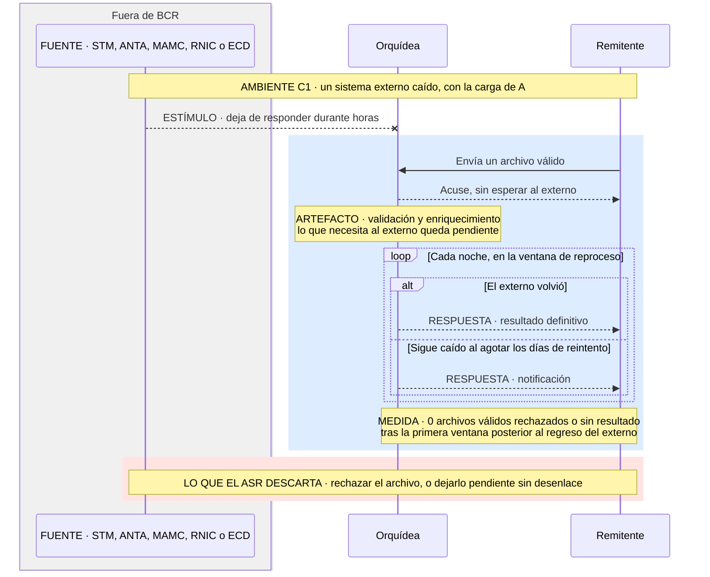

### ASR-L04 — Aislamiento de carga entre archivos masivos y pequeños {#asr-l04}

| Parte | Descripción |
|---|---|
| **Fuente** | Los remitentes de archivos pequeños |
| **Estímulo** | Envían archivos pequeños, con arribo estocástico, mientras 5 masivos están en proceso |
| **Artefacto** | El procesamiento completo de los archivos pequeños |
| **Ambiente** | A: 400 pequeños por minuto y 5 masivos concurrentes, sin fallas |
| **Respuesta** | Cada archivo pequeño se resuelve casi tan rápido como sin masivos |
| **Medida** | El p99 de los archivos pequeños con 5 masivos en proceso no supera en más de 10 % su p99 sin masivos: si sin masivos es 2 s, con masivos es ≤ 2,2 s. Se mide del último byte al resultado definitivo |
| **Por qué es ASR** | Obliga a decidir si pequeños y masivos comparten capacidad. Con +100 % bastaría una prioridad; con +10 %, el aislamiento tiene que ser por construcción. Nota de trampa: la medida es relativa; el piso absoluto son los 3 s del enunciado, que el experimento reporta |
| **Cómo se verifica** | La misma carga A, sin masivos y con 5; se comparan los dos p99. Luego se suben los masivos hasta encontrar el quiebre |
| **Prioridad · Impacto · Origen** | Crítica · Alto · `enunciado` («jamás encolará ni degradará la latencia de los archivos de pocos registros») · BCR: N = 5 y margen de 10 % |

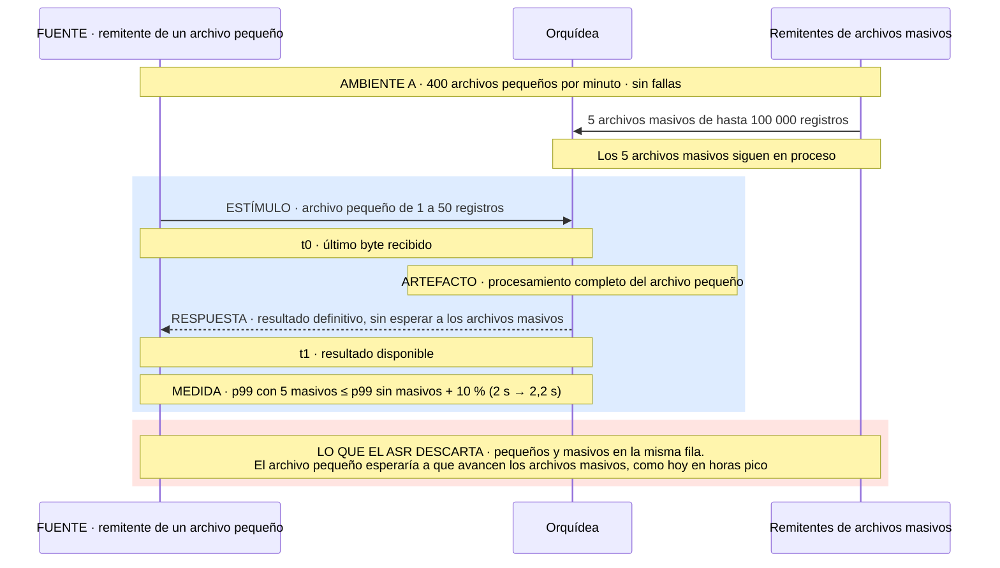

### ASR-S06 — Ningún archivo se acepta sin validación criptográfica completa {#asr-s06}

| Parte | Descripción |
|---|---|
| **Fuente** | Un remitente, o un tercero que lo suplanta |
| **Estímulo** | Envía un archivo cuya firma, firmante, cadena, estampa o revocación no es válida o no se puede verificar |
| **Artefacto** | La emisión del resultado definitivo |
| **Ambiente** | Carga de A, con la ECD disponible (A) o caída (C1) |
| **Respuesta** | El archivo puede acusarse, pero no se acepta hasta verificarse; si falla, se rechaza con la causa |
| **Medida** | 0 archivos aceptados sin firma, firmante, cadena, estampa y revocación verificadas |
| **Por qué es ASR** | BCR aprobó acusar antes de verificar: el masivo con acuse de custodia y la ECD caída. Hay que decidir dónde espera el archivo y cómo se garantiza que lo verificado es lo que se procesa. El no repudio sale de esta medida y de [S04](#asr-s04). El desfase y la antigüedad de la estampa son `[PREGUNTA → BCR]`. Nota de trampa: se cumple rechazando todo |
| **Cómo se verifica** | Un catálogo con firma alterada, firmante distinto, certificado revocado o fuera de la cadena, estampa desfasada o vencida, y la ECD caída; se cuentan los aceptados. El TLS mutuo queda fuera |
| **Prioridad · Impacto · Origen** | Crítica · Alto · `enunciado` («el 100 % de los archivos deben contar con validación criptográfica»; no repudio) · reunión del 6-nov |

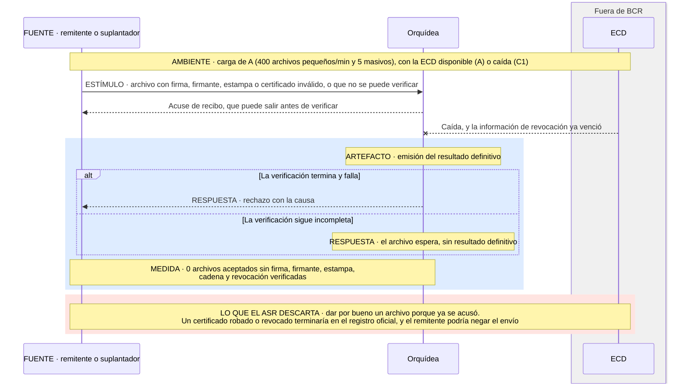

### ASR-M01 — Despliegue de una regla cambiaria nueva en ≤ 4 h-persona {#asr-m01}

| Parte | Descripción |
|---|---|
| **Fuente** | La Junta Directiva de BCR |
| **Estímulo** | Cambia una regla cambiaria sobre datos que ya llegan · Tipo: adaptativo |
| **Artefacto** | La aplicación de las reglas cambiarias |
| **Ambiente** | Ligado en despliegue, sin recompilar |
| **Respuesta** | La regla se implementa, se prueba, entra a producción y rige desde su fecha |
| **Medida** | ≤ 4 h-persona desde la especificación aprobada hasta producción |
| **De dónde sale el número** | Del enunciado; BCR precisó que son h-persona con desarrollo y pruebas, sin la aprobación regulatoria |
| **Quién lo hace** | El equipo de TI de BCR `[SUPUESTO → BCR]` |
| **Por qué es ASR** | Decide dónde vive la regla y si es dato o código. Si la Circular cambiara una vez por década, encapsularla sería esfuerzo perdido; la frecuencia es `[PREGUNTA → BCR]`. Nota de trampa: las 4 h se cumplen regando un cambio barato por varias funciones |
| **Cómo se verifica** | Juicio de expertos, con el protocolo al final de las fichas. Complemento: activar una regla con tráfico A y contar h-persona y funciones tocadas |
| **Prioridad · Impacto · Origen** | Alta · Alto · `enunciado` · fue crítico hasta el 6-nov |

### ASR-S01 — Validación criptográfica en ≤ 200 ms {#asr-s01}

| Parte | Descripción |
|---|---|
| **Fuente** | Un remitente |
| **Estímulo** | Envía un archivo firmado de hasta 50 MB, con arribo estocástico |
| **Artefacto** | La verificación de la firma, la estampa y el certificado |
| **Ambiente** | A, sin fallas |
| **Respuesta** | Determina si la firma, la estampa y el certificado son válidos y vigentes |
| **Medida** | p99 ≤ 200 ms del último byte al resultado de la validación |
| **Por qué es ASR** | Pasan todos los archivos. Con 2 s cabría consultar a la ECD en línea; con 200 ms no, y un archivo de 50 MB no puede cargarse entero. Con la ECD caída no aplica. Lo que el control protege lo mide [S06](#asr-s06) |
| **Cómo se verifica** | Benchmark con archivos de 1 registro a 50 MB y certificados vigentes, vencidos y revocados; p99 por tamaño |
| **Prioridad · Impacto · Origen** | Alta · Alto · `enunciado` («… en menos de 200 milisegundos») |

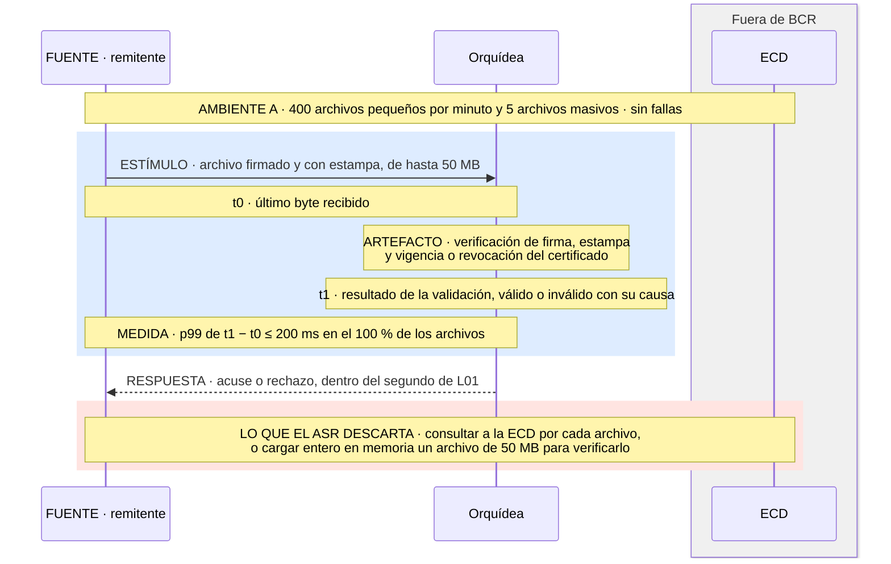

### ASR-E01 — Carga pico de archivos pequeños con p99 ≤ 5 s {#asr-e01}

| Parte | Descripción |
|---|---|
| **Fuente** | Los remitentes, en cierres de mercado y vencimientos |
| **Estímulo** | Envían 1 200 archivos pequeños por minuto durante 45 min, en ráfaga `[SUPUESTO → BCR]` |
| **Artefacto** | El procesamiento completo de los archivos pequeños |
| **Ambiente** | B: pico de 45 min con 5 masivos, sin fallas |
| **Respuesta** | Cada archivo pequeño se resuelve sin que el retraso se acumule |
| **Medida** | p99 ≤ 5 s del último byte al resultado definitivo, en cada minuto de la ventana |
| **Por qué es ASR** | La capacidad se triplica 45 min sin quedar fija el resto del día. Con 5 min, una cola absorbería el pico; con 5 s, no. Si los 5 s son de procesamiento o de acuse es `[PREGUNTA → BCR]` |
| **Cómo se verifica** | Carga sostenida de 45 min con 5 masivos; p99 por minuto |
| **Prioridad · Impacto · Origen** | Alta · Alto · `enunciado` (Escalabilidad) |

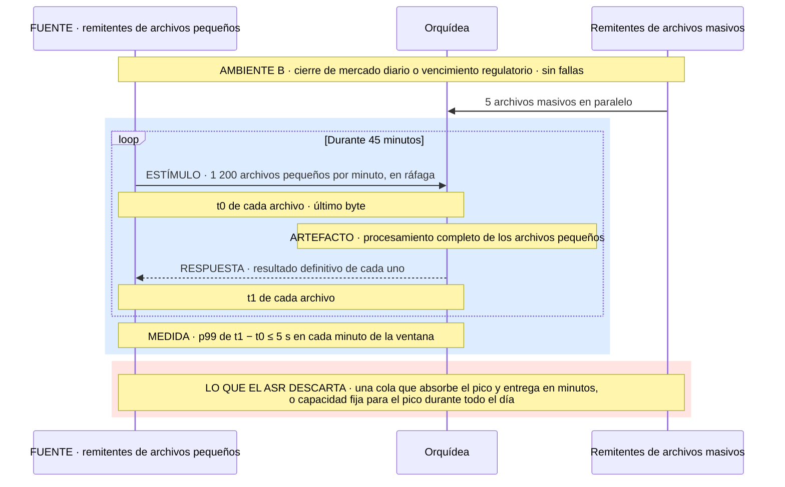

### ASR-I01 — Nueva versión del contrato de API de un sistema externo en ≤ 4 h-persona {#asr-i01}

| Parte | Descripción |
|---|---|
| **Fuente** | El área de TI de BCR |
| **Estímulo** | Integrar la versión nueva del contrato de API de STM, ANTA, MAMC o RNIC · Tipo: adaptativo |
| **Artefacto** | El enriquecimiento con ese sistema externo |
| **Ambiente** | Desarrollo · socio conocido de antemano · tercero fuera de control |
| **Respuesta** | La versión nueva entra a producción, y sus datos se interpretan con el significado que les da el externo |
| **Medida** | ≤ 4 h-persona desde que se recibe el contrato hasta producción |
| **De dónde sale el número** | Del enunciado («adaptación y reemplazo de conectores… máximo 4 horas»); BCR precisó h-persona. Distancias que cierra: sintáctica y semántica en datos |
| **Quién lo hace** | El equipo de TI de BCR `[SUPUESTO → BCR]` |
| **Por qué es ASR** | Cuatro terceros cambian su contrato por su cuenta: hay que decidir dónde se traduce sin que el cambio llegue al resto del flujo. Nota de trampa: las 4 h se cumplen integrando rápido y mal |
| **Cómo se verifica** | Juicio de expertos, con el protocolo al final de las fichas. Complemento: cambiar el contrato de ANTA en un simulador y medir las h-persona |
| **Prioridad · Impacto · Origen** | Alta · Alto · `enunciado` (Modificabilidad e Interoperabilidad) |

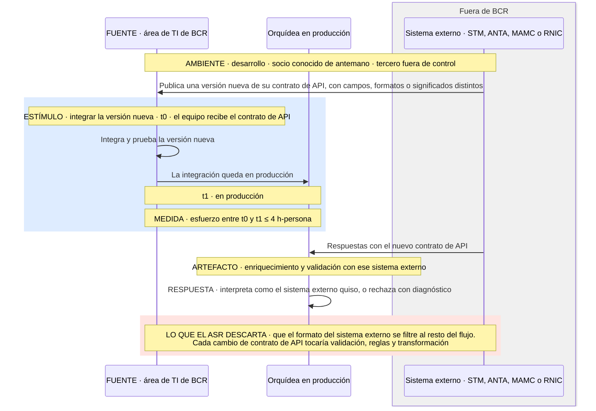

### ASR-D03 — Cero pérdidas y cero duplicados de declaraciones con acuse emitido {#asr-d03}

| Parte | Descripción |
|---|---|
| **Fuente** | Un nodo interno de procesamiento |
| **Estímulo** | Falla con archivos acusados en curso |
| **Artefacto** | Las declaraciones de los archivos acusados |
| **Ambiente** | C2 sobre B: la falla ocurre en el pico |
| **Respuesta** | Cada declaración acusada termina con un solo resultado definitivo |
| **Medida** | 0 declaraciones acusadas sin resultado o con más de uno, por conciliación |
| **Por qué es ASR** | Un acuse es una promesa: hay que decidir cuándo el archivo queda a salvo y cómo no aplicar dos veces lo que se reprocesa |
| **Cómo se verifica** | Matar nodos durante la prueba de E01 y conciliar las declaraciones acusadas contra las resueltas |
| **Prioridad · Impacto · Origen** | Alta · Alto · `enunciado` («sin pérdida de mensajes») |

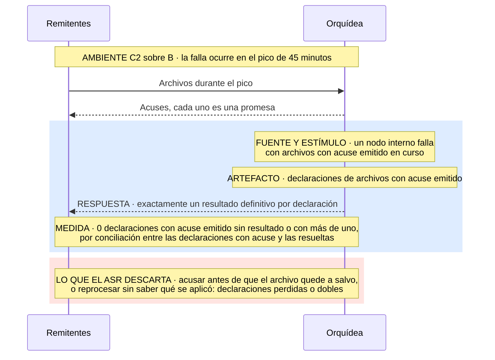

### ASR-L01 — Acuse de recibo en ≤ 1 s {#asr-l01}

| Parte | Descripción |
|---|---|
| **Fuente** | Un remitente |
| **Estímulo** | Termina de enviar un archivo de hasta 50 MB |
| **Artefacto** | La recepción y el acuse |
| **Ambiente** | A, sin fallas |
| **Respuesta** | Entrega un acuse que confirma el inicio del procesamiento |
| **Medida** | p99 ≤ 1 s del último byte al acuse. El percentil es `[SUPUESTO → BCR]` |
| **Por qué es ASR** | En un segundo no cabe validar 100 000 registros: el acuse tiene que separarse del procesamiento. Un masivo cuya verificación no quepa recibe acuse de custodia (BCR) |
| **Cómo se verifica** | Carga A con mezcla de tamaños; p99 del acuse por tamaño |
| **Prioridad · Impacto · Origen** | Alta · Alto · `enunciado` (Latencia) · BCR: t0 en el último byte |

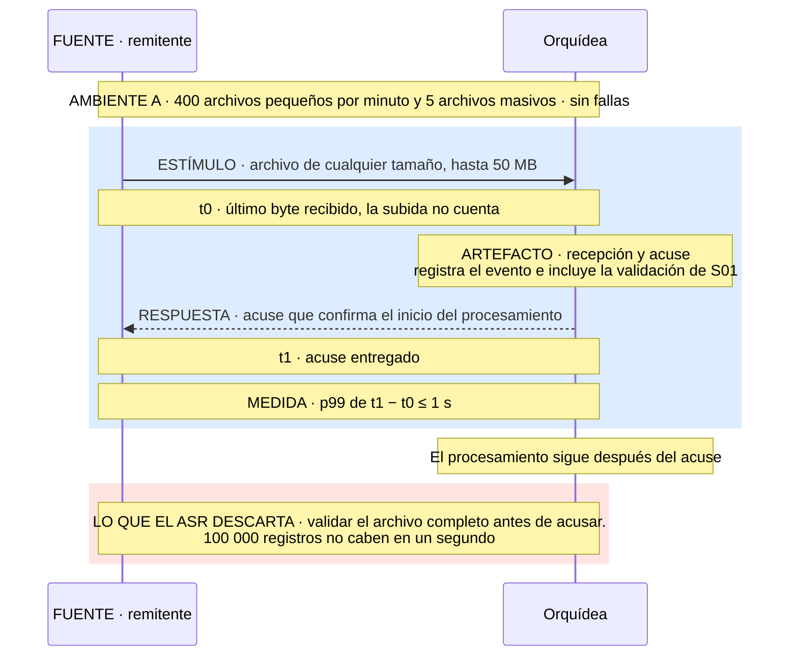

### ASR-S03 — Aislamiento de datos entre remitentes {#asr-s03}

| Parte | Descripción |
|---|---|
| **Fuente** | Un remitente autenticado |
| **Estímulo** | Intenta consultar, corregir o anular operaciones que reportó otro remitente |
| **Artefacto** | La consulta, la corrección y la anulación |
| **Ambiente** | A, sin fallas |
| **Respuesta** | Solo accede a lo que reportó él; lo demás se niega |
| **Medida** | 0 accesos efectivos a operaciones de otro remitente, sobre el catálogo de pruebas |
| **Por qué es ASR** | El límite no es el declarante sino quién reportó, y la identidad sale de la autenticación y el certificado, no de un campo del archivo. Se cuenta el acceso que ocurrió, no el intento |
| **Cómo se verifica** | Pruebas de acceso cruzado por todas las vías; se cuentan los accesos efectivos |
| **Prioridad · Impacto · Origen** | Alta · Medio · `enunciado` («aislamiento estricto de datos entre declarantes») |

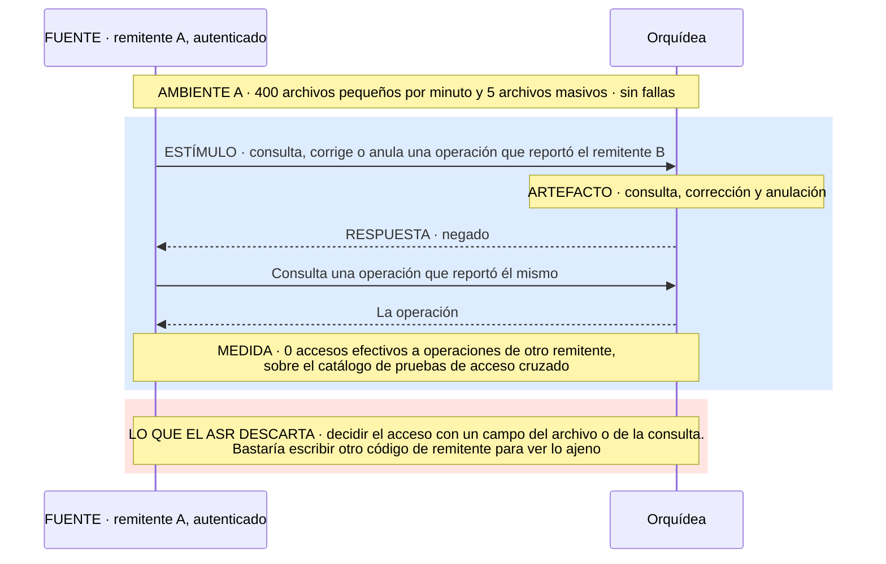

### ASR-D04 — Despliegue sin indisponibilidad (zero downtime) {#asr-d04}

| Parte | Descripción |
|---|---|
| **Fuente** | El equipo de TI de BCR |
| **Estímulo** | Activa o revierte una regla, un XSD o un contrato de API con archivos en curso |
| **Artefacto** | La recepción y el acuse |
| **Ambiente** | E: cambio en producción con la carga de A |
| **Respuesta** | Sigue recibiendo y acusando durante el cambio |
| **Medida** | p99 ≤ 1 s del último byte al acuse mientras dura el cambio |
| **Por qué es ASR** | Las dos versiones conviven mientras hay archivos en curso, y una ventana de mantenimiento no cabe en el 99,99 %. Nota de trampa: se cumple aunque un archivo se evalúe con dos versiones; BCR fijó la vigente a la hora de ingesta, y la prueba lo cuenta |
| **Cómo se verifica** | Activar y revertir con tráfico A; comparar el p99 del acuse y contar los archivos evaluados con dos versiones |
| **Prioridad · Impacto · Origen** | Alta · Medio · `enunciado` («no debe generar tiempo de inactividad») |

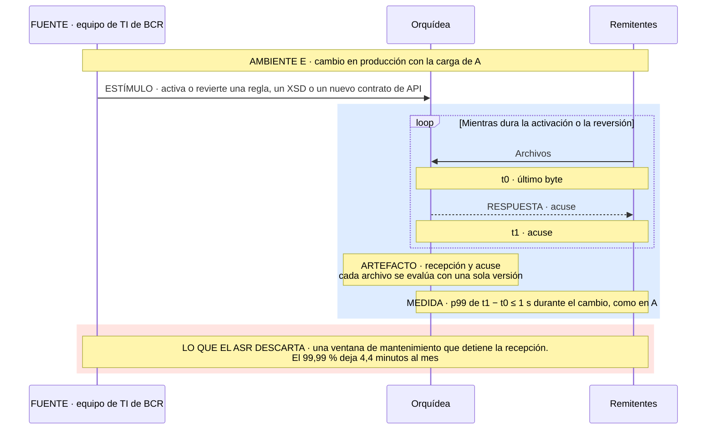

### ASR-L03 — Procesamiento completo de un archivo masivo en ≤ 5 min {#asr-l03}

| Parte | Descripción |
|---|---|
| **Fuente** | Un remitente |
| **Estímulo** | Envía un archivo de 100 000 registros con otros 4 masivos en proceso |
| **Artefacto** | El procesamiento completo del archivo masivo |
| **Ambiente** | A, sin fallas |
| **Respuesta** | El archivo llega a resultado definitivo |
| **Medida** | ≤ 5 min del último byte al resultado definitivo, para cada uno de los 5 masivos |
| **Por qué es ASR** | Son unos 333 registros por segundo por archivo: hay que procesar en paralelo. Con 50 min bastaría en secuencia. Es un máximo y no un percentil, porque la muestra es de cinco |
| **Cómo se verifica** | 5 masivos de 100 000 registros en paralelo sobre la carga de A |
| **Prioridad · Impacto · Origen** | Media · Alto · `enunciado` (Latencia) |

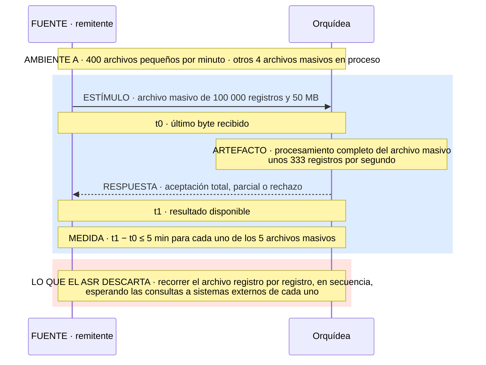

### ASR-D02 — Recuperación ante la falla de un nodo interno en ≤ 10 s {#asr-d02}

| Parte | Descripción |
|---|---|
| **Fuente** | Un nodo interno de procesamiento |
| **Estímulo** | Falla con declaraciones en curso |
| **Artefacto** | El procesamiento de esas declaraciones |
| **Ambiente** | C2: falla interna con la carga de A |
| **Respuesta** | Las declaraciones vuelven a avanzar sin intervención |
| **Medida** | ≤ 10 s desde la falla hasta que avanza la última declaración afectada |
| **Por qué es ASR** | El estado en curso tiene que vivir donde otro nodo lo retome. Con 10 min alcanzaría un reinicio manual. Que no se pierda ni se duplique nada lo mide [D03](#asr-d03) |
| **Cómo se verifica** | Matar un nodo en carga A y medir cuándo avanza la última declaración marcada |
| **Prioridad · Impacto · Origen** | Media · Medio · `enunciado` («recuperarse de fallos de nodos internos en menos de 10 segundos») |

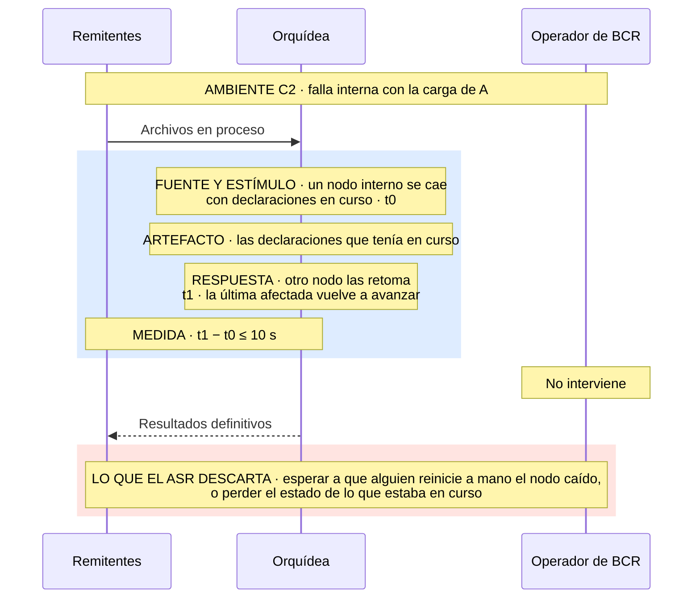

### ASR-L05 — Procesamiento completo de un archivo mediano con p99 ≤ 30 s {#asr-l05}

| Parte | Descripción |
|---|---|
| **Fuente** | Un remitente |
| **Estímulo** | Envía un archivo mediano (51 a 5 000 registros) |
| **Artefacto** | El procesamiento completo del archivo mediano |
| **Ambiente** | A, con 5 masivos en proceso |
| **Respuesta** | El archivo llega a resultado definitivo |
| **Medida** | p99 ≤ 30 s del último byte al resultado definitivo. El percentil es `[SUPUESTO → BCR]` |
| **Por qué es ASR** | Hay que decidir con qué carga va: con los masivos se pasa de 30 s, y con los pequeños puede degradarlos |
| **Cómo se verifica** | Medianos de 5 000 registros con 5 masivos sobre la carga de A |
| **Prioridad · Impacto · Origen** | Media · Medio · `enunciado` (Latencia) |

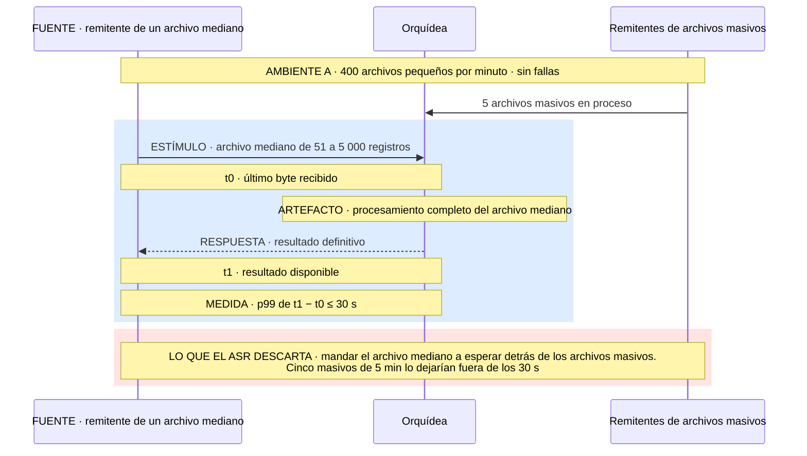

### ASR-M02 — Despliegue de una versión nueva del XSD en ≤ 4 h-persona {#asr-m02}

| Parte | Descripción |
|---|---|
| **Fuente** | La Junta Directiva de BCR |
| **Estímulo** | Cambia el XSD sin tocar el modelo canónico `[SUPUESTO → BCR]` · Tipo: adaptativo |
| **Artefacto** | La validación de la estructura de los archivos |
| **Ambiente** | Ligado en despliegue |
| **Respuesta** | La versión nueva entra a producción, y la anterior sigue validándose mientras convivan `[SUPUESTO → BCR]` |
| **Medida** | ≤ 4 h-persona desde el XSD aprobado hasta producción |
| **De dónde sale el número** | Del enunciado; BCR precisó h-persona con desarrollo y pruebas |
| **Quién lo hace** | El equipo de TI de BCR `[SUPUESTO → BCR]` |
| **Por qué es ASR** | Cada archivo tiene que identificar su versión, y la transformación al modelo canónico tiene que separar lo que depende del esquema. Nota de trampa: se cumple regando el cambio por varias funciones |
| **Cómo se verifica** | BCR lo evalúa en la Fase 4 con inspección del código |
| **Prioridad · Impacto · Origen** | Media · Medio · `enunciado` · secundario para BCR |

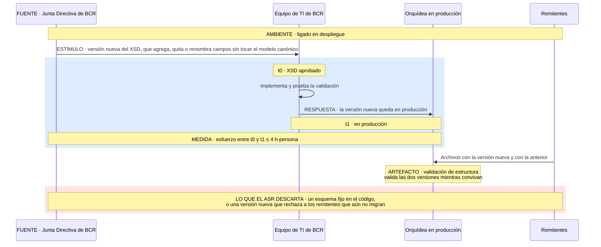

### ASR-S04 — Detección de alteraciones en la auditoría inmutable {#asr-s04}

| Parte | Descripción |
|---|---|
| **Fuente** | Alguien con acceso al almacenamiento |
| **Estímulo** | Modifica, borra o reordena registros de auditoría ya escritos |
| **Artefacto** | La auditoría de recepción, acuses y resultados |
| **Ambiente** | A, sin fallas |
| **Respuesta** | La verificación de integridad señala la alteración y dónde ocurrió |
| **Medida** | 100 % de las alteraciones del catálogo detectadas en la verificación siguiente |
| **Por qué es ASR** | La evidencia tiene que encadenarse para que una alteración se note sin depender de quien administra el almacenamiento. Nota de trampa: se cumple verificando una vez al año; la frecuencia es `[PREGUNTA → BCR]` |
| **Cómo se verifica** | Alterar, borrar y reordenar registros de prueba y correr la verificación. BCR inspecciona en la Fase 4 |
| **Prioridad · Impacto · Origen** | Media · Medio · `enunciado` («asegurar una auditoría inmutable») · secundario para BCR |

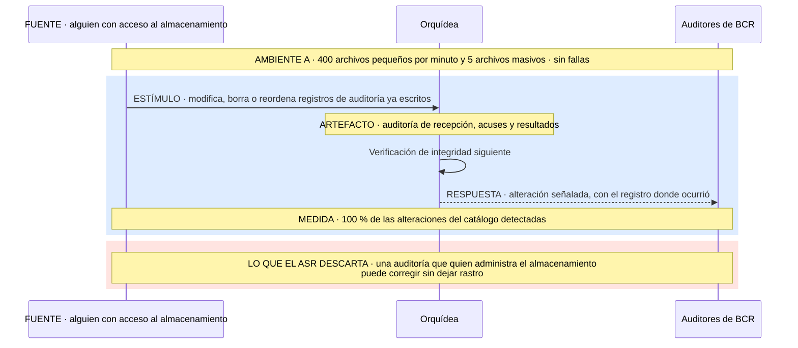

### ASR-I02 — Integración de un nuevo consumidor interno sin modificar el flujo principal {#asr-i02}

| Parte | Descripción |
|---|---|
| **Fuente** | Un área de BCR |
| **Estímulo** | Pide los datos en un formato nuevo · Tipo: aditivo |
| **Artefacto** | La entrega de datos a las áreas |
| **Ambiente** | Desarrollo · socio conocido de antemano · propio |
| **Respuesta** | El área recibe los datos en su formato, con el mismo significado |
| **Medida** | 0 funciones del flujo principal modificadas para integrarla |
| **De dónde sale el número** | Del informe de consultoría; BCR lo aceptó como secundario |
| **Quién lo hace** | El equipo de TI de BCR `[SUPUESTO → BCR]` |
| **Por qué es ASR** | Prueba si la entrega se alimenta de lo ya registrado o depende del flujo de procesamiento. Nota de trampa: se cumple metiendo toda la lógica en la entrega |
| **Cómo se verifica** | BCR lo evalúa en la Fase 4 con inspección del código |
| **Prioridad · Impacto · Origen** | Baja · Bajo · informe · secundario para BCR |

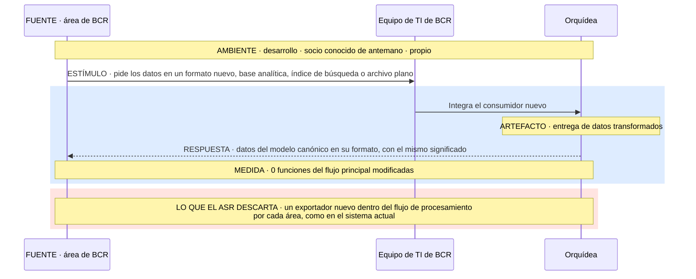

### Protocolo de verificación de modificabilidad e interoperabilidad

Se validan [M01](#asr-m01) e [I01](#asr-i01), uno de cada atributo. M02 e I02 no van en esta encuesta.

| Parte | Descripción |
|---|---|
| **Panel** | Al menos dos humanos de fuera del curso, con experiencia en arquitectura de sistemas críticos o de integración. Un evaluador no humano, si se suma, va en una columna aparte y no cuenta para la mayoría |
| **Presentación** | Los ASR, la arquitectura y las decisiones principales, contadas en neutro y sin mostrar los umbrales. No se elogian las tácticas. Después, una sesión de preguntas |
| **Escala** | 1 muy improbable · 2 improbable · 3 ni una ni otra · 4 probable · 5 muy probable |
| **Escenarios** | M01: «una regla cambiaria nueva llega a producción con ≤ 2, 4, 6 y 12 h-persona»; el real queda segundo en la escalera. I01: «el nuevo contrato de API de ANTA se integra con ≤ 1, 2,5, 4 y 8 h-persona»; el real queda tercero. En el formulario van en orden aleatorio y no se dice cuál es el real. Control negativo, uno para el panel: «cambiar el canal de envío de los remitentes a transferencia de archivos con ≤ 4 h-persona». Preguntas abiertas: «¿la regla podría cumplir las 4 h regando el cambio por varias funciones?» y «¿el contrato de API podría integrarse en 4 h interpretando mal sus datos?» |
| **Tabulación** | Una tabla por ASR validado, con una columna por experto (A, B, C), la mediana de los humanos y el rango |
| **Regla de decisión** | Se escribe antes de encuestar. **Sostenido**: mediana ≥ 4 en el escenario real y ningún humano ≤ 2. **Refutado**: mediana ≤ 2. **No concluyente**: cualquier otro caso. El control negativo debe salir ≤ 2; si sale alto, las respuestas tienen sesgo de aquiescencia |

## 5. Descartes

| Candidato | Origen | Salió por | Razón en una frase | Va a |
|---|---|---|---|---|
| «Con un sistema externo caído, 0 archivos rechazados», sin plazo | informe | Se cumple sin lograr el objetivo | Se cumple dejando las declaraciones pendientes para siempre. La medida de D01 le agrega el plazo: la primera ventana nocturna tras el regreso del externo | Medida de [D01](#asr-d01) |
| Cualquier regla cambiaria en 4 h-persona | informe | Cambio sin acotar | Una regla que pide un dato nuevo de un sistema externo no cabe en 4 h; se acota a reglas sobre datos que ya llegan | [M01](#asr-m01) |
| Reemplazar un sistema externo por otro proveedor en 4 h-persona | informe | Cambio sin acotar | El enunciado pide adaptar o reemplazar el conector, no cambiar de proveedor | [I01](#asr-i01) |
| Pérdida cero en el pico sin fallas | `enunciado` | Lo cubre otro ASR | Sin fallas, solo se pierde si se descarta carga; D03 lo mide en el peor caso, una falla durante el pico | [D03](#asr-d03) |
| Pequeños en ≤ 3 s en A | `enunciado` | Lo cubre otro ASR | Fuerza la misma decisión que E01, 5 s con el triple de carga, y se mide en la misma prueba | Se verifica junto con [E01](#asr-e01) |
| Disponibilidad del 99,99 % | `enunciado` | No diseñable | Es la meta de negocio; la persiguen D01, D02, D03 y D04 | Motivador |
| Cifrado en tránsito y en reposo | `enunciado` | Es infraestructura o configuración | Se cumple con configuración y práctica estándar, y no descarta ninguna familia de solución | Restricción |
| Protección contra ataques XML | `enunciado` | Práctica estándar | Endurecer el parser es práctica estándar; la parte estructural, que lo verificado sea lo procesado, va en S06 | Restricción · [S06](#asr-s06) |
| Autenticación del canal con TLS mutuo | BCR (ADR-13) | Fuera de alcance | En la reunión del 6-nov la seguridad crítica quedó en la firma del archivo, no en el canal | Restricción |
| 0 s de indisponibilidad dentro de las medidas de M01, M02 e I01 | informe | Otro atributo | Es una medida de ejecución dentro de un ASR de modificabilidad | [D04](#asr-d04) |
| «Sin pérdida» dentro de E01 y «sin pérdida ni duplicados» dentro de D02 | `enunciado` · informe | Dos medidas | Cada ASR lleva una sola medida | [D03](#asr-d03) |
| «Vuelve a producir resultados» como medida de D02 | informe | Se cumple sin lograr el objetivo | Se cumple con los elementos sanos aunque lo afectado siga detenido | Medida de [D02](#asr-d02) |
| Ambiente «bajo ataque» | informe | — | El ataque es el estímulo del escenario, no el ambiente | — |
| Topología activo-activo en varias zonas | BCR (ADR-17) | Es infraestructura o configuración | Es infraestructura | Infraestructura |
| Recuperación ante desastre entre regiones | informe | Fuera de alcance | El enunciado pide recuperarse de fallas de nodo, no de región | — |
| Detectar el archivo atascado o con resultado descuadrado | análisis del equipo | Sin umbral | El enunciado no da tiempo de detección | Sección 6 |
| Drenar 12 h de pendientes sin degradar lo nuevo | análisis del equipo | Pendiente | Es la medida de L04 en otro ambiente; entra si BCR fija cómo se drena | Sección 6 |
| Archivo aceptado con un certificado revocado dentro de la ventana de la caché | análisis del equipo | Sin umbral | Su detección depende de cada cuánto publica la ECD su lista de revocación | Sección 6 |
| Más de 5 archivos masivos al mismo tiempo | análisis del equipo | Pendiente | El enunciado y BCR fijan 5, y nadie dice qué pasa con el sexto | Sección 6 |
| Un remitente que satura a los demás con archivos pequeños | análisis del equipo | No cambia la estructura | Dentro de B la carga total está acotada a 1 200 por minuto | — |
| Frescura de los datos para las áreas («tiempo real») | análisis del equipo | Sin umbral | El enunciado no da cifra | Sección 6 |
| Correcciones o anulaciones que llegan antes que la declaración original | informe | Funcional | Es una regla de orden del negocio | Funcional |
| Exactitud de las reglas cambiarias | análisis del equipo | Funcional | Ningún diseño mueve la exactitud de una regla | Funcional |
| Retención de 10 años en almacenamiento no modificable | BCR (ADR-14) | Restricción | Es una norma | Restricción |
| Trazar cada archivo del acuse a la notificación | BCR | Asunto transversal | Es observabilidad, que el diseño resuelve aunque nadie la pida | Asunto transversal |
| Firma en streaming, hash encadenado en paralelo, purga del outbox | BCR | Diseño | Preguntan cómo se cumplen S01, S04 y E01, no qué se exige | ADR |

## 6. Abierto

**Preguntas**

- `[PREGUNTA → BCR]` ¿A partir de qué latencia un sistema externo cuenta como «extrema»? De eso depende cuándo dejan de aplicar los plazos de procesamiento, como aceptó BCR.
- `[PREGUNTA → BCR]` ¿A qué hora corre la ventana nocturna de reproceso?
- `[PREGUNTA → BCR]` ¿Cuántos días se reintenta un archivo pendiente, y qué pasa con él si el sistema externo sigue caído varios días: se notifica cada día, se rechaza con causa o queda a cargo de un operador?
- `[PREGUNTA → BCR]` ¿En cuánto tiempo hay que detectar que un sistema externo cayó o se puso lento, y qué tasa de falsas alarmas se tolera? Es la rama de detección de la disponibilidad, que no tiene ASR por falta de cifra.
- `[PREGUNTA → BCR]` ¿Qué desfase de reloj y qué antigüedad máxima de la estampa se toleran antes de rechazar un archivo?
- `[PREGUNTA → BCR]` ¿El XSD trae entidad, fecha, lote y consecutivo, para usarlos como llave de un archivo duplicado?
- `[PREGUNTA → equipo]` En la reunión del 6-nov el ASR de seguridad crítico quedó como «ningún archivo se acepta sin validación criptográfica completa», que es S06. Confirmar con BCR por escrito que S06 reemplaza a S01 entre los críticos; S01 conserva sus 200 ms como alto.
- `[PREGUNTA → BCR]` Los «5 segundos de respuesta» del pico, ¿son de procesamiento completo, como los 3 s de A, o del acuse?
- `[PREGUNTA → BCR]` ¿Cada cuánto debe verificarse la integridad de la auditoría?
- `[PREGUNTA → BCR]` ¿Cuántos archivos medianos llegan por minuto, en A y en B?
- `[PREGUNTA → BCR]` ¿Cuántas veces al año cambia la Circular, y cuántas cambian su contrato de API los sistemas externos?
- `[PREGUNTA → BCR]` ¿Los remitentes migran a una versión nueva del XSD a ritmos distintos?
- `[PREGUNTA → BCR]` ¿Qué pasa si llegan más de 5 archivos masivos al mismo tiempo: esperan, se rechazan o se aceptan con otro plazo?
- `[PREGUNTA → BCR]` ¿Cada cuánto publica la ECD su lista de revocación, y en cuánto tiempo hay que detectar un archivo aceptado con un certificado ya revocado?
- `[PREGUNTA → BCR]` ¿Qué significa «tiempo real» para las estadísticas de las áreas?
- `[PREGUNTA → BCR]` ¿Qué datos ve cada área de BCR según su rol, y hay un límite de archivos por remitente?

**Supuestos**

- `[SUPUESTO → BCR]` El percentil de L01 y L05 es p99, el mismo que BCR usó en L04, E01 y S01.
- `[SUPUESTO → BCR]` En A el arribo es estocástico, y en B llega en ráfaga en los cierres.
- `[SUPUESTO → BCR]` Los cambios de reglas, XSD y contratos de API los hace el equipo propio de TI, que conoce Orquídea.
- `[SUPUESTO → BCR]` Las versiones del XSD conviven mientras los remitentes migran, y una versión nueva no cambia el modelo canónico.
- `[SUPUESTO → BCR]` Los contratos de API de los sistemas externos cambian menos que la Circular; por eso I01 va después de M01.

**Riesgos de alcanzabilidad**

- **S01 contra 50 MB.** Verificar la firma de un XML de 50 MB exige canonicalizar y resumir el documento completo, y 200 ms pueden no alcanzar. Es la primera pregunta de BCR.
- **S01 contra el ADR-04 aprobado.** El ADR-04 deja que un archivo masivo reciba un acuse de custodia y se verifique después. S01, en cambio, pide la validación criptográfica en 200 ms para el 100 % de los archivos: `[PREGUNTA → BCR]` ¿S01 aplica también a los archivos masivos?
- **N = 5 en A o en B.** BCR pone los 5 archivos masivos en el ambiente A en su tabla de ASR y en hora pico en el ADR-02. Los ASR los usan en los dos; si en A son menos, L04 y L03 se relajan.

**Fuera de alcance**

- La disponibilidad física: la redundancia de servidores, zonas y redes es infraestructura.
