# Los ASR de Orquídea: latencia, escalabilidad, disponibilidad, seguridad, modificabilidad e interoperabilidad

Un ASR, o requisito arquitectónicamente significativo, es el que obligaría a repensar la arquitectura si cambiara.

Los de Orquídea salen del enunciado del curso, del informe de consultoría del Grupo 1 y de la respuesta que BCR envió el 3 de noviembre de 2026. El enunciado manda, y la respuesta de BCR es vinculante donde fija una cifra. Las decisiones de arquitectura (ADR) que BCR aprobó responden a estos requisitos, no al revés.

Cada ASR tiene una sola medida y ninguno nombra componentes ni tecnologías. Cuando una medida se puede cumplir sin lograr lo que pide, la ficha lo advierte en una «nota de trampa».

Cuatro grupos de siglas se repiten en la página. BCR es la entidad que opera Orquídea. Los remitentes son los intermediarios del mercado cambiario (IMC) y los titulares de cuentas de compensación. STM, ANTA, MAMC y RNIC son los cuatro sistemas externos que aportan tasas, datos tributarios y aduaneros, datos migratorios e identidad. La ECD es la entidad de certificación digital que emite los certificados y las estampas cronológicas.

## 1. Los ASR

Van en orden de importancia, y cada ID lleva a su ficha. La columna «Amb.» dice dónde aplica la medida, con los ambientes de la sección 2. A es la operación normal, B el pico, C1 un sistema externo degradado, C2 una falla interna y E un cambio en producción. En modificabilidad e interoperabilidad, en cambio, dice cuándo entra el cambio.

| # | ID | Atributo | Qué exige | Amb. | Prioridad | Impacto | Origen |
|---|---|---|---|---|---|---|---|
| 1 | [ASR-L04](#asr-l04) | Latencia | **Aislamiento de carga entre archivos masivos y pequeños.** Mientras 5 archivos masivos se procesan, cada archivo pequeño debe resolverse casi igual de rápido que sin ellos: su p99 sube como máximo 10 % | A | Crítica | Alto | `enunciado` · BCR |
| 2 | [ASR-D01](#asr-d01) | Disponibilidad · enmascaramiento | **Aislamiento de fallas de los sistemas externos.** Si STM, ANTA, MAMC, RNIC o la ECD se cae o se pone lento, el remitente sigue recibiendo su acuse en p99 ≤ 1 s, y ningún archivo se rechaza por esa falla | C1 | Crítica | Alto | `enunciado` |
| 3 | [ASR-S06](#asr-s06) | Seguridad · prevención | **Ningún archivo se acepta sin validación criptográfica completa.** Un archivo puede acusarse antes de verificar su firma, estampa y certificado, pero no puede quedar aceptado hasta que esa verificación termine bien: 0 casos | A, C1 | Crítica | Alto | `enunciado` |
| 4 | [ASR-M01](#asr-m01) | Modificabilidad · adaptativo | **Despliegue de una regla cambiaria nueva en ≤ 4 h-persona.** Cuando la Junta cambia la Circular con una regla sobre datos que ya llegan, implementarla, probarla y ponerla en producción cuesta ≤ 4 h-persona, sin detener el flujo | Despliegue | Crítica | Alto | `enunciado` · BCR |
| 5 | [ASR-S01](#asr-s01) | Seguridad · prevención | **Validación criptográfica en ≤ 200 ms.** Desde que llega el último byte, el sistema sabe en p99 ≤ 200 ms si la firma, la estampa y el certificado del archivo son válidos y vigentes | A | Alta | Alto | `enunciado` |
| 6 | [ASR-E01](#asr-e01) | Escalabilidad | **Carga pico de archivos pequeños con p99 ≤ 5 s.** En cierres de mercado y vencimientos, con 1 200 archivos pequeños por minuto durante 45 minutos y 5 archivos masivos en paralelo, cada archivo pequeño se resuelve en p99 ≤ 5 s | B | Alta | Alto | `enunciado` |
| 7 | [ASR-I01](#asr-i01) | Interoperabilidad | **Nueva versión del contrato de API de un sistema externo en ≤ 4 h-persona.** Cuando STM, ANTA, MAMC o RNIC publica una versión nueva de su contrato de API, integrarla en producción cuesta ≤ 4 h-persona, y sus datos se interpretan con el significado que él les da | Desarrollo | Alta | Alto | `enunciado` · BCR |
| 8 | [ASR-D03](#asr-d03) | Disponibilidad · prevención | **Cero pérdidas y cero duplicados de declaraciones con acuse emitido.** Si un nodo interno falla durante el pico, cada declaración con acuse emitido termina con exactamente un resultado definitivo: 0 perdidas y 0 dobles | C2 sobre B | Alta | Alto | `enunciado` |
| 9 | [ASR-L01](#asr-l01) | Latencia | **Acuse de recibo en ≤ 1 s.** Desde que llega el último byte de un archivo de cualquier tamaño, el remitente recibe en p99 ≤ 1 s el acuse que confirma el inicio del procesamiento | A | Alta | Alto | `enunciado` · BCR |
| 10 | [ASR-S03](#asr-s03) | Seguridad · prevención | **Aislamiento de datos entre remitentes.** Un remitente autenticado solo consulta, corrige o anula lo que reportó él: 0 accesos efectivos a operaciones de otro remitente | A | Alta | Medio | `enunciado` |
| 11 | [ASR-D04](#asr-d04) | Disponibilidad · prevención | **Despliegue sin indisponibilidad (zero downtime).** Mientras se activa o se revierte una regla, un XSD o un contrato de API, los remitentes siguen recibiendo su acuse en p99 ≤ 1 s | E | Alta | Medio | `enunciado` |
| 12 | [ASR-L03](#asr-l03) | Latencia | **Procesamiento completo de un archivo masivo en ≤ 5 min.** Un archivo de 100 000 registros, procesado junto a otros 4 archivos masivos, llega a resultado definitivo en ≤ 5 min desde su último byte | A | Media | Alto | `enunciado` |
| 13 | [ASR-D02](#asr-d02) | Disponibilidad · reparación | **Recuperación ante la falla de un nodo interno en ≤ 10 s.** Si un nodo interno se cae, las declaraciones que tenía en curso vuelven a avanzar solas en ≤ 10 s, sin que nadie intervenga | C2 | Media | Medio | `enunciado` |
| 14 | [ASR-L05](#asr-l05) | Latencia | **Procesamiento completo de un archivo mediano con p99 ≤ 30 s.** Un archivo de 51 a 5 000 registros, que llega con 5 archivos masivos en proceso, llega a resultado definitivo en p99 ≤ 30 s | A | Media | Medio | `enunciado` |
| 15 | [ASR-M02](#asr-m02) | Modificabilidad · adaptativo | **Despliegue de una versión nueva del XSD en ≤ 4 h-persona.** Cuando cambia la estructura de las declaraciones sin tocar el modelo canónico, ponerla en producción cuesta ≤ 4 h-persona, y la versión anterior sigue validándose | Despliegue | Media | Medio | `enunciado` · BCR |
| 16 | [ASR-S04](#asr-s04) | Seguridad · detección | **Detección de alteraciones en la auditoría inmutable.** Si alguien modifica, borra o reordena registros de auditoría ya escritos, la verificación de integridad lo señala en el 100 % de los casos | A | Media | Medio | `enunciado` · BCR |
| 17 | [ASR-I02](#asr-i02) | Integración | **Integración de un nuevo consumidor interno sin modificar el flujo principal.** Integrar un área que pide los datos en un formato nuevo no modifica la recepción, la validación, el enriquecimiento, la transformación ni la persistencia | Desarrollo | Baja | Bajo | informe · BCR |

**Por qué este orden.** La prioridad es exposición al riesgo: qué tan probable es no cumplir, multiplicado por cuánto le duele a BCR. El impacto es la dificultad de diseño: cuánto pesa el requisito en la estructura.

Los cuatro primeros son **críticos**: cada uno cubre una de las cuatro tensiones del problema (carga de archivos masivos contra pequeños, dependencia de sistemas externos, archivos aceptados sin verificar y cambios de la Circular), y son los que guían la primera iteración del diseño. Los tres siguientes, S01, E01 e I01, completan los seis que BCR priorizó en su respuesta.

- **L04 va primero** porque es el reto tal como lo escribe el enunciado: procesar pequeños y masivos «sin generar encolamientos ni bloqueos mutuos».
- **D01** depende de cuatro sistemas y una ECD que BCR no controla; el informe ya calificó ese riesgo con probabilidad alta.
- **S06** protege lo que el enunciado exige del 100 % de los archivos: que ninguno sin verificar termine aceptado. BCR aprobó dos casos en que el acuse sale antes de verificar, y en ellos el riesgo es real. BCR no lo listó entre sus seis: entra como crítico en lugar de S01 porque mide lo que S01 solo cronometra.
- **M01** ataca el problema que el enunciado describe con «altos costos y largos tiempos de puesta en producción»: cada cambio de la Circular.
- **S01** encabeza los altos: mide cuánto tarda la verificación, y es el de mayor riesgo de alcanzabilidad, porque verificar un archivo de 50 MB en 200 ms es lo primero que BCR cuestiona. Lo que esa verificación protege ya lo mide S06.
- **E01** va después porque el pico son 20 archivos por segundo, y el informe concluye que esa tasa no es la presión real.
- **I01** comparte el problema de M01, y los contratos de API de los sistemas externos cambian con menos frecuencia que la Circular `[SUPUESTO → BCR]`.

Del 8 al 11 son requisitos explícitos del enunciado que BCR no listó y que pesan en la estructura. Del 12 al 17 completan el alcance. BCR evalúa tres de ellos (M02, S04 e I02) con su propia inspección de código en la Fase 4 de la hoja de ruta.

### De qué historia de usuario sale cada ASR

Cada escenario de calidad cuelga de una [historia de usuario](requirements.md): la historia dice qué necesita el stakeholder, y el ASR, con qué calidad.

| ASR | Historia |
|---|---|
| [ASR-L04](#asr-l04) | [HU-03](requirements.md) |
| [ASR-D01](#asr-d01) | [HU-06](requirements.md) |
| [ASR-S06](#asr-s06) | [HU-02](requirements.md) |
| [ASR-M01](#asr-m01) | [HU-11](requirements.md) |
| [ASR-S01](#asr-s01) | [HU-02](requirements.md) |
| [ASR-E01](#asr-e01) | [HU-03](requirements.md) |
| [ASR-I01](#asr-i01) | [HU-13](requirements.md) |
| [ASR-D03](#asr-d03) | [HU-07](requirements.md) |
| [ASR-L01](#asr-l01) | [HU-01](requirements.md) |
| [ASR-S03](#asr-s03) | [HU-09](requirements.md) |
| [ASR-D04](#asr-d04) | [HU-11](requirements.md) |
| [ASR-L03](#asr-l03) | [HU-04](requirements.md) |
| [ASR-D02](#asr-d02) | [HU-07](requirements.md) |
| [ASR-L05](#asr-l05) | [HU-03](requirements.md) |
| [ASR-M02](#asr-m02) | [HU-12](requirements.md) |
| [ASR-S04](#asr-s04) | [HU-14](requirements.md) |
| [ASR-I02](#asr-i02) | [HU-10](requirements.md) |

## 2. Ambientes

### Tiempo, disponibilidad y seguridad

| Variable | A — normal | B — carga pico | C1 — sistema externo degradado | C2 — falla interna | E — cambio en producción |
|---|---|---|---|---|---|
| Pequeños (1 a 50 registros) | 400/min (enunciado, Escalabilidad) | 1 200/min durante 45 min (enunciado) | Como A | Como A; como B para D03 | Como A |
| Medianos (51 a 5 000) | `[PREGUNTA → BCR]` ¿cuántos por minuto? | `[PREGUNTA → BCR]` | Como A | Como A | Como A |
| Masivos (hasta 100 000, hasta 50 MB) | 5 concurrentes (BCR, tabla de ASR) | 5 concurrentes (BCR, ADR-02) | Como A | Como A | Como A |
| Patrón de arribo | Estocástico `[SUPUESTO → BCR]` | Ráfaga en los cierres de mercado diario y los vencimientos regulatorios `[SUPUESTO → BCR]` | — | — | — |
| Estado | Sin fallas; externos y ECD disponibles; sin pendientes | Sin fallas | STM, ANTA, MAMC, RNIC o la ECD caído o con latencia extrema, por horas (respuesta de BCR) | Un nodo interno de procesamiento deja de funcionar con archivos en curso | Se activa o se revierte una regla, un XSD o el contrato de API de un sistema externo |
| Alcance | Dentro | Dentro | Dentro | Dentro: la falla de software. La redundancia física queda fuera | Dentro |

La caída de un sistema externo puede durar horas: BCR plantea un caso de 12 horas con 500 000 declaraciones acumuladas.

Con un sistema externo caído, BCR aceptó que los plazos de procesamiento de 3 s, 30 s y 5 min no apliquen. Nadie ha dicho qué latencia de un sistema externo cuenta como «extrema», y de eso depende cuándo empieza esa exención.

### Modificabilidad · momento de ligado

| Ligado | Qué cambios entran así |
|---|---|
| Despliegue | Una regla cambiaria nueva (M01) y una versión nueva del XSD (M02): entran a producción sin recompilar ni detener el resto del flujo, como pide el enunciado |
| Ejecución | Ninguno exigido: el enunciado habla de despliegue sin inactividad, no de cambios sin desplegar |

| Tipo | Cambio probable | Ligado | ASR o descarte |
|---|---|---|---|
| Correctivo | Corregir una regla que se activó con un error | Despliegue | Lo cubre [M01](#asr-m01): es el mismo cambio, por la misma vía |
| Preventivo | Ninguno probable: el sistema es nuevo y el enunciado no trae deuda técnica del que reemplaza | — | — |
| Adaptativo | Una regla de la Circular cambia · el XSD de las declaraciones cambia · un sistema externo cambia su contrato de API | Despliegue · despliegue · desarrollo | [M01](#asr-m01) · [M02](#asr-m02) · [I01](#asr-i01) (interoperabilidad) |
| Aditivo | Un área de BCR pide los datos en un formato nuevo | Desarrollo | [I02](#asr-i02) (integración, socio propio) |

### Interoperabilidad · socios

| Socio | Fase | Cómo se le conoce | Grado de control |
|---|---|---|---|
| STM, ANTA, MAMC, RNIC | Desarrollo | Conocidos de antemano | Tercero fuera de control: cambian su contrato de API por su cuenta |
| ECD | Desarrollo | Conocida de antemano | Tercero fuera de control, con protocolos estándar |
| Remitentes | Desarrollo | Conocidos de antemano | Tercero bajo control: BCR fija el XSD |
| Áreas de BCR | Desarrollo | Conocidas de antemano | Propio |

## 3. Matrices de cobertura

### Seguridad: STRIDE

El eje es el flujo de datos del dominio; el stakeholder va como columna auxiliar.

| STRIDE | Flujo de datos del dominio | Stakeholder | Modo | Amb. | Resultado |
|---|---|---|---|---|---|
| **S** Suplantación | El archivo firmado que envía un remitente | Tercero contra un IMC | Prevención | A | **[ASR-S01](#asr-s01)** |
| **S** Suplantación | Un archivo con firma inválida o certificado revocado que llega a resultado definitivo | Tercero con certificado robado | Prevención | A, C1 | **[ASR-S06](#asr-s06)** |
| **S** Suplantación | Un archivo aceptado con un certificado revocado después de la última actualización de la información de revocación | Tercero con certificado robado | Detección | A | Pendiente: sin umbral `[PREGUNTA → BCR]` |
| **S** Suplantación | El mismo caso, ya detectado | Tercero con certificado robado | Reacción | A | Pendiente: sin umbral |
| **S** Suplantación | Un firmante distinto del remitente autenticado | IMC contra IMC | Prevención | A | Descartada: es una regla de la verificación de S01 |
| **T** Manipulación | El contenido firmado de un archivo (firma envuelta) | Tercero | Prevención | A | **[ASR-S06](#asr-s06)**: lo verificado tiene que ser lo que se procesa |
| **T** Manipulación | La auditoría ya escrita | Interno, por abuso o **mal uso** | Detección | A | **[ASR-S04](#asr-s04)** |
| **T** Manipulación | Las declaraciones que reportó otro remitente | IMC contra IMC | Prevención | A | **[ASR-S03](#asr-s03)** |
| **R** Repudio | El envío de un archivo que el remitente niega | IMC | Detección | A | Descartada: la firma y la estampa dan el no repudio, y S04 conserva la evidencia |
| **R** Repudio | El acuse o el resultado que BCR niega haber emitido | IMC contra BCR | Prevención | A | Descartada: un acuse y una respuesta firmados por BCR son funcionales |
| **I** Divulgación | La consulta de resultados y declaraciones | IMC contra IMC | Prevención | A | **[ASR-S03](#asr-s03)** |
| **I** Divulgación | La entrega a las áreas internas | Funcionario de BCR, **mal uso** | Prevención | A | Descartada: `[PREGUNTA → BCR]` ¿qué ve cada área por su rol? |
| **I** Divulgación | Los datos en tránsito y en reposo | Externo | Prevención | A | Descartada: el cifrado es una restricción del enunciado |
| **D** Denegación | Un XML con expansión de entidades que degrada a los demás | Tercero | Detección | A | Descartada: endurecer el parser es práctica estándar; la degradación real la mide L04 |
| **D** Denegación | Una avalancha de archivos de un solo remitente | IMC | Detección | B | Descartada: E01 acota la carga total; `[PREGUNTA → BCR]` ¿hay límite por remitente? |
| **E** Elevación | Un operador de un IMC con permisos de administrador | Usuario de un IMC | Detección | A | Descartada: la gestión de usuarios queda fuera de alcance (informe, §4.3) |

### Interoperabilidad: distancias

| Socio · control | Sintáctica | Semántica en datos | Semántica en comportamiento | Temporal | De recursos |
|---|---|---|---|---|---|
| STM · tercero fuera de control | **[ASR-I01](#asr-i01)** | **[ASR-I01](#asr-i01)**: base de la tasa, decimales, fecha de vigencia | Fuera: quién reintenta y qué pasa si cae es disponibilidad ([D01](#asr-d01)) | Descartada: cuándo publica STM es parte del contrato de API que integra I01; el tiempo del intercambio es desempeño | Descartada: `[PREGUNTA → BCR]` ¿límite de consultas? |
| ANTA · tercero fuera de control | **[ASR-I01](#asr-i01)** | **[ASR-I01](#asr-i01)**: identificación tributaria y aduanera | Fuera: [D01](#asr-d01) | Descartada: igual que STM | Descartada: igual que STM |
| MAMC · tercero fuera de control | **[ASR-I01](#asr-i01)** | **[ASR-I01](#asr-i01)**: condición migratoria | Fuera: [D01](#asr-d01) | Descartada: igual que STM | Descartada: igual que STM |
| RNIC · tercero fuera de control | **[ASR-I01](#asr-i01)** | **[ASR-I01](#asr-i01)**: tipo y número de documento | Fuera: [D01](#asr-d01) | Descartada: igual que STM | Descartada: igual que STM |
| ECD · tercero fuera de control | Descartada: CRL, OCSP y estampa son estándares (RFC 5280, 6960 y 3161) | Descartada: igual | Fuera: [D01](#asr-d01) | Pendiente: la ventana de revocación (sección 6) | Descartada |
| Remitentes · tercero bajo control | **[ASR-M02](#asr-m02)**: versión del XSD | Descartada: el significado lo valida la aplicación de reglas (M01) | Descartada: acuse, aviso y consulta son funcionales | Descartada | Descartada: el tope de 50 MB es una restricción (BCR) |
| Áreas de BCR · propio | **[ASR-I02](#asr-i02)** | **[ASR-I02](#asr-i02)**: el dato significa lo mismo que en el registro | Descartada | Fuera: la frescura es desempeño; `[PREGUNTA → BCR]` ¿qué es «tiempo real»? | Descartada |

## 4. Fichas

Cada ficha trae, debajo de la tabla, un diagrama de secuencia con Orquídea como caja negra. La banda azul encierra lo que se mide: el estímulo, la respuesta y los instantes t0 y t1 entre los que corre la medida. La banda roja dice qué familia de soluciones descarta el número, que es lo que hace del requisito un ASR. Lo que queda fuera de las dos bandas pasa en el escenario pero no entra en la medida. El diagrama no muestra componentes internos: esos los decide el diseño, no el requisito.

### ASR-L04 — Aislamiento de carga entre archivos masivos y pequeños {#asr-l04}

| Parte | Descripción |
|---|---|
| **Fuente** | Varios remitentes que envían a la vez archivos pequeños y masivos |
| **Estímulo** | Llegan archivos pequeños (1 a 50 registros) con arribo estocástico mientras 5 archivos masivos de hasta 100 000 registros están en proceso |
| **Artefacto** | El procesamiento completo de los archivos pequeños: verificación, validación, enriquecimiento, transformación y persistencia |
| **Ambiente** | A: 400 archivos pequeños por minuto y 5 archivos masivos concurrentes, sin fallas |
| **Respuesta** | Los archivos pequeños se procesan sin esperar a que avancen los archivos masivos |
| **Medida** | p99 de los archivos pequeños con 5 archivos masivos ≤ 1,10 × su p99 sin archivos masivos, del último byte recibido al resultado definitivo disponible para el remitente, en A |
| **Por qué es ASR** | Hay que decidir si archivos de tamaños distintos comparten capacidad y orden de atención. Con un margen de +100 % bastaría una prioridad sobre un camino compartido; con +10 %, el aislamiento tiene que sostenerse por construcción. Nota de trampa: la medida es relativa y se cumple aunque el p99 sin archivos masivos ya sea malo; ese piso lo pone E01 |
| **Cómo se verifica** | Prueba de carga en A con el mismo generador, una vez sin archivos masivos y otra con 5, comparando los dos p99. Después se suben los archivos masivos por encima de 5 hasta encontrar el quiebre |
| **Prioridad · Impacto · Origen** | Crítica · Alto · `enunciado` (Latencia: «jamás encolará ni degradará la latencia de los archivos de pocos registros») · BCR fijó N = 5 y el margen de 10 % |

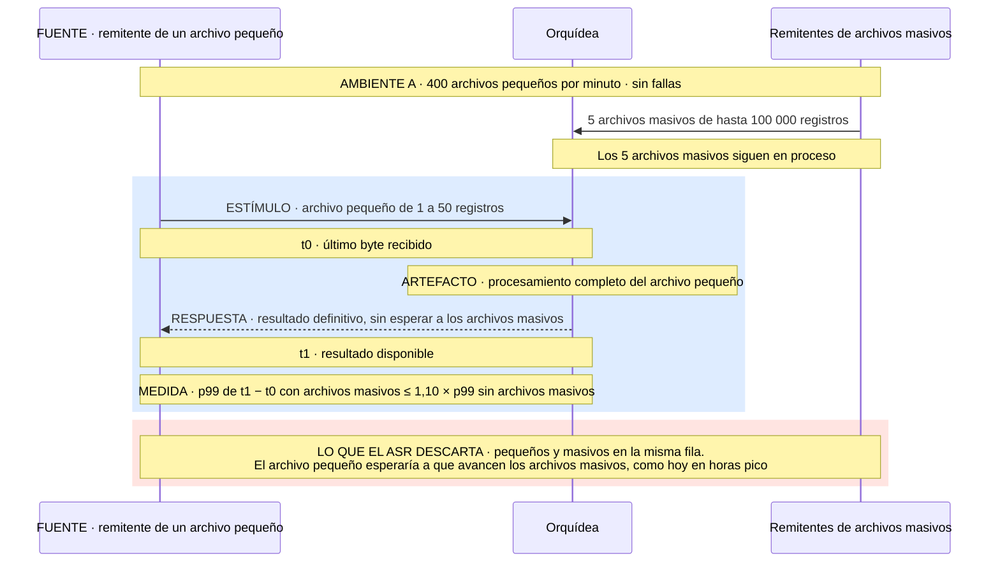

### ASR-D01 — Aislamiento de fallas de los sistemas externos {#asr-d01}

| Parte | Descripción |
|---|---|
| **Fuente** | STM, ANTA, MAMC, RNIC o la ECD: sistemas que BCR no controla |
| **Estímulo** | Uno de ellos deja de responder o responde con lentitud extrema, durante horas, mientras siguen llegando archivos |
| **Artefacto** | La recepción y el acuse de archivos |
| **Ambiente** | C1: un sistema externo caído o lento, con la carga de A |
| **Respuesta** | Ningún archivo se rechaza por la falla del sistema externo: se recibe y se acusa como siempre, y las declaraciones que dependen del sistema externo quedan pendientes de enriquecimiento hasta que vuelva |
| **Medida** | p99 ≤ 1 s del último byte recibido al acuse, con el sistema externo caído o lento, en C1: el mismo umbral de A ([L01](#asr-l01)) |
| **Por qué es ASR** | Si el acuse esperara la respuesta de un sistema externo, su caída o su lentitud le llegarían al remitente. Con este número, la recepción no puede depender en línea de ningún sistema ajeno, y la lentitud queda medida sin tener que definir cuándo un sistema externo cuenta como caído. Nota de trampa: la medida se cumple aunque las declaraciones pendientes nunca se completen; cuánto tardan cuando el sistema externo vuelve se le pregunta a BCR (sección 6) |
| **Cómo se verifica** | Cortar cada sistema externo y la ECD a mitad de una carga A, y luego agregarles latencia. Se compara el p99 del acuse con el de A y se cuentan los archivos rechazados por esa causa |
| **Prioridad · Impacto · Origen** | Crítica · Alto · `enunciado` (Disponibilidad: «continuar operando sin rechazar archivos»; reto: «sin detener la recepción ni el procesamiento local») |

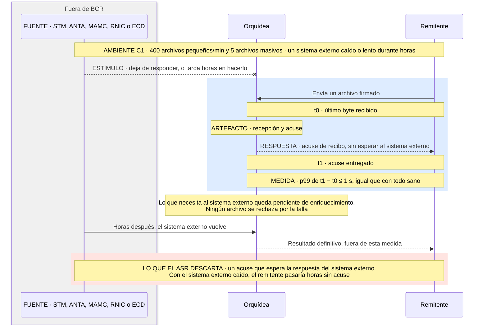

### ASR-S06 — Ningún archivo se acepta sin validación criptográfica completa {#asr-s06}

| Parte | Descripción |
|---|---|
| **Fuente** | Un remitente cuyo archivo trae una firma, una estampa o un certificado inválido, o que no se pudo verificar |
| **Estímulo** | El archivo llega y su verificación criptográfica falla o queda incompleta, por ejemplo porque la ECD está caída y la información de revocación venció |
| **Artefacto** | El paso de un archivo con acuse a resultado definitivo |
| **Ambiente** | A: 400 archivos pequeños por minuto y 5 archivos masivos · C1: la ECD caída, con la carga de A |
| **Respuesta** | El archivo puede acusarse, pero no recibe aceptación total ni parcial hasta que su verificación termine bien; si falla, se rechaza |
| **Medida** | 0 archivos con aceptación total o parcial sin firma, estampa y revocación verificadas, contados en el registro de resultados, en A y en C1 |
| **Por qué es ASR** | El enunciado pide verificar el 100 % de los archivos, y BCR aprobó dos casos en que el acuse sale antes de verificar: el masivo con acuse de custodia y la ECD caída con la información de revocación vencida. Hay que decidir dónde espera un archivo hasta que su verificación cierre, y cómo se garantiza que lo verificado sea lo mismo que se procesa. S01 mide cuánto tarda el control; esta medida, lo que el control protege |
| **Cómo se verifica** | Enviar archivos con firma alterada, estampa inválida, certificado revocado y firma envuelta, y otros con la ECD caída y sin información de revocación vigente; se cuentan los que llegan a aceptación |
| **Prioridad · Impacto · Origen** | Crítica · Alto · `enunciado` (Seguridad: «el 100 % de los archivos deben contar con validación criptográfica») |

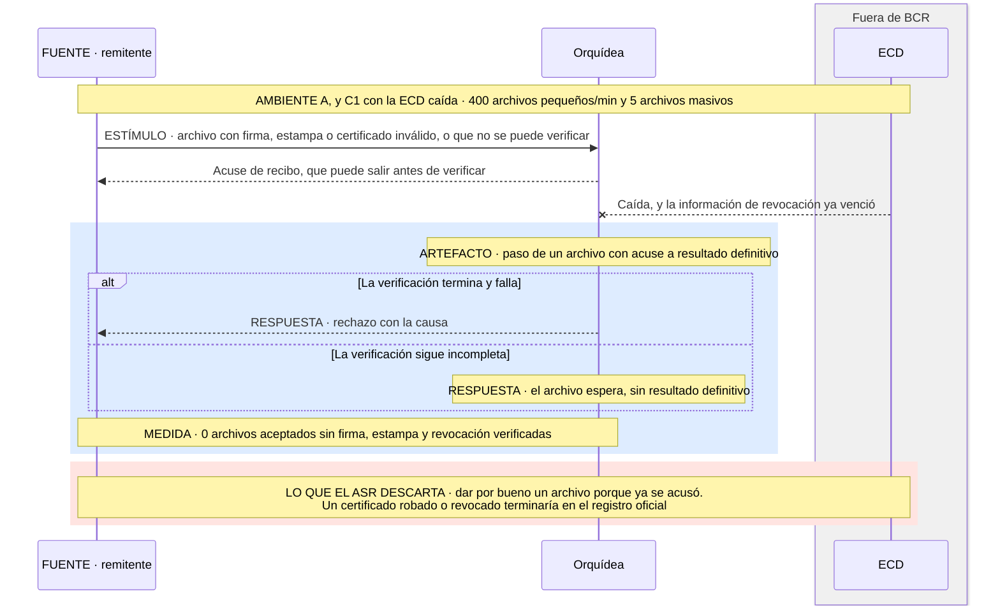

### ASR-M01 — Despliegue de una regla cambiaria nueva en ≤ 4 h-persona {#asr-m01}

| Parte | Descripción |
|---|---|
| **Fuente** | La Junta Directiva de BCR, que modifica la Circular Reglamentaria Externa |
| **Estímulo** | Una regla cambiaria nueva o modificada (un tope, la consistencia de tasas, los declarantes o una vigencia) que usa datos que la declaración ya trae o que un sistema externo integrado ya entrega, con la fecha desde la que rige. Cambia con frecuencia `[PREGUNTA → BCR]` ¿cuántas veces al año? · Tipo: adaptativo |
| **Artefacto** | La aplicación de las reglas cambiarias a las declaraciones |
| **Ambiente** | Ligado en despliegue: la regla entra a producción sin recompilar ni detener el resto del flujo |
| **Respuesta** | La regla se implementa, se prueba y se pone en producción, y rige para los archivos recibidos desde su fecha |
| **Medida** | ≤ 4 h-persona desde la especificación aprobada de la regla hasta su puesta en producción |
| **De dónde sale el número** | Origen: el enunciado («debe tomar máximo 4 horas de esfuerzo de desarrollo»). BCR precisó que son 4 h-persona con desarrollo y pruebas, sin la aprobación regulatoria. Base de estimación: el recorrido del cambio por recepción, validación, reglas, transformación y resultado, sumado por función |
| **Quién lo hace** | El equipo de TI de BCR, que conoce Orquídea `[SUPUESTO → BCR]` ¿lo hace el equipo propio o un tercero? |
| **Por qué es ASR** | Decide dónde vive la regla, si se expresa como dato o como código, y cómo se fija la que aplica a cada archivo. Si la Circular cambiara una vez por década, encapsular las reglas sería esfuerzo perdido. Una regla que pide un dato nuevo de un sistema externo es otro cambio, más grande: suma la integración de I01. Nota de trampa: las 4 h se cumplen regando un cambio barato por varias funciones; va como pregunta al panel |
| **Cómo se verifica** | Juicio de expertos, con el protocolo de abajo: es el ASR de modificabilidad que se valida. Complemento: activar una regla nueva con tráfico de A y contar las h-persona invertidas y las funciones tocadas |
| **Prioridad · Impacto · Origen** | Crítica · Alto · `enunciado` (Modificabilidad e Interoperabilidad) |

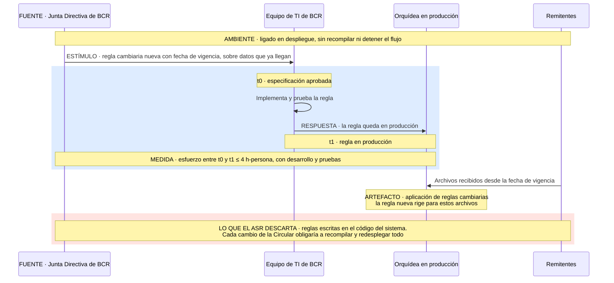

### ASR-S01 — Validación criptográfica en ≤ 200 ms {#asr-s01}

| Parte | Descripción |
|---|---|
| **Fuente** | Un remitente, legítimo o con un certificado vencido o revocado |
| **Estímulo** | Envía un archivo firmado y con estampa cronológica, de hasta 50 MB; arribo estocástico |
| **Artefacto** | La verificación de la firma digital, la estampa cronológica y la vigencia o revocación del certificado |
| **Ambiente** | A: 400 archivos pequeños por minuto y 5 archivos masivos, sin fallas |
| **Respuesta** | El sistema determina si la firma y la estampa son válidas y si el certificado está vigente y no revocado |
| **Medida** | p99 ≤ 200 ms del último byte recibido al resultado de la validación criptográfica, sobre el 100 % de los archivos, en A |
| **Por qué es ASR** | Pasan por aquí todos los archivos. Hay que decidir cómo se conoce la revocación sin consultar a la ECD por cada archivo, y cómo se verifica uno de 50 MB sin cargarlo entero. Con 2 s cabría la consulta en línea; con 200 ms, no. Con la ECD caída y sin información de revocación vigente, BCR aceptó acusar con «verificación pendiente», y ahí la medida no aplica. Lo que el control protege lo mide [S06](#asr-s06) |
| **Cómo se verifica** | Benchmark de la verificación con archivos firmados reales de 1 registro a 50 MB, con certificados vigentes, vencidos y revocados; p99 por tamaño |
| **Prioridad · Impacto · Origen** | Alta · Alto · `enunciado` (Seguridad: «el 100 % de los archivos… en menos de 200 milisegundos») |

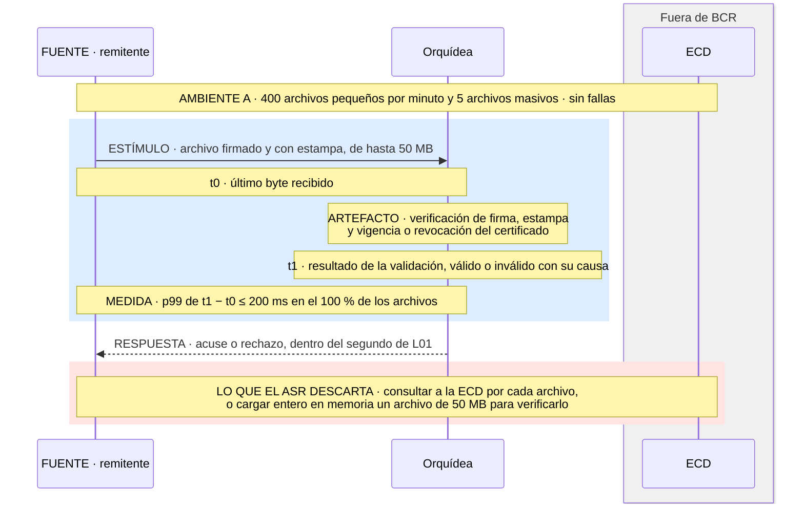

### ASR-E01 — Carga pico de archivos pequeños con p99 ≤ 5 s {#asr-e01}

| Parte | Descripción |
|---|---|
| **Fuente** | Los remitentes, en los cierres de mercado diario y los vencimientos regulatorios |
| **Estímulo** | 1 200 archivos pequeños por minuto durante 45 minutos, en ráfaga `[SUPUESTO → BCR]`, con 5 archivos masivos en paralelo |
| **Artefacto** | El procesamiento completo de los archivos pequeños |
| **Ambiente** | B: 1 200 archivos pequeños por minuto durante 45 min y 5 archivos masivos concurrentes, sin fallas |
| **Respuesta** | Todos los archivos pequeños se procesan |
| **Medida** | p99 ≤ 5 s del último byte recibido al resultado definitivo disponible para el remitente, durante toda la ventana de 45 min, en B |
| **Por qué es ASR** | La capacidad para los archivos pequeños tiene que triplicarse durante 45 minutos sin quedar fija el resto del día. Con 5 min, una cola absorbería el pico sin cambiar nada; con 5 s, no. La pérdida cero que pide el enunciado la mide D03, y los 3 s en A se verifican en la misma prueba. El enunciado dice «5 segundos de respuesta», y aquí se lee como procesamiento completo, igual que los 3 s de A `[PREGUNTA → BCR]` |
| **Cómo se verifica** | Prueba de carga sostenida de 45 min a 1 200 archivos pequeños por minuto con 5 archivos masivos; p99 por ventanas de un minuto |
| **Prioridad · Impacto · Origen** | Alta · Alto · `enunciado` (Escalabilidad) |

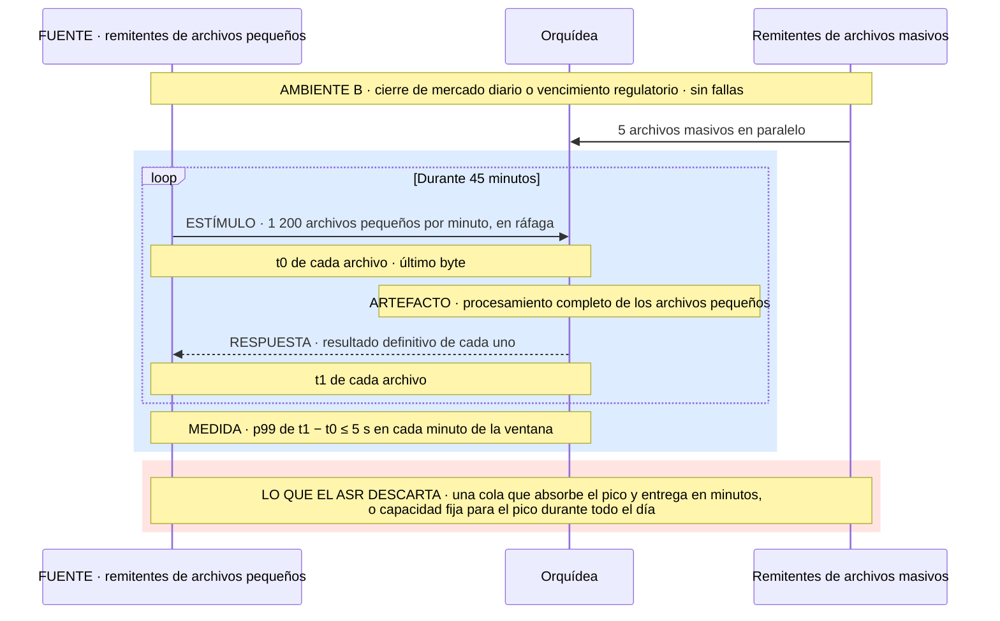

### ASR-I01 — Nueva versión del contrato de API de un sistema externo en ≤ 4 h-persona {#asr-i01}

| Parte | Descripción |
|---|---|
| **Fuente** | El área de TI de BCR, que pide integrar la versión nueva del contrato de API de un sistema externo |
| **Estímulo** | STM, ANTA, MAMC o RNIC publica una versión nueva de su contrato de API: campos, formatos o significados distintos para la misma información |
| **Artefacto** | El enriquecimiento y la validación de las declaraciones con la información de ese sistema externo |
| **Ambiente** | Desarrollo · socio conocido de antemano · tercero fuera de control |
| **Respuesta** | La versión nueva queda integrada: los datos del sistema externo se interpretan con el significado que él les da o se rechazan con diagnóstico, y ninguno se registra con otro significado |
| **Medida** | ≤ 4 h-persona desde que el equipo recibe el nuevo contrato de API hasta su puesta en producción |
| **De dónde sale el número** | Origen: el enunciado («la adaptación y reemplazo de conectores… máximo 4 horas de esfuerzo de desarrollo»); BCR precisó que son h-persona. Base de estimación: el inventario de los campos del contrato de API por su distancia. Distancia que cierra: sintáctica y semántica en datos |
| **Quién lo hace** | El equipo de TI de BCR, que conoce Orquídea y no el nuevo contrato de API `[SUPUESTO → BCR]` |
| **Por qué es ASR** | Cuatro terceros cambian su contrato de API por su cuenta. Hay que decidir dónde se traduce y se valida su significado sin que el cambio llegue al resto del flujo: una tasa bien formada puede venir en otra base o con otra fecha de vigencia. Nota de trampa: las 4 h se cumplen integrando rápido y mal; la respuesta exige que nada se registre con otro significado, y va como pregunta al panel |
| **Cómo se verifica** | Juicio de expertos, con el protocolo de abajo: es el ASR de interoperabilidad que se valida. Complemento: cambiar el contrato de API de ANTA en un simulador con tráfico, medir las h-persona y correr una prueba de punta a punta con un lote de respuestas del sistema externo |
| **Prioridad · Impacto · Origen** | Alta · Alto · `enunciado` (Modificabilidad e Interoperabilidad) |

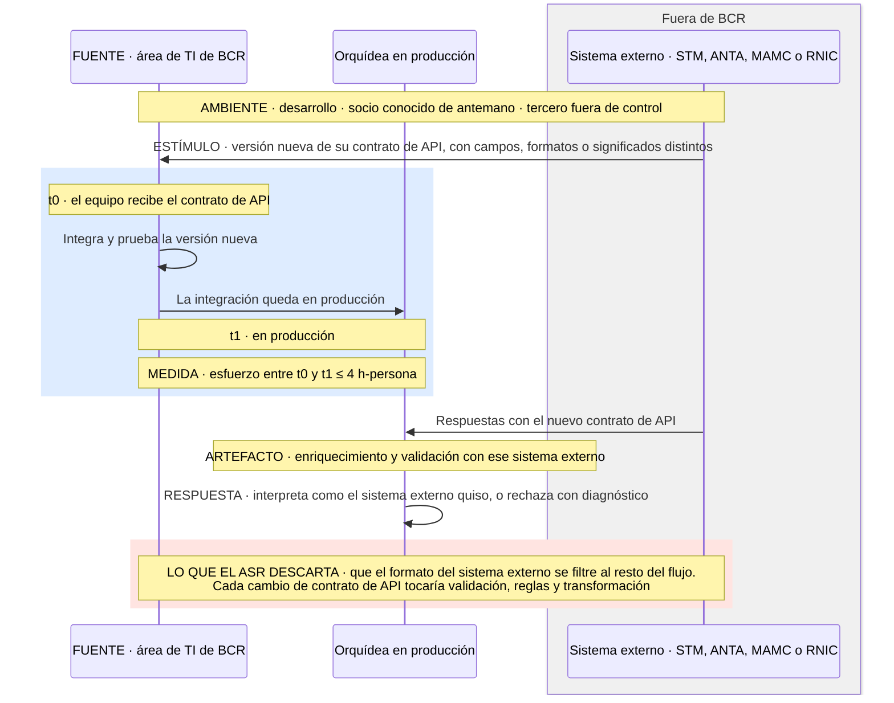

### ASR-D03 — Cero pérdidas y cero duplicados de declaraciones con acuse emitido {#asr-d03}

| Parte | Descripción |
|---|---|
| **Fuente** | Un nodo interno de procesamiento que falla |
| **Estímulo** | Deja de funcionar con archivos con acuse emitido en curso, en un momento impredecible |
| **Artefacto** | Las declaraciones de los archivos con acuse emitido |
| **Ambiente** | C2 sobre la carga de B: la falla ocurre durante el pico de 45 min |
| **Respuesta** | Cada declaración con acuse emitido termina con exactamente un resultado definitivo |
| **Medida** | 0 declaraciones con acuse emitido sin resultado definitivo o con más de uno, contadas por conciliación entre las declaraciones con acuse y las resueltas, en C2 sobre B |
| **Por qué es ASR** | Un acuse es una promesa. Hay que decidir en qué momento un archivo queda a salvo antes de acusarlo, y cómo se evita aplicar dos veces lo que se reprocesa tras una falla. Se mide en el pico porque ahí el enunciado exige no perder mensajes, y ahí una falla deja más trabajo en curso |
| **Cómo se verifica** | Matar nodos de procesamiento durante la prueba de 45 min de E01 y conciliar al final las declaraciones con acuse contra las resueltas |
| **Prioridad · Impacto · Origen** | Alta · Alto · `enunciado` (Escalabilidad: «sin pérdida de mensajes») |

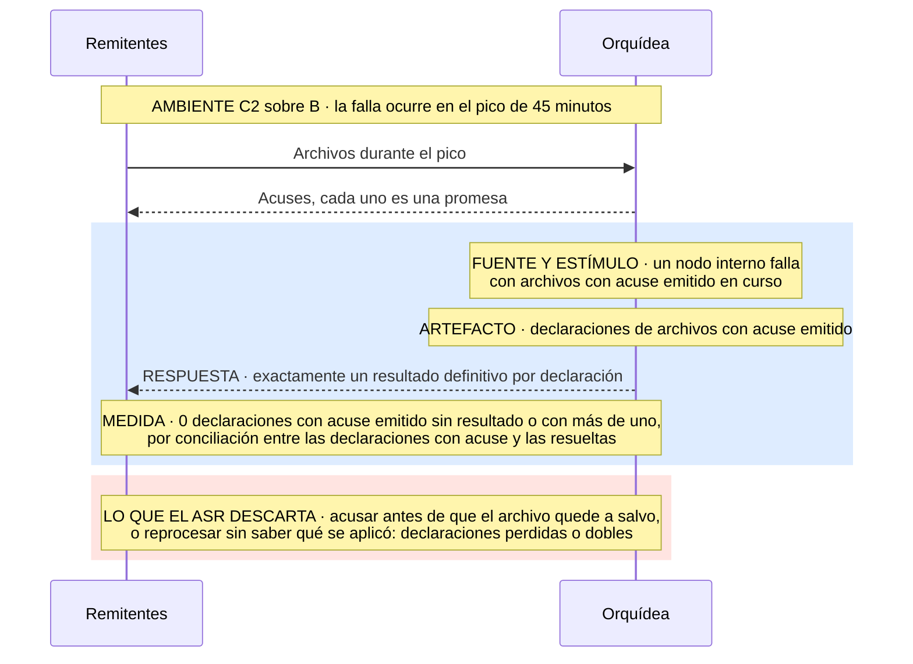

### ASR-L01 — Acuse de recibo en ≤ 1 s {#asr-l01}

| Parte | Descripción |
|---|---|
| **Fuente** | Un remitente |
| **Estímulo** | Termina de enviar un archivo de cualquier tamaño, hasta 50 MB; arribo estocástico |
| **Artefacto** | La recepción y el acuse de recibo |
| **Ambiente** | A: 400 archivos pequeños por minuto y 5 archivos masivos, sin fallas |
| **Respuesta** | El sistema registra el evento y entrega al remitente un acuse que confirma el inicio del procesamiento |
| **Medida** | p99 ≤ 1 s del último byte recibido a que el remitente tiene el acuse, en A. El percentil es `[SUPUESTO → BCR]`: el enunciado dice «menos de 1 segundo» |
| **Por qué es ASR** | En un segundo no cabe validar 100 000 registros, así que el acuse tiene que separarse del procesamiento; la verificación de S01 ya consume hasta 200 ms de ese segundo. Con un minuto, el acuse podría esperar a la validación. BCR fijó que el tiempo cuenta desde el último byte, y que un archivo masivo cuya verificación no quepa en el segundo recibe un acuse de custodia |
| **Cómo se verifica** | Prueba de carga en A con la mezcla de tamaños; p99 del acuse por tamaño |
| **Prioridad · Impacto · Origen** | Alta · Alto · `enunciado` (Latencia) · BCR (el tiempo cuenta desde el último byte) |

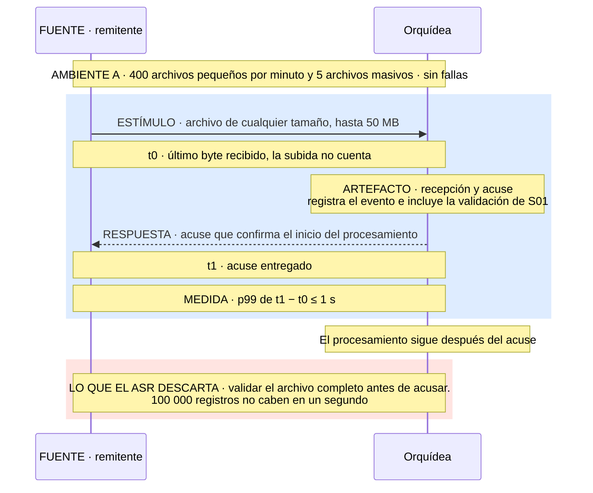

### ASR-S03 — Aislamiento de datos entre remitentes {#asr-s03}

| Parte | Descripción |
|---|---|
| **Fuente** | Un remitente autenticado que, con o sin malicia, intenta llegar a operaciones que reportó otro remitente |
| **Estímulo** | Pide consultar resultados, declaraciones o archivos de otro remitente, o envía correcciones o anulaciones sobre declaraciones que otro reportó |
| **Artefacto** | La consulta de resultados y declaraciones, y la corrección y anulación de declaraciones |
| **Ambiente** | A: 400 archivos pequeños por minuto y 5 archivos masivos, sin fallas |
| **Respuesta** | Solo obtiene o modifica lo que reportó él; lo demás se niega y queda en la auditoría |
| **Medida** | 0 accesos efectivos a operaciones reportadas por otro remitente, sobre el catálogo de pruebas de acceso cruzado, en A |
| **Por qué es ASR** | Un IMC reporta operaciones de sus clientes, así que el límite no es el declarante de cada registro sino quién reportó la operación. La identidad del remitente tiene que salir de la autenticación y del certificado, no de un campo del archivo, y el filtro tiene que estar en todas las vías de consulta y corrección. La medida cuenta el acceso que sí ocurrió, no el intento bloqueado |
| **Cómo se verifica** | Pruebas de acceso cruzado entre remitentes de prueba por todas las vías de consulta, corrección y anulación; se cuentan los accesos efectivos |
| **Prioridad · Impacto · Origen** | Alta · Medio · `enunciado` (Seguridad: «aislamiento estricto de datos entre declarantes»; reto: «impedir que un IMC o titular consulte o altere operaciones de terceros») |

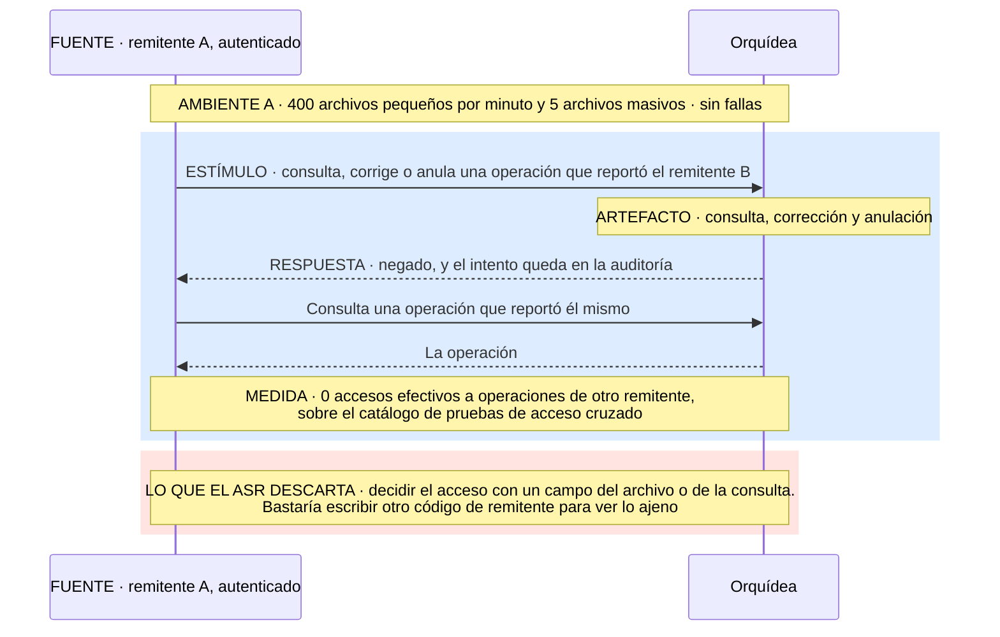

### ASR-D04 — Despliegue sin indisponibilidad (zero downtime) {#asr-d04}

| Parte | Descripción |
|---|---|
| **Fuente** | El equipo de TI de BCR, que activa en producción una regla, una versión del XSD o el nuevo contrato de API de un sistema externo |
| **Estímulo** | La activación, o su reversión, ocurre con archivos llegando y en proceso |
| **Artefacto** | La recepción y el acuse de archivos |
| **Ambiente** | E: cambio en producción con la carga de A |
| **Respuesta** | El sistema sigue recibiendo, acusando y procesando durante el cambio y después de él, y ningún archivo se rechaza por el cambio |
| **Medida** | p99 ≤ 1 s del último byte recibido al acuse mientras dura la activación o su reversión, en E: el mismo umbral de A ([L01](#asr-l01)) |
| **Por qué es ASR** | La versión anterior y la nueva tienen que convivir mientras hay archivos en curso. Con una ventana de mantenimiento bastaría detener y redesplegar, pero el 99,99 % deja 4,4 minutos al mes. Medir el acuse evita discutir qué rechazo fue culpa del cambio. Nota de trampa: la medida se cumple aunque un archivo termine evaluado con dos versiones, como en el caso de Knight Capital; BCR fijó que aplica la regla vigente a la hora de ingesta, y eso se comprueba en la misma prueba |
| **Cómo se verifica** | Activar una regla, una versión del XSD y un nuevo contrato de API con tráfico de A, y luego revertirlos; se compara el p99 del acuse con el de A y se cuentan los archivos evaluados con dos versiones |
| **Prioridad · Impacto · Origen** | Alta · Medio · `enunciado` («no debe generar tiempo de inactividad»): es la parte de M01, M02 e I01 que se mide en ejecución |

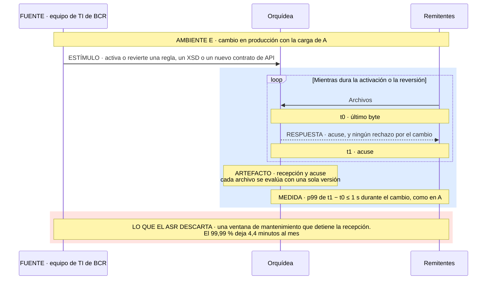

### ASR-L03 — Procesamiento completo de un archivo masivo en ≤ 5 min {#asr-l03}

| Parte | Descripción |
|---|---|
| **Fuente** | Un remitente |
| **Estímulo** | Envía un archivo masivo de hasta 100 000 registros y 50 MB mientras otros 4 archivos masivos están en proceso |
| **Artefacto** | El procesamiento completo del archivo masivo |
| **Ambiente** | A: 400 archivos pequeños por minuto y 5 archivos masivos concurrentes, sin fallas |
| **Respuesta** | Todas sus declaraciones quedan aceptadas o rechazadas, y el resultado definitivo del archivo queda disponible |
| **Medida** | ≤ 5 min para cada uno de los 5 archivos masivos concurrentes, del último byte al resultado definitivo disponible, en A. Es un máximo y no un percentil: con cinco archivos a la vez, la muestra es pequeña |
| **Por qué es ASR** | 100 000 registros en 300 s son unos 333 por segundo por archivo, antes de contar las consultas a sistemas externos: un archivo tiene que procesarse en partes paralelas. Un plazo de 50 minutos admitiría un recorrido secuencial |
| **Cómo se verifica** | Prueba con 5 archivos masivos de 100 000 registros firmados en paralelo, sobre la carga de A |
| **Prioridad · Impacto · Origen** | Media · Alto · `enunciado` (Latencia) |

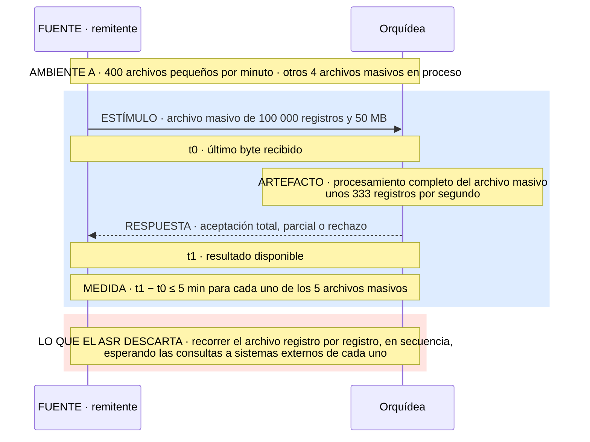

### ASR-D02 — Recuperación ante la falla de un nodo interno en ≤ 10 s {#asr-d02}

| Parte | Descripción |
|---|---|
| **Fuente** | Un nodo interno de procesamiento que falla |
| **Estímulo** | Deja de funcionar con declaraciones en curso, en un momento impredecible |
| **Artefacto** | El procesamiento de las declaraciones que ese nodo tenía en curso |
| **Ambiente** | C2: falla interna con la carga de A |
| **Respuesta** | Esas declaraciones vuelven a avanzar sin intervención manual |
| **Medida** | ≤ 10 s desde la falla hasta que la última declaración afectada vuelve a avanzar, en C2 |
| **Por qué es ASR** | El estado de lo que está en curso tiene que vivir donde otro nodo pueda retomarlo. A 10 minutos, alguien alcanzaría a reiniciar a mano. Que al retomar no se pierda ni se duplique nada lo mide D03 |
| **Cómo se verifica** | Matar un elemento de procesamiento a mitad de una carga A, marcar las declaraciones que tenía y medir cuándo avanza la última |
| **Prioridad · Impacto · Origen** | Media · Medio · `enunciado` (Disponibilidad: «recuperarse de fallos de nodos internos en menos de 10 segundos») |

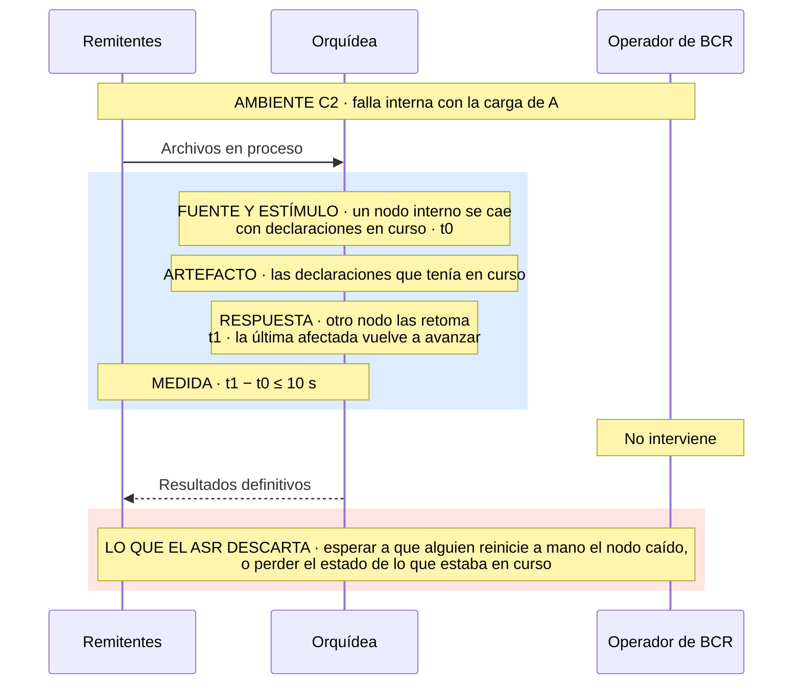

### ASR-L05 — Procesamiento completo de un archivo mediano con p99 ≤ 30 s {#asr-l05}

| Parte | Descripción |
|---|---|
| **Fuente** | Un remitente |
| **Estímulo** | Envía un archivo mediano (51 a 5 000 registros) mientras 5 archivos masivos están en proceso. Tasa: `[PREGUNTA → BCR]` |
| **Artefacto** | El procesamiento completo del archivo mediano |
| **Ambiente** | A: 400 archivos pequeños por minuto y 5 archivos masivos, sin fallas |
| **Respuesta** | El resultado definitivo del archivo queda disponible |
| **Medida** | p99 ≤ 30 s del último byte al resultado definitivo disponible, en A. El percentil es `[SUPUESTO → BCR]` |
| **Por qué es ASR** | Hay que decidir con qué carga va un archivo mediano. Si espera con los archivos masivos, cinco de 5 minutos lo dejan fuera de los 30 s; si va con los archivos pequeños, puede degradarlos. Si el plazo fuera de 5 minutos, iría con los archivos masivos sin pensarlo. El informe de consultoría no lo formuló, y el enunciado lo pide |
| **Cómo se verifica** | Prueba con medianos de 5 000 registros mientras corren 5 archivos masivos sobre la carga de A |
| **Prioridad · Impacto · Origen** | Media · Medio · `enunciado` (Latencia: «para archivos medianos… máximo 30 segundos») |

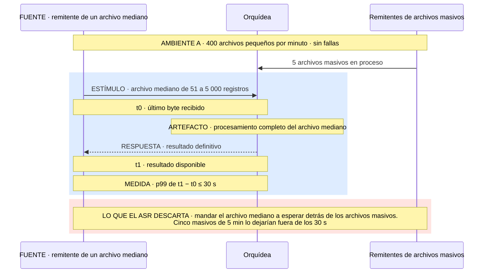

### ASR-M02 — Despliegue de una versión nueva del XSD en ≤ 4 h-persona {#asr-m02}

| Parte | Descripción |
|---|---|
| **Fuente** | La Junta Directiva de BCR, al cambiar en la Circular la estructura de las declaraciones |
| **Estímulo** | Una versión nueva del esquema XML (XSD) de las declaraciones que agrega, quita o renombra campos sin cambiar el modelo canónico `[SUPUESTO → BCR]` · Tipo: adaptativo |
| **Artefacto** | La validación de la estructura de los archivos |
| **Ambiente** | Ligado en despliegue |
| **Respuesta** | La versión nueva se implementa, se prueba y se pone en producción; los archivos de la versión anterior siguen validándose mientras convivan `[SUPUESTO → BCR]` ¿los remitentes migran a ritmos distintos? |
| **Medida** | ≤ 4 h-persona desde el XSD aprobado hasta su puesta en producción |
| **De dónde sale el número** | Origen: el enunciado («cambios en esquemas XML/XSD… máximo 4 horas de esfuerzo de desarrollo»); BCR precisó que son h-persona con desarrollo y pruebas. Base de estimación: el recorrido del cambio por la validación, la transformación al modelo canónico y la consulta |
| **Quién lo hace** | El equipo de TI de BCR, que conoce Orquídea `[SUPUESTO → BCR]` |
| **Por qué es ASR** | Cada archivo tiene que identificar su versión, y hay que separar qué parte de la transformación al modelo canónico depende del esquema. Un cambio que toca el modelo canónico arrastra la transformación y la entrega a las áreas, y no cabe en 4 h. Nota de trampa: las 4 h se cumplen aunque el cambio se riegue por la validación, la transformación y la consulta |
| **Cómo se verifica** | No va al panel de expertos del equipo, que valida M01 e I01 (protocolo al final de las fichas). BCR lo revisa con su inspección de código en la Fase 4. BCR lo evalúa en la Fase 4 por inspección estática y listas de chequeo |
| **Prioridad · Impacto · Origen** | Media · Medio · `enunciado` · BCR lo clasificó como secundario |

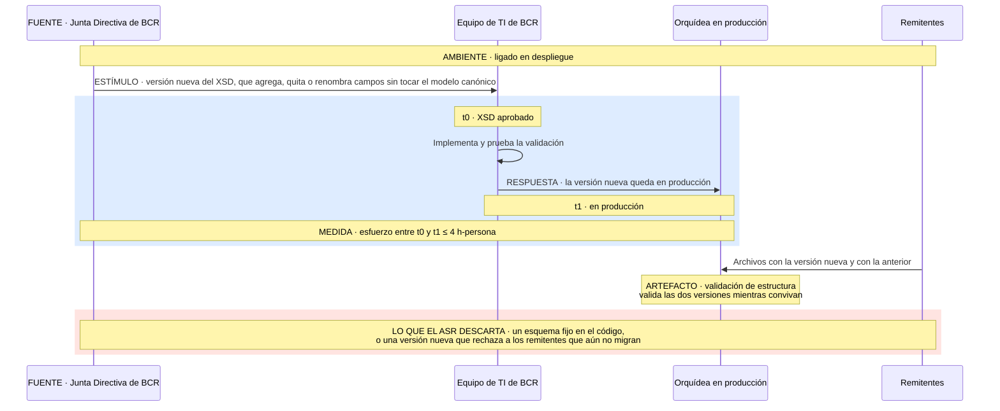

### ASR-S04 — Detección de alteraciones en la auditoría inmutable {#asr-s04}

| Parte | Descripción |
|---|---|
| **Fuente** | Alguien con acceso al almacenamiento, interno, por abuso o por mal uso |
| **Estímulo** | Modifica, borra o reordena registros de auditoría ya escritos |
| **Artefacto** | La auditoría de la recepción, los acuses y los resultados |
| **Ambiente** | A: 400 archivos pequeños por minuto y 5 archivos masivos, sin fallas |
| **Respuesta** | La verificación de integridad señala la alteración y el registro donde ocurrió |
| **Medida** | 100 % de las alteraciones del catálogo de pruebas detectadas en la verificación de integridad siguiente, en A |
| **Por qué es ASR** | La evidencia tiene que encadenarse para que una alteración se note sin depender de quien administra el almacenamiento, y escribirse en orden aunque los archivos se procesen en paralelo, como pregunta BCR. El 100 % se justifica: una verificación criptográfica no tiene el conflicto entre completitud y exactitud de un detector por tiempo, y un 95 % dejaría alteraciones sin detectar por diseño. Nota de trampa: la medida se cumple con una verificación al año; cada cuánto se verifica es `[PREGUNTA → BCR]` |
| **Cómo se verifica** | Alterar, borrar y reordenar registros de prueba y correr la verificación. BCR lo evalúa en la Fase 4 por inspección |
| **Prioridad · Impacto · Origen** | Media · Medio · `enunciado` («asegurar una auditoría inmutable») · BCR lo clasificó como secundario |

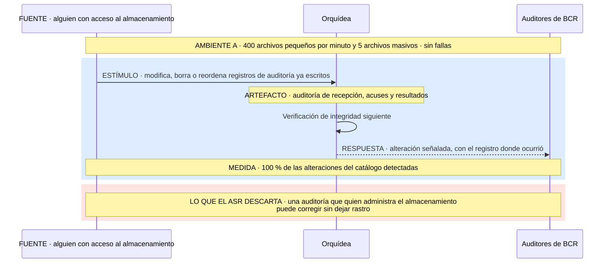

### ASR-I02 — Integración de un nuevo consumidor interno sin modificar el flujo principal {#asr-i02}

| Parte | Descripción |
|---|---|
| **Fuente** | Un área de BCR (estadística, analítica o búsqueda) que pide recibir los datos transformados |
| **Estímulo** | Integrar un consumidor nuevo en un formato que hoy no se entrega: una base analítica, un índice de búsqueda o un archivo plano · Tipo: aditivo |
| **Artefacto** | La entrega de datos transformados a las áreas de BCR |
| **Ambiente** | Desarrollo · socio conocido de antemano · propio |
| **Respuesta** | El área recibe los datos del modelo canónico en su formato, con el mismo significado que en el registro |
| **Medida** | 0 funciones del flujo principal (recepción, validación, enriquecimiento, transformación y persistencia) modificadas para integrarla |
| **De dónde sale el número** | Origen: el informe de consultoría (tabla 10), aceptado por BCR como secundario. El enunciado no trae la cifra. Base de estimación: el recorrido de la integración por la descomposición funcional. Distancia que cierra: sintáctica, el formato de cada área |
| **Quién lo hace** | El equipo de TI de BCR `[SUPUESTO → BCR]` |
| **Por qué es ASR** | Pone a prueba si la entrega a las áreas depende del flujo de procesamiento o se alimenta de los hechos ya registrados. Nota de trampa: cero funciones del flujo principal se cumple metiendo toda la lógica en la entrega |
| **Cómo se verifica** | No va al panel de expertos del equipo, que valida M01 e I01 (protocolo al final de las fichas). BCR lo revisa con su inspección de código en la Fase 4. BCR lo evalúa en la Fase 4 por inspección |
| **Prioridad · Impacto · Origen** | Baja · Bajo · informe · BCR lo clasificó como secundario |

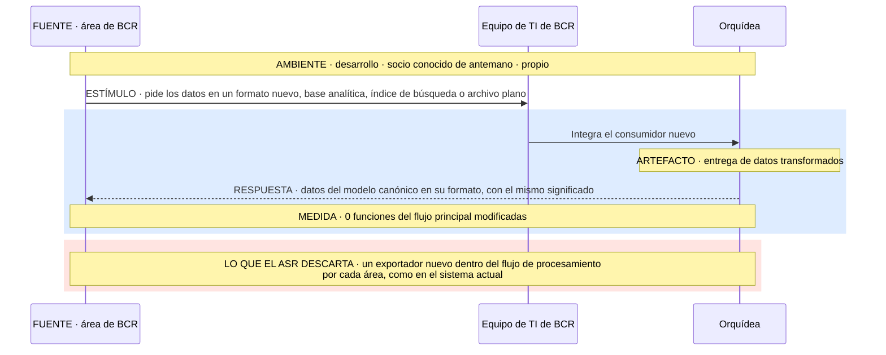

### Protocolo de verificación de modificabilidad e interoperabilidad

Se validan [M01](#asr-m01) e [I01](#asr-i01), uno de cada atributo. M02 e I02 no van en esta encuesta.

| Parte | Descripción |
|---|---|
| **Panel** | Al menos dos humanos de fuera del curso, con experiencia en arquitectura de sistemas críticos o de integración. Un evaluador no humano, si se suma, va en una columna aparte y no cuenta para la mayoría |
| **Presentación** | Los ASR, la arquitectura y las decisiones principales, contadas en neutro y sin mostrar los umbrales. No se elogian las tácticas. Después, una sesión de preguntas |
| **Escala** | 1 muy improbable · 2 improbable · 3 ni una ni otra · 4 probable · 5 muy probable |
| **Escenarios** | M01: «una regla cambiaria nueva llega a producción con ≤ 2, 4, 6 y 12 h-persona»; el real queda segundo en la escalera. I01: «el nuevo contrato de API de ANTA se integra con ≤ 1, 2,5, 4 y 8 h-persona»; el real queda tercero. En el formulario van en orden aleatorio y no se dice cuál es el real. Control negativo, uno para el panel: «cambiar el canal de envío de los remitentes a transferencia de archivos con ≤ 4 h-persona». Preguntas abiertas: «¿la regla podría cumplir las 4 h regando el cambio por varias funciones?» y «¿el contrato de API podría integrarse en 4 h interpretando mal sus datos?» |
| **Tabulación** | Una tabla por ASR validado, con una columna por experto (A, B, C), la mediana de los humanos y el rango |
| **Regla de decisión** | Se escribe antes de encuestar. **Sostenido**: mediana ≥ 4 en el escenario real y ningún humano ≤ 2. **Refutado**: mediana ≤ 2. **No concluyente**: cualquier otro caso. El control negativo debe salir ≤ 2; si sale alto, las respuestas tienen sesgo de aquiescencia |

## 5. Descartes

| Candidato | Origen | Salió por | Razón en una frase | Va a |
|---|---|---|---|---|
| «Con un sistema externo caído, 0 archivos rechazados» como medida | informe | Se cumple sin lograr el objetivo | Se cumple dejando las declaraciones pendientes para siempre, y no mide la lentitud del sistema externo | Respuesta de [D01](#asr-d01) |
| Cualquier regla cambiaria en 4 h-persona | informe | Cambio sin acotar | Una regla que pide un dato nuevo de un sistema externo no cabe en 4 h; se acota a reglas sobre datos que ya llegan | [M01](#asr-m01) |
| Reemplazar un sistema externo por otro proveedor en 4 h-persona | informe | Cambio sin acotar | El enunciado pide adaptar o reemplazar el conector, no cambiar de proveedor | [I01](#asr-i01) |
| Pérdida cero en el pico sin fallas | `enunciado` | Lo cubre otro ASR | Sin fallas, solo se pierde si se descarta carga; D03 lo mide en el peor caso, una falla durante el pico | [D03](#asr-d03) |
| Pequeños en ≤ 3 s en A | `enunciado` | Lo cubre otro ASR | Fuerza la misma decisión que E01, 5 s con el triple de carga, y se mide en la misma prueba | Se verifica junto con [E01](#asr-e01) |
| Disponibilidad del 99,99 % | `enunciado` | No diseñable | Es la meta de negocio; la persiguen D01, D02, D03 y D04 | Motivador |
| Cifrado en tránsito y en reposo | `enunciado` | Es infraestructura o configuración | Se cumple con configuración y práctica estándar, y no descarta ninguna familia de solución | Restricción |
| Protección contra ataques XML | `enunciado` | Práctica estándar | Endurecer el parser es práctica estándar; la parte estructural, que lo verificado sea lo procesado, va en S06 | Restricción · [S06](#asr-s06) |
| Firmante distinto del remitente | informe | Funcional | Comparar dos identidades es una regla de la verificación de S01 | Funcional |
| 0 s de indisponibilidad dentro de las medidas de M01, M02 e I01 | informe | Otro atributo | Es una medida de ejecución dentro de un ASR de modificabilidad | [D04](#asr-d04) |
| «Sin pérdida» dentro de E01 y «sin pérdida ni duplicados» dentro de D02 | `enunciado` · informe | Dos medidas | Cada ASR lleva una sola medida | [D03](#asr-d03) |
| «Vuelve a producir resultados» como medida de D02 | informe | Se cumple sin lograr el objetivo | Se cumple con los elementos sanos aunque lo afectado siga detenido | Medida de [D02](#asr-d02) |
| Ambiente «bajo ataque» | informe | — | El ataque es el estímulo del escenario, no el ambiente | — |
| Topología activo-activo en varias zonas | BCR (ADR-17) | Es infraestructura o configuración | Es infraestructura | Infraestructura |
| Recuperación ante desastre entre regiones | informe | Fuera de alcance | El enunciado pide recuperarse de fallas de nodo, no de región | — |
| Detectar el archivo atascado o con resultado descuadrado | análisis del equipo | Sin umbral | El enunciado no da tiempo de detección | Sección 6 |
| Drenar 12 h de pendientes sin degradar lo nuevo | análisis del equipo | Pendiente | Es la medida de L04 en otro ambiente; entra si BCR fija cómo se drena | Sección 6 |
| Archivo aceptado con un certificado revocado dentro de la ventana de la caché | análisis del equipo | Sin umbral | Su detección depende de cada cuánto publica la ECD su lista de revocación | Sección 6 |
| Más de 5 archivos masivos al mismo tiempo | análisis del equipo | Pendiente | El enunciado y BCR fijan 5, y nadie dice qué pasa con el sexto | Sección 6 |
| Un remitente que satura a los demás con archivos pequeños | análisis del equipo | No cambia la estructura | Dentro de B la carga total está acotada a 1 200 por minuto | — |
| Frescura de los datos para las áreas («tiempo real») | análisis del equipo | Sin umbral | El enunciado no da cifra | Sección 6 |
| Correcciones o anulaciones que llegan antes que la declaración original | informe | Funcional | Es una regla de orden del negocio | Funcional |
| Exactitud de las reglas cambiarias | análisis del equipo | Funcional | Ningún diseño mueve la exactitud de una regla | Funcional |
| Retención de 10 años en almacenamiento no modificable | BCR (ADR-14) | Restricción | Es una norma | Restricción |
| Trazar cada archivo del acuse a la notificación | BCR | Asunto transversal | Es observabilidad, que el diseño resuelve aunque nadie la pida | Asunto transversal |
| Firma en streaming, hash encadenado en paralelo, purga del outbox | BCR | Diseño | Preguntan cómo se cumplen S01, S04 y E01, no qué se exige | ADR |

## 6. Abierto

**Preguntas**

- `[PREGUNTA → BCR]` ¿A partir de qué latencia un sistema externo cuenta como «extrema»? De eso depende cuándo dejan de aplicar los plazos de procesamiento, como aceptó BCR.
- `[PREGUNTA → BCR]` Cuando un sistema externo vuelve tras una caída larga, ¿en cuánto tiempo deben completarse las declaraciones que quedaron pendientes, y sin afectar el tráfico nuevo?
- `[PREGUNTA → BCR]` S06 no está entre los seis ASR que BCR priorizó, y aquí reemplaza a S01 entre los críticos. ¿BCR acepta el cambio? S01 conserva sus 200 ms.
- `[PREGUNTA → BCR]` Los «5 segundos de respuesta» del pico, ¿son de procesamiento completo, como los 3 s de A, o del acuse?
- `[PREGUNTA → BCR]` ¿Cada cuánto debe verificarse la integridad de la auditoría?
- `[PREGUNTA → BCR]` ¿Cuántos archivos medianos llegan por minuto, en A y en B?
- `[PREGUNTA → BCR]` ¿Cuántas veces al año cambia la Circular, y cuántas cambian su contrato de API los sistemas externos?
- `[PREGUNTA → BCR]` ¿Qué pasa si llegan más de 5 archivos masivos al mismo tiempo: esperan, se rechazan o se aceptan con otro plazo?
- `[PREGUNTA → BCR]` ¿Cada cuánto publica la ECD su lista de revocación, y en cuánto tiempo hay que detectar un archivo aceptado con un certificado ya revocado?
- `[PREGUNTA → BCR]` ¿Qué significa «tiempo real» para las estadísticas de las áreas?
- `[PREGUNTA → BCR]` ¿Qué datos ve cada área de BCR según su rol, y hay un límite de archivos por remitente?

**Supuestos**

- `[SUPUESTO → BCR]` El percentil de L01 y L05 es p99, el mismo que BCR usó en L04, E01 y S01.
- `[SUPUESTO → BCR]` En A el arribo es estocástico, y en B llega en ráfaga en los cierres.
- `[SUPUESTO → BCR]` Los cambios de reglas, XSD y contratos de API los hace el equipo propio de TI, que conoce Orquídea.
- `[SUPUESTO → BCR]` Las versiones del XSD conviven mientras los remitentes migran, y una versión nueva no cambia el modelo canónico.
- `[SUPUESTO → BCR]` Los contratos de API de los sistemas externos cambian menos que la Circular; por eso I01 va después de M01.

**Riesgos de alcanzabilidad**

- **S01 contra 50 MB.** Verificar la firma de un XML de 50 MB exige canonicalizar y resumir el documento completo, y 200 ms pueden no alcanzar. Es la primera pregunta de BCR.
- **S01 contra el ADR-04 aprobado.** El ADR-04 deja que un archivo masivo reciba un acuse de custodia y se verifique después. S01, en cambio, pide la validación criptográfica en 200 ms para el 100 % de los archivos: `[PREGUNTA → BCR]` ¿S01 aplica también a los archivos masivos?
- **N = 5 en A o en B.** BCR pone los 5 archivos masivos en el ambiente A en su tabla de ASR y en hora pico en el ADR-02. Los ASR los usan en los dos; si en A son menos, L04 y L03 se relajan.

**Fuera de alcance**

- La disponibilidad física: la redundancia de servidores, zonas y redes es infraestructura.
