# ASRs de latencia, escalabilidad, disponibilidad, seguridad, modificabilidad e interoperabilidad — Orquídea

{: .nota }
> Versión 1, del 4 de noviembre de 2026. Sale del enunciado del curso, del informe de consultoría v1.0 del Grupo 1 y de la respuesta de BCR del 3 de noviembre. El enunciado manda; la respuesta de BCR es vinculante donde fija cifras. Cada ASR lleva una sola medida y ninguno nombra componentes ni tecnologías: los ADR aprobados por BCR responden a estos requisitos, no al revés.

## 1. Los ASRs

Ordenados por importancia. El orden es una propuesta para revisar en equipo.

| # | ID | Atributo | Enunciado corto | Amb. | Prioridad | Impacto | Origen |
|---|---|---|---|---|---|---|---|
| 1 | ASR-L04 | Latencia | Con 5 masivos en proceso, el p99 de los pequeños sube ≤ 10 % | A | Alta | Alto | `enunciado` · BCR |
| 2 | ASR-D01 | Disponibilidad · enmascaramiento | Con un externo caído, 0 archivos rechazados por esa causa | C1 | Alta | Alto | `enunciado` |
| 3 | ASR-S01 | Seguridad · prevención | Veredicto de firma, estampa y certificado en p99 ≤ 200 ms | A | Alta | Alto | `enunciado` |
| 4 | ASR-M01 | Modificabilidad · adaptativo | Una regla cambiaria nueva llega a producción con ≤ 4 h-persona | Despliegue | Alta | Alto | `enunciado` · BCR |
| 5 | ASR-E01 | Escalabilidad | En pico, p99 de los pequeños ≤ 5 s durante los 45 min | B | Alta | Alto | `enunciado` |
| 6 | ASR-I01 | Interoperabilidad | El contrato nuevo de un externo se integra con ≤ 4 h-persona | Desarrollo | Alta | Alto | `enunciado` · BCR |
| 7 | ASR-D03 | Disponibilidad · prevención | 0 declaraciones acusadas perdidas o duplicadas | B, C2 | Alta | Alto | `enunciado` · `lente: estímulo repetido` |
| 8 | ASR-L01 | Latencia | Acuse en p99 ≤ 1 s desde el último byte | A | Alta | Alto | `enunciado` · BCR |
| 9 | ASR-S03 | Seguridad · prevención | 0 accesos efectivos a operaciones de otro declarante | A | Alta | Medio | `enunciado` |
| 10 | ASR-D04 | Disponibilidad · prevención | 0 archivos rechazados o sin acuse por un cambio en producción | E | Alta | Medio | `enunciado` · reclasificado |
| 11 | ASR-L03 | Latencia | Cada masivo termina en ≤ 5 min | A | Media | Alto | `enunciado` |
| 12 | ASR-D02 | Disponibilidad · reparación | Tras una falla interna, el procesamiento vuelve en ≤ 10 s | C2 | Media | Medio | `enunciado` |
| 13 | ASR-L05 | Latencia | Un mediano termina en p99 ≤ 30 s | A | Media | Medio | `enunciado` (omitido en el informe) |
| 14 | ASR-M02 | Modificabilidad · adaptativo | Una versión nueva del XSD llega a producción con ≤ 4 h-persona | Despliegue | Media | Medio | `enunciado` · BCR |
| 15 | ASR-S04 | Seguridad · detección | 100 % de las alteraciones de la auditoría detectadas | A | Media | Medio | `enunciado` · BCR |
| 16 | ASR-I02 | Integración | Un área nueva de BCR se integra con 0 funciones del flujo principal modificadas | Desarrollo | Baja | Bajo | informe · BCR |

**Por qué este orden.** La prioridad es exposición al riesgo: qué tan probable es no cumplir, por cuánto le duele a BCR si no se cumple. Los seis primeros son los que BCR declaró vinculantes, y los cuatro primeros coinciden con los cuatro escenarios que el informe detalló, uno por tensión principal.

- **L04 va primero** porque es el reto tal como lo escribe el enunciado: procesar livianos y masivos «sin generar encolamientos ni bloqueos mutuos».
- **D01** depende de cuatro sistemas que BCR no controla, y el informe ya calificó ese riesgo con probabilidad alta (RT-02).
- **S01** tiene el mayor riesgo de alcanzabilidad: verificar un archivo de 50 MB en 200 ms es lo que BCR cuestiona en su primera pregunta.
- **M01** ataca el motivador de negocio más caro: cada cambio de la Circular hoy es un redespliegue largo.
- **E01** baja al quinto lugar porque el pico son 20 archivos por segundo, y el propio informe concluye que esa tasa no es la presión real.
- **I01** comparte el problema de M01, y los contratos de los externos cambian con menos frecuencia que la Circular `[SUPUESTO → BCR]`.

Del 7 al 10 son requisitos explícitos del enunciado que BCR no listó, pero que tienen impacto alto o medio en la estructura. Del 11 al 16 completan el alcance; tres de ellos (M02, S04, I02) BCR ya los evalúa por inspección en la Fase 4.

### 1b. Réplica en Helix

Cada escenario cuelga de una historia de usuario, y `requirements.md` todavía no existe. La columna «Historia» se llena cuando exista.

| ID | Atributo en Helix | Prioridad en Helix | ¿Cabe la medida? | Historia |
|---|---|---|---|---|
| ASR-L04 | Performance · Latency | Critical | Es relativa: `[PREGUNTA → recorrido de Helix]` | — |
| ASR-D01 | Availability · Recovery | Critical | No es de tiempo: no tiene campo | — |
| ASR-S01 | Security · Resistance | Critical | Sí: 200 ms | — |
| ASR-M01 | Modifiability | Critical | `[PREGUNTA → recorrido de Helix]` | — |
| ASR-E01 | Performance · Scalability | Critical | Sí: 5 000 ms, TPS 20 | — |
| ASR-I01 | Interoperability | Critical | `[PREGUNTA → recorrido de Helix]` | — |
| ASR-D03 | Availability · Prevention | High | No es de tiempo | — |
| ASR-L01 | Performance · Latency | High | Sí: 1 000 ms | — |
| ASR-S03 | Security · Resistance | High | No es de tiempo | — |
| ASR-D04 | Availability · Prevention | High | No es de tiempo | — |
| ASR-L03 | Performance · Latency | Medium | **No**: 300 000 ms supera el techo de 60 000 ms | — |
| ASR-D02 | Availability · Recovery | Medium | Sí: 10 000 ms | — |
| ASR-L05 | Performance · Latency | Medium | Sí: 30 000 ms | — |
| ASR-M02 | Modifiability | Medium | `[PREGUNTA → recorrido de Helix]` | — |
| ASR-S04 | Security · Detection | Medium | No es de tiempo | — |
| ASR-I02 | Interoperability | Low | `[PREGUNTA → recorrido de Helix]` | — |

El TPS del ambiente A son 400 pequeños por minuto, unos 7 por segundo. El del ambiente B son 1 200 por minuto, 20 por segundo.

## 2. Ambientes

### Tiempo, disponibilidad y seguridad

| Variable | A — normal | B — pico | C1 — externo degradado | C2 — falla interna | E — cambio en producción |
|---|---|---|---|---|---|
| Pequeños (1 a 50 registros) | 400/min (enunciado, Escalabilidad) | 1 200/min durante 45 min (enunciado) | Como A | Como A; como B para D03 | Como A |
| Medianos (51 a 5 000) | `[PREGUNTA → BCR]` ¿cuántos por minuto? | `[PREGUNTA → BCR]` | Como A | Como A | Como A |
| Masivos (hasta 100 000, hasta 50 MB) | 5 concurrentes (BCR, tabla de ASR) | 5 simultáneos (BCR, ADR-02) | Como A | Como A | Como A |
| Patrón de arribo | Estocástico `[SUPUESTO → BCR]` | Ráfaga en los cierres de mercado diario y los vencimientos regulatorios `[SUPUESTO → BCR]` | — | — | — |
| Estado | Sin fallas; externos y ECD disponibles; sin pendientes | Sin fallas | STM, ANTA, MAMC, RNIC o la ECD caído o con latencia extrema, por horas (BCR, P12) | Un elemento interno de procesamiento deja de funcionar con archivos en curso | Se activa o se revierte una regla, un XSD o el contrato de un externo |
| Alcance | Dentro | Dentro | Dentro | Dentro: la falla de software. La redundancia física queda fuera | Dentro |

La caída de un externo puede durar horas: BCR plantea en su pregunta 6 un caso de 12 horas con 500 000 declaraciones acumuladas. Qué latencia de un externo cuenta como «extrema» no está definido, y de eso depende cuándo empieza C1 y cuándo aplica la exención del SLA de latencia que aceptó BCR.

### Modificabilidad · momento de ligado

| Ligado | Qué cambios entran así |
|---|---|
| Despliegue | Una regla cambiaria nueva (M01) y una versión nueva del XSD (M02): entran a producción sin recompilar ni detener el resto del flujo, como pide el enunciado |
| Ejecución | Ninguno exigido: el enunciado habla de despliegue sin inactividad, no de cambios sin desplegar |

| Tipo | Cambio probable | Ligado | ASR o descarte |
|---|---|---|---|
| Correctivo | Corregir una regla que se activó con un error | Despliegue | Lo cubre M01: es el mismo cambio, por la misma vía |
| Preventivo | Ninguno probable: el sistema es nuevo y el enunciado no trae deuda técnica del que lo reemplaza | — | — |
| Adaptativo | Una regla de la Circular cambia · el XSD de las declaraciones cambia · un externo cambia su contrato | Despliegue · despliegue · desarrollo | ASR-M01 · ASR-M02 · ASR-I01 (interoperabilidad) |
| Aditivo | Un área de BCR pide los datos en un formato nuevo | Desarrollo | ASR-I02 (integración, socio propio) |

### Interoperabilidad · socios

| Socio | Fase | Cómo se le conoce | Grado de control |
|---|---|---|---|
| STM, ANTA, MAMC, RNIC | Desarrollo | Conocidos de antemano | Tercero fuera de control: cambian su contrato por su cuenta |
| Entidad de certificación digital (ECD) | Desarrollo | Conocida de antemano | Tercero fuera de control, con protocolos estándar |
| Remitentes (IMC y titulares) | Desarrollo | Conocidos de antemano | Tercero bajo control: BCR fija el XSD |
| Áreas de BCR | Desarrollo | Conocidas de antemano | Propio |

## 2b. Matrices de cobertura

### Seguridad: STRIDE

El eje es el flujo de datos del dominio; el stakeholder va como columna auxiliar.

| STRIDE | Flujo de datos del dominio | Stakeholder | Modo | Amb. | Resultado |
|---|---|---|---|---|---|
| **S** Suplantación | El archivo firmado que envía un remitente | Tercero contra un IMC | Prevención | A | **ASR-S01** |
| **S** Suplantación | Un archivo aceptado con un certificado revocado después de la última actualización de la información de revocación | Tercero con certificado robado | Detección | A | Pendiente: sin umbral `[PREGUNTA → BCR]` (§5) |
| **S** Suplantación | El mismo caso, ya detectado | Tercero con certificado robado | Reacción | A | Pendiente: sin umbral (§5) |
| **S** Suplantación | Un firmante distinto del remitente autenticado | IMC contra IMC | Prevención | A | Descartada: es una regla de la verificación de S01 |
| **T** Manipulación | El contenido firmado de un archivo (firma envuelta) | Tercero | Prevención | A | Descartada: que lo verificado sea lo procesado se exige dentro de S01 |
| **T** Manipulación | La auditoría ya escrita | Interno, por abuso o **mal uso** | Detección | A | **ASR-S04** |
| **T** Manipulación | Las declaraciones de otro declarante | IMC contra IMC | Prevención | A | **ASR-S03** |
| **R** Repudio | El envío de un archivo que el remitente niega | IMC | Detección | A | Descartada: la firma y la estampa dan el no repudio (enunciado) y S04 conserva la evidencia |
| **R** Repudio | El acuse o el resultado que BCR niega haber emitido | IMC contra BCR | Prevención | A | Descartada: acuse y respuesta firmados por BCR son funcionales |
| **I** Divulgación | La consulta de resultados y declaraciones | IMC contra IMC | Prevención | A | **ASR-S03** |
| **I** Divulgación | La entrega a las áreas internas | Funcionario de BCR, **mal uso** | Prevención | A | Descartada: `[PREGUNTA → BCR]` ¿qué ve cada área por su rol? |
| **I** Divulgación | Los datos en tránsito y en reposo | Externo | Prevención | A | Descartada: el cifrado es una restricción del enunciado |
| **D** Denegación | Un XML con expansión de entidades que degrada a los demás | Tercero | Detección | A | Descartada: endurecer el parser es práctica estándar; la degradación real la mide L04 |
| **D** Denegación | Una avalancha de archivos de un solo remitente | IMC | Detección | B | Descartada: E01 acota la carga total; `[PREGUNTA → BCR]` ¿hay límite por remitente? |
| **E** Elevación | Un operador de un IMC con permisos de administrador | Usuario de un IMC | Detección | A | Descartada: la gestión de usuarios queda fuera de alcance (informe §4.3) |

### Interoperabilidad: distancias

| Socio · control | Sintáctica | Semántica en datos | Semántica en comportamiento | Temporal | De recursos |
|---|---|---|---|---|---|
| STM · tercero fuera de control | **ASR-I01** | **ASR-I01**: base de la tasa, decimales, fecha de vigencia | Fuera: quién reintenta y qué pasa si cae es disponibilidad (D01) | Descartada: cuándo publica STM es parte del contrato que integra I01; el tiempo del intercambio es desempeño | Descartada: `[PREGUNTA → BCR]` ¿límite de consultas? (P8) |
| ANTA · tercero fuera de control | **ASR-I01** | **ASR-I01**: identificación tributaria y aduanera | Fuera: D01 | Descartada: igual que STM | Descartada: igual que STM |
| MAMC · tercero fuera de control | **ASR-I01** | **ASR-I01**: condición migratoria | Fuera: D01 | Descartada: igual que STM | Descartada: igual que STM |
| RNIC · tercero fuera de control | **ASR-I01** | **ASR-I01**: tipo y número de documento | Fuera: D01 | Descartada: igual que STM | Descartada: igual que STM |
| ECD · tercero fuera de control | Descartada: CRL, OCSP y estampa son estándares (RFC 5280, 6960 y 3161) | Descartada: igual | Fuera: D01 | Pendiente: la ventana de revocación (§5) | Descartada |
| Remitentes · tercero bajo control | **ASR-M02**: versión del XSD | Descartada: el significado lo valida la aplicación de reglas (M01) | Descartada: acuse, aviso y consulta son funcionales | Descartada | Descartada: el tope de 50 MB es una restricción (BCR, P7) |
| Áreas de BCR · propio | **ASR-I02** | **ASR-I02**: el dato significa lo mismo que en el registro | Descartada | Fuera: la frescura es desempeño; `[PREGUNTA → BCR]` ¿qué es «tiempo real»? | Descartada |

## 3. Fichas

### ASR-L04 — Los masivos no degradan a los pequeños

| | |
|---|---|
| **Fuente** | Varios remitentes que envían a la vez archivos pequeños y masivos |
| **Estímulo** | Llegan archivos pequeños (1 a 50 registros) con arribo estocástico mientras 5 masivos de hasta 100 000 registros están en proceso |
| **Artefacto** | El procesamiento completo de los archivos pequeños: verificación, validación, enriquecimiento, transformación y persistencia |
| **Ambiente** | A: 400 pequeños por minuto y 5 masivos concurrentes, sin fallas |
| **Respuesta** | Los pequeños se procesan sin esperar a que avancen los masivos |
| **Medida** | p99 de los pequeños con 5 masivos en proceso ≤ 1,10 × el p99 de la misma carga sin masivos, desde el último byte recibido hasta que el resultado definitivo queda disponible para el remitente, en A |
| **Por qué es ASR** | Toca la recepción, la validación y el enriquecimiento de todos los archivos, y obliga a decidir si archivos de tamaños distintos comparten capacidad y orden de atención. Con un margen de +100 % bastaría una prioridad sobre un camino compartido; con +10 % el aislamiento tiene que sostenerse por construcción. Nota de trampa: como la medida es relativa, se cumple aunque el p99 sin masivos ya sea malo; ese piso lo pone E01 |
| **Cómo se verifica** | Prueba de carga en A con el mismo generador, una vez sin masivos y otra con 5; se comparan los dos p99. Después se suben los masivos por encima de 5 hasta encontrar el quiebre |
| **Prioridad · Impacto · Origen** | Alta · Alto · `enunciado` (Latencia: «jamás encolará ni degradará la latencia de los archivos de pocos registros») · BCR fijó N = 5 y el margen de 10 % |

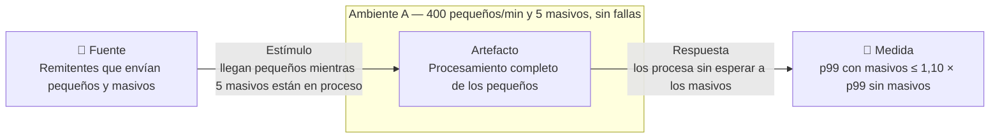

### ASR-D01 — Un externo caído no rechaza archivos

| | |
|---|---|
| **Fuente** | STM, ANTA, MAMC, RNIC o la ECD, que dejan de responder o responden con latencia extrema |
| **Estímulo** | Un externo cae o se pone lento mientras llegan archivos; la caída puede durar horas |
| **Artefacto** | La recepción, la validación y el enriquecimiento de las declaraciones |
| **Ambiente** | C1: un externo caído o lento, con la carga de A |
| **Respuesta** | El sistema sigue recibiendo y acusando; las declaraciones que dependen del externo quedan pendientes y se completan cuando vuelve |
| **Medida** | 0 archivos rechazados por la indisponibilidad del externo, contados desde que cae hasta que todas sus declaraciones pendientes tienen resultado definitivo, en C1 |
| **Por qué es ASR** | Toca el enriquecimiento con cuatro sistemas que BCR no controla, y obliga a decidir qué pasa con una declaración cuya información externa no está disponible y dónde espera. Si se aceptara rechazar, bastaría devolver un error; con cero rechazos aparece un estado pendiente, que BCR aceptó al eximir del SLA de latencia la operación degradada |
| **Cómo se verifica** | Inyección de fallas: cortar cada externo a mitad de una carga A y agregarle latencia; contar los archivos rechazados por esa causa y comprobar que los pendientes cierran al volver el externo |
| **Prioridad · Impacto · Origen** | Alta · Alto · `enunciado` (Disponibilidad: «continuar operando sin rechazar archivos») |

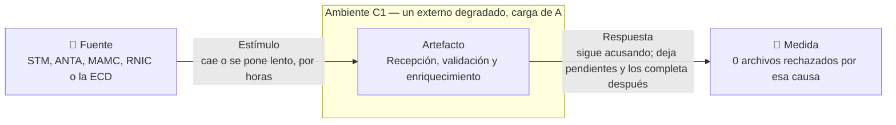

### ASR-S01 — Veredicto criptográfico en 200 ms

| | |
|---|---|
| **Fuente** | Un remitente, legítimo o con un certificado vencido o revocado |
| **Estímulo** | Envía un archivo firmado y con estampa cronológica, de hasta 50 MB; arribo estocástico |
| **Artefacto** | La verificación de la firma digital, la estampa cronológica y la vigencia o revocación del certificado |
| **Ambiente** | A: 400 pequeños por minuto y 5 masivos, sin fallas |
| **Respuesta** | El sistema determina si la firma y la estampa son válidas y si el certificado está vigente y no revocado |
| **Medida** | p99 ≤ 200 ms desde el último byte recibido hasta el veredicto criptográfico, sobre el 100 % de los archivos, en A |
| **Por qué es ASR** | Toca la recepción de todos los archivos, y obliga a decidir cómo se conoce la revocación sin consultar en línea a la ECD por cada archivo y cómo se verifica un archivo de 50 MB sin cargarlo entero. Con 2 s cabría la consulta en línea; con 200 ms, no. En C1, con la ECD caída y sin información de revocación vigente, BCR aceptó acusar con «verificación pendiente», y la medida no aplica |
| **Cómo se verifica** | Benchmark de la verificación con archivos firmados reales de 1 registro a 50 MB, con certificados vigentes, vencidos y revocados; p99 por tamaño |
| **Prioridad · Impacto · Origen** | Alta · Alto · `enunciado` (Seguridad: «el 100 % de los archivos… en menos de 200 milisegundos») |

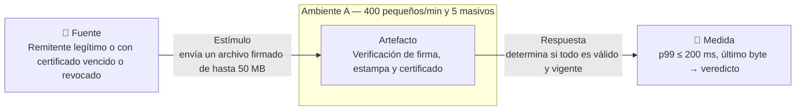

### ASR-M01 — Una regla cambiaria nueva en 4 h-persona

| | |
|---|---|
| **Fuente** | La Junta Directiva de BCR, que modifica la Circular Reglamentaria Externa |
| **Estímulo** | Una regla cambiaria nueva o modificada (un tope, la consistencia de tasas, los declarantes o una vigencia), con la fecha desde la que rige. Cambia con frecuencia `[PREGUNTA → BCR]` ¿cuántas veces al año? · Tipo: adaptativo |
| **Artefacto** | La aplicación de las reglas cambiarias a las declaraciones |
| **Ambiente** | Ligado en despliegue: la regla entra a producción sin recompilar ni detener el resto del flujo |
| **Respuesta** | La regla se implementa, se prueba y se pone en producción, y rige para los archivos recibidos desde su fecha |
| **Medida** | ≤ 4 h-persona desde la especificación aprobada de la regla hasta su puesta en producción |
| **De dónde sale el número** | Origen: el enunciado («debe tomar máximo 4 horas de esfuerzo de desarrollo»). BCR precisó que son 4 h-persona y que incluyen desarrollo y pruebas, no la aprobación regulatoria (respuesta, ADR-11 y P9). Base de estimación: recorrido del cambio sobre la descomposición funcional (recepción, validación, reglas, transformación y resultado), sumado por función |
| **Quién lo hace** | El equipo de TI de BCR, que conoce Orquídea `[SUPUESTO → BCR]` ¿lo hace el equipo propio o un tercero? |
| **Por qué es ASR** | Obliga a decidir dónde vive la regla, si se expresa como dato o como código, y cómo se fija la versión que aplica a cada archivo. Si la Circular cambiara una vez por década, encapsular las reglas sería esfuerzo desperdiciado. Nota de trampa: las 4 h se cumplen regando un cambio barato por varias funciones; va como pregunta T al panel |
| **Cómo se verifica** | Juicio de expertos, con el protocolo de abajo: es el ASR de modificabilidad que se valida. Complemento: activar una regla nueva con tráfico de A y contar las h-persona invertidas y las funciones tocadas en el diff |
| **Prioridad · Impacto · Origen** | Alta · Alto · `enunciado` (Modificabilidad e Interoperabilidad) |

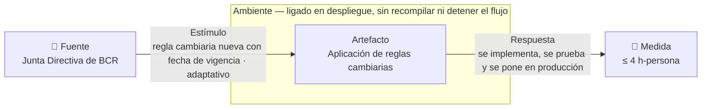

### ASR-E01 — El pico de pequeños en 5 s

| | |
|---|---|
| **Fuente** | Los remitentes, en los cierres de mercado diario y los vencimientos regulatorios |
| **Estímulo** | 1 200 archivos pequeños por minuto durante 45 minutos, en ráfaga `[SUPUESTO → BCR]`, con 5 masivos en paralelo |
| **Artefacto** | El procesamiento completo de los archivos pequeños |
| **Ambiente** | B: 1 200 pequeños por minuto durante 45 min y 5 masivos simultáneos, sin fallas |
| **Respuesta** | Todos los pequeños se procesan |
| **Medida** | p99 ≤ 5 s desde el último byte recibido hasta el resultado definitivo disponible para el remitente, durante toda la ventana de 45 min, en B |
| **Por qué es ASR** | Toca el procesamiento de los pequeños, y obliga a decidir cómo se triplica la capacidad durante 45 minutos sin dejarla fija el resto del día. Con 5 min, una cola absorbería el pico sin cambiar nada; con 5 s, no. La pérdida cero que pide el enunciado es la medida de D03, y los 3 s en A se verifican en la misma prueba (§4) |
| **Cómo se verifica** | Prueba de carga sostenida de 45 min a 1 200 pequeños por minuto con 5 masivos; p99 por ventanas de un minuto |
| **Prioridad · Impacto · Origen** | Alta · Alto · `enunciado` (Escalabilidad) |

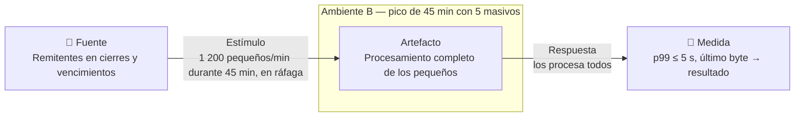

### ASR-I01 — El contrato nuevo de un externo en 4 h-persona

| | |
|---|---|
| **Fuente** | El área de TI de BCR, que pide integrar la versión nueva del contrato de un externo |
| **Estímulo** | STM, ANTA, MAMC o RNIC publica una versión nueva de su contrato (campos, formatos o significados), o BCR reemplaza a uno de ellos |
| **Artefacto** | El enriquecimiento y la validación de las declaraciones con la información de ese externo |
| **Ambiente** | Desarrollo · socio conocido de antemano · tercero fuera de control |
| **Respuesta** | La versión nueva queda integrada: los datos del externo se interpretan con el significado que él les da o se rechazan con diagnóstico, y ninguno se registra con otro significado |
| **Medida** | ≤ 4 h-persona desde la publicación del contrato nuevo hasta su puesta en producción |
| **De dónde sale el número** | Origen: el enunciado («la adaptación y reemplazo de conectores… máximo 4 horas de esfuerzo de desarrollo»); BCR precisó que son h-persona (respuesta, tabla de ASR). Base de estimación: inventario de los campos del contrato del externo por su distancia. Distancia que cierra: sintáctica y semántica en datos |
| **Quién lo hace** | El equipo de TI de BCR, que conoce Orquídea y no el contrato nuevo `[SUPUESTO → BCR]` |
| **Por qué es ASR** | Cierra la distancia sintáctica y semántica con cuatro terceros que cambian su contrato por su cuenta, y obliga a decidir dónde se traduce y se valida su significado sin que el cambio llegue al resto del flujo. Una tasa bien formada puede venir en otra base o con otra fecha de vigencia. Nota de trampa: las 4 h se cumplen integrando rápido y mal; la respuesta exige que nada se registre con otro significado, y va como pregunta T al panel |
| **Cómo se verifica** | Juicio de expertos, con el protocolo de abajo: es el ASR de interoperabilidad que se valida. Complemento: cambiar el contrato de ANTA en un simulador con tráfico, medir las h-persona y correr una prueba de integración de punta a punta con un lote de respuestas del externo |
| **Prioridad · Impacto · Origen** | Alta · Alto · `enunciado` (Modificabilidad e Interoperabilidad) |

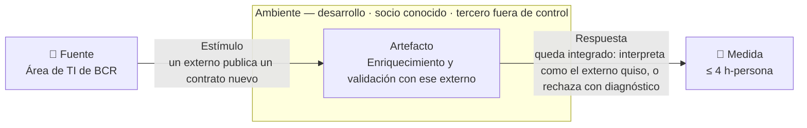

### ASR-D03 — Ninguna declaración acusada se pierde ni se duplica

| | |
|---|---|
| **Fuente** | El propio sistema, ante una falla interna o el pico |
| **Estímulo** | Un elemento interno de procesamiento falla con archivos en curso, o llega el pico de B |
| **Artefacto** | Las declaraciones de los archivos ya acusados |
| **Ambiente** | B: pico de 45 min sin fallas · C2: falla interna con la carga de A |
| **Respuesta** | Cada declaración acusada termina con exactamente un resultado definitivo |
| **Medida** | 0 declaraciones acusadas sin resultado definitivo o con más de uno, contadas por conciliación entre lo acusado y lo resuelto, en B y en C2 |
| **Por qué es ASR** | Toca la recepción, el acuse y la persistencia, y obliga a decidir en qué momento un archivo queda a salvo antes de acusarlo y cómo se evita aplicar dos veces lo que se reprocesa tras una falla. Si se aceptaran pérdidas, el pico se resolvería descartando carga; con cero, no. Reúne el «sin pérdida de mensajes» del enunciado y el «sin pérdida ni duplicados» que el informe tenía dentro de D02 |
| **Cómo se verifica** | Conciliación de lo enviado contra lo resuelto al final de la prueba de 45 min de E01, y después de matar elementos de procesamiento a mitad de una carga A |
| **Prioridad · Impacto · Origen** | Alta · Alto · `enunciado` (Escalabilidad: «sin pérdida de mensajes») · `lente: estímulo repetido` |

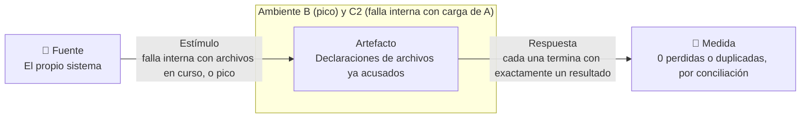

### ASR-L01 — El acuse en 1 s

| | |
|---|---|
| **Fuente** | Un remitente |
| **Estímulo** | Termina de enviar un archivo de cualquier tamaño, hasta 50 MB; arribo estocástico |
| **Artefacto** | La recepción y el acuse de recibo |
| **Ambiente** | A: 400 pequeños por minuto y 5 masivos, sin fallas |
| **Respuesta** | El sistema registra el evento y entrega al remitente un acuse que confirma el inicio del procesamiento |
| **Medida** | p99 ≤ 1 s desde el último byte recibido hasta que el remitente tiene el acuse, en A. El percentil es `[SUPUESTO → BCR]`: el enunciado dice «menos de 1 segundo» |
| **Por qué es ASR** | Toca la recepción y obliga a separar el acuse del procesamiento: en un segundo no cabe validar 100 000 registros, y la verificación de S01 consume hasta 200 ms de ese segundo. Con un minuto, el acuse podría esperar a la validación. BCR fijó que el tiempo cuenta desde el último byte y que un masivo cuya verificación no quepa en el segundo recibe un acuse de custodia |
| **Cómo se verifica** | Prueba de carga en A con la mezcla de tamaños; p99 del acuse por tamaño |
| **Prioridad · Impacto · Origen** | Alta · Alto · `enunciado` (Latencia) · BCR (t0 desde el último byte, P1) |

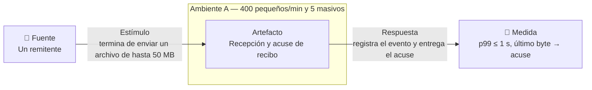

### ASR-S03 — Ningún declarante ve ni altera operaciones de otro

| | |
|---|---|
| **Fuente** | Un remitente autenticado que, con o sin malicia, intenta consultar o alterar operaciones de otro declarante |
| **Estímulo** | Pide consultar resultados, declaraciones o archivos que no son suyos, o envía un archivo con operaciones a nombre de otro |
| **Artefacto** | La consulta de resultados y declaraciones, y el registro de declaraciones |
| **Ambiente** | A: 400 pequeños por minuto y 5 masivos, sin fallas |
| **Respuesta** | Solo obtiene o afecta lo que corresponde a su identidad autenticada; lo demás se niega y queda en la auditoría |
| **Medida** | 0 accesos efectivos a operaciones de otro declarante sobre el catálogo de pruebas de acceso cruzado, en A |
| **Por qué es ASR** | Toca la consulta, el registro y la entrega de datos, y obliga a decidir de dónde sale la identidad del declarante (de la autenticación y del certificado, no de un campo del archivo) y dónde se aplica el filtro. Mide la materialización, el acceso que sí ocurrió, no el intento bloqueado. Un «aislamiento estricto» no admite tolerancia |
| **Cómo se verifica** | Pruebas de acceso cruzado entre declarantes de prueba por todas las vías de consulta y envío; se cuentan los accesos efectivos |
| **Prioridad · Impacto · Origen** | Alta · Medio · `enunciado` (Seguridad: «aislamiento estricto de datos entre declarantes») |

### ASR-D04 — Un cambio en producción no detiene la recepción

| | |
|---|---|
| **Fuente** | El equipo de TI de BCR, que activa en producción una regla, una versión del XSD o el contrato nuevo de un externo |
| **Estímulo** | La activación, o su reversión, ocurre con archivos llegando y en proceso |
| **Artefacto** | La recepción, el acuse y el procesamiento de archivos |
| **Ambiente** | E: cambio en producción con la carga de A |
| **Respuesta** | El sistema sigue recibiendo, acusando y procesando durante la activación y después de ella, y también si el cambio se revierte |
| **Medida** | 0 archivos rechazados o sin acuse por causa de la activación, desde que empieza hasta que termina, en E |
| **Por qué es ASR** | Toca todo el flujo y obliga a decidir cómo conviven la versión anterior y la nueva mientras hay archivos en curso. Con una ventana de mantenimiento bastaría detener y redesplegar, pero el 99,99 % deja 4,4 minutos al mes. Nota de trampa: la medida se cumple aunque un archivo termine evaluado con dos versiones, como en Knight Capital; BCR fijó que aplica la regla vigente a la hora de ingesta, y eso se comprueba en la misma prueba |
| **Cómo se verifica** | Activar una regla, una versión del XSD y un contrato nuevo con tráfico de A, y luego revertirlos; contar los archivos afectados y los evaluados con dos versiones |
| **Prioridad · Impacto · Origen** | Alta · Medio · `enunciado` («no debe generar tiempo de inactividad») · reclasificado: es la mitad de M01, M02 e I01 que se mide en ejecución |

### ASR-L03 — Un masivo termina en 5 min

| | |
|---|---|
| **Fuente** | Un remitente |
| **Estímulo** | Envía un archivo masivo de hasta 100 000 registros y 50 MB mientras otros 4 masivos están en proceso |
| **Artefacto** | El procesamiento completo del archivo masivo |
| **Ambiente** | A: 400 pequeños por minuto y 5 masivos concurrentes, sin fallas |
| **Respuesta** | Todas sus declaraciones quedan aceptadas o rechazadas, y el resultado definitivo del archivo queda disponible |
| **Medida** | ≤ 5 min para cada uno de los 5 masivos concurrentes, desde el último byte hasta el resultado definitivo disponible, en A. Es un máximo y no un percentil: con cinco archivos a la vez, la muestra es pequeña |
| **Por qué es ASR** | Toca la validación y el enriquecimiento, y obliga a procesar un archivo en partes paralelas: 100 000 registros en 300 s son unos 333 por segundo por archivo, antes de contar las consultas a externos. Con 50 minutos alcanzaría un recorrido secuencial |
| **Cómo se verifica** | Prueba con 5 masivos de 100 000 registros firmados en paralelo, sobre la carga de A |
| **Prioridad · Impacto · Origen** | Media · Alto · `enunciado` (Latencia) |

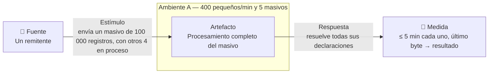

### ASR-D02 — El procesamiento se recupera de una falla interna en 10 s

| | |
|---|---|
| **Fuente** | Un elemento interno de procesamiento que falla |
| **Estímulo** | Deja de funcionar con archivos en curso, en un momento impredecible |
| **Artefacto** | El procesamiento de las declaraciones en curso |
| **Ambiente** | C2: falla interna con la carga de A |
| **Respuesta** | Las declaraciones que estaban en proceso vuelven a avanzar sin intervención manual |
| **Medida** | ≤ 10 s desde la falla hasta que el procesamiento vuelve a producir resultados definitivos, en C2 |
| **Por qué es ASR** | Toca el procesamiento, y obliga a decidir dónde vive el estado de lo que está en curso para que otro elemento lo retome. Con 10 minutos cabría un reinicio manual. Que al retomar no se pierda ni se duplique nada lo mide D03 |
| **Cómo se verifica** | Matar un elemento de procesamiento a mitad de una carga A y medir el tiempo hasta que vuelven a salir resultados |
| **Prioridad · Impacto · Origen** | Media · Medio · `enunciado` (Disponibilidad: «recuperarse de fallos de nodos internos en menos de 10 segundos») |

### ASR-L05 — Un mediano termina en 30 s

| | |
|---|---|
| **Fuente** | Un remitente |
| **Estímulo** | Envía un archivo mediano (51 a 5 000 registros) mientras 5 masivos están en proceso. Tasa: `[PREGUNTA → BCR]` |
| **Artefacto** | El procesamiento completo del archivo mediano |
| **Ambiente** | A: 400 pequeños por minuto y 5 masivos, sin fallas |
| **Respuesta** | El resultado definitivo del archivo queda disponible |
| **Medida** | p99 ≤ 30 s desde el último byte hasta el resultado definitivo disponible, en A. El percentil es `[SUPUESTO → BCR]` |
| **Por qué es ASR** | Obliga a decidir con qué carga va un mediano: si espera con los masivos, cinco masivos de 5 minutos lo dejan fuera de los 30 s; si va con los pequeños, puede degradarlos. Con 5 minutos iría con los masivos sin pensarlo. El informe v1.0 no lo formuló, y el enunciado lo pide |
| **Cómo se verifica** | Prueba con medianos de 5 000 registros mientras corren 5 masivos sobre la carga de A |
| **Prioridad · Impacto · Origen** | Media · Medio · `enunciado` (Latencia: «para archivos medianos… máximo 30 segundos») |

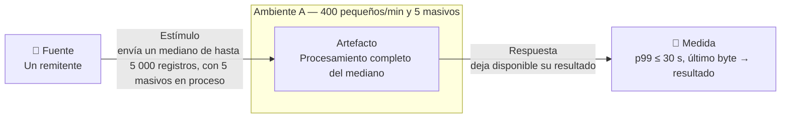

### ASR-M02 — Una versión nueva del XSD en 4 h-persona

| | |
|---|---|
| **Fuente** | La Junta Directiva de BCR, al cambiar en la Circular la estructura de las declaraciones |
| **Estímulo** | Una versión nueva del esquema XML (XSD) de las declaraciones · Tipo: adaptativo |
| **Artefacto** | La validación de la estructura de los archivos |
| **Ambiente** | Ligado en despliegue |
| **Respuesta** | La versión nueva se implementa, se prueba y se pone en producción; los archivos de la versión anterior siguen validándose mientras convivan `[SUPUESTO → BCR]` ¿los remitentes migran a ritmos distintos y las dos versiones conviven? |
| **Medida** | ≤ 4 h-persona desde el XSD aprobado hasta su puesta en producción |
| **De dónde sale el número** | Origen: el enunciado («cambios en esquemas XML/XSD… máximo 4 horas de esfuerzo de desarrollo»); BCR: h-persona con desarrollo y pruebas (P9). Base de estimación: recorrido del cambio sobre la validación, la transformación al modelo canónico y la consulta |
| **Quién lo hace** | El equipo de TI de BCR, que conoce Orquídea `[SUPUESTO → BCR]` |
| **Por qué es ASR** | Obliga a decidir cómo se identifica la versión de cada archivo y qué parte de la transformación al modelo canónico depende del esquema. Nota de trampa: las 4 h se cumplen aunque el cambio se riegue por la validación, la transformación y la consulta |
| **Cómo se verifica** | Juicio de expertos (no va en esta encuesta). BCR lo evalúa en la Fase 4 por inspección estática y listas de chequeo |
| **Prioridad · Impacto · Origen** | Media · Medio · `enunciado` · BCR lo clasificó como secundario |

### ASR-S04 — Toda alteración de la auditoría se detecta

| | |
|---|---|
| **Fuente** | Alguien con acceso al almacenamiento, interno, por abuso o por mal uso |
| **Estímulo** | Modifica, borra o reordena registros de auditoría ya escritos |
| **Artefacto** | La auditoría de la recepción, los acuses y los resultados |
| **Ambiente** | A: 400 pequeños por minuto y 5 masivos, sin fallas |
| **Respuesta** | La verificación de integridad señala la alteración y el registro donde ocurrió |
| **Medida** | 100 % de las alteraciones del catálogo de pruebas detectadas en la verificación de integridad siguiente, en A |
| **Por qué es ASR** | Obliga a decidir cómo se encadena la evidencia para que una alteración se note sin depender de quien administra el almacenamiento, y cómo se escribe en orden mientras los archivos se procesan en paralelo (pregunta 2 de BCR). El 100 % se justifica: una verificación criptográfica no tiene el conflicto entre completitud y exactitud de un detector por tiempo, y un 95 % dejaría alteraciones sin detectar por diseño |
| **Cómo se verifica** | Alterar, borrar y reordenar registros de prueba y correr la verificación. BCR lo evalúa en la Fase 4 por inspección |
| **Prioridad · Impacto · Origen** | Media · Medio · `enunciado` («asegurar una auditoría inmutable») · BCR lo clasificó como secundario |

### ASR-I02 — Un área nueva de BCR recibe datos sin tocar el flujo principal

| | |
|---|---|
| **Fuente** | Un área de BCR (estadística, analítica o búsqueda) que pide recibir los datos transformados |
| **Estímulo** | Integrar un consumidor nuevo en un formato que hoy no se entrega: una base analítica, un índice de búsqueda o un archivo plano · Tipo: aditivo |
| **Artefacto** | La entrega de datos transformados a las áreas de BCR |
| **Ambiente** | Desarrollo · socio conocido de antemano · propio |
| **Respuesta** | El área recibe los datos del modelo canónico en su formato, con el mismo significado que en el registro |
| **Medida** | 0 funciones del flujo principal (recepción, validación, enriquecimiento, transformación y persistencia) modificadas para integrarla |
| **De dónde sale el número** | Origen: el informe v1.0 (tabla 10), aceptado por BCR como secundario (respuesta, §2). El enunciado no trae la cifra. Base de estimación: recorrido de la integración sobre la descomposición funcional. Distancia que cierra: sintáctica, el formato de cada área |
| **Quién lo hace** | El equipo de TI de BCR `[SUPUESTO → BCR]` |
| **Por qué es ASR** | Obliga a decidir si la entrega a las áreas depende del flujo de procesamiento o se alimenta de los hechos ya registrados. Nota de trampa: cero funciones del flujo principal se cumple metiendo toda la lógica en la entrega |
| **Cómo se verifica** | Juicio de expertos (no va en esta encuesta). BCR lo evalúa en la Fase 4 por inspección |
| **Prioridad · Impacto · Origen** | Baja · Bajo · informe · BCR lo clasificó como secundario · `lente: fuente` |

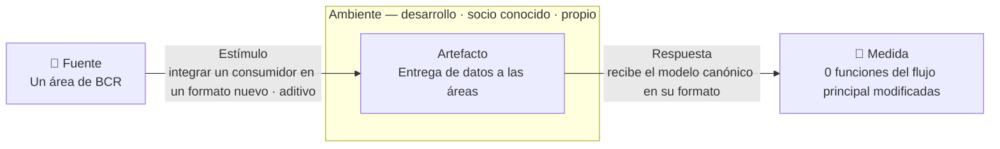

### Protocolo de verificación de modificabilidad e interoperabilidad

Se validan ASR-M01 e ASR-I01, uno de cada atributo. M02 e I02 no van en esta encuesta.

| | |
|---|---|
| **Panel** | Al menos dos humanos de fuera del curso con experiencia en arquitectura de sistemas de misión crítica o de integración `[PREGUNTA → equipo]` ¿quiénes? Si se suma un evaluador no humano, va en una columna aparte y no cuenta para la mayoría |
| **Presentación** | Los ASR, la arquitectura y las decisiones principales, contadas en neutro y sin mostrar los umbrales. No se elogian las tácticas. Después, una sesión de preguntas |
| **Escala** | 1 muy improbable · 2 improbable · 3 ni una ni otra · 4 probable · 5 muy probable |
| **Escenarios** | M01: «una regla cambiaria nueva llega a producción con ≤ 2, 4, 6 y 12 h-persona» (×0,5, ×1, ×1,5 y ×3; el real queda segundo en la escalera). I01: «el contrato nuevo de ANTA se integra con ≤ 1, 2,5, 4 y 8 h-persona» (×0,25, ×0,6, ×1 y ×2; el real queda tercero). En el formulario van en orden aleatorio y no se dice cuál es el real. Control negativo, uno para el panel: «cambiar el canal de envío de los remitentes a transferencia de archivos con ≤ 4 h-persona». Preguntas T: «¿la regla podría cumplir las 4 h regando el cambio por varias funciones?» y «¿el contrato podría integrarse en 4 h interpretando mal sus datos?» |
| **Tabulación** | Una tabla por ASR validado, con una columna por experto (A, B, C), la mediana de los humanos y el rango |
| **Regla de decisión** | Escrita antes de encuestar. **Sostenido**: mediana ≥ 4 en el escenario real y ningún humano ≤ 2. **Refutado**: mediana ≤ 2. **No concluyente**: cualquier otro caso. El control negativo debe salir ≤ 2; si sale alto, las respuestas tienen sesgo de aquiescencia |

## 4. Descartes

| Candidato | Origen | Salió por | Razón en una frase | Va a |
|---|---|---|---|---|
| Pequeños en ≤ 3 s en A | `enunciado` | Abogado del diablo | Fuerza la misma decisión que E01, 5 s con el triple de carga, y se mide en la misma prueba | Se verifica junto con E01 |
| Disponibilidad del 99,99 % | `enunciado` | No diseñable | Es la meta de negocio; la persiguen D01, D02, D03 y D04 | Motivador |
| Cifrado en tránsito y en reposo | `enunciado` | Palanca | Se cumple con configuración y práctica estándar y no descarta ninguna familia de solución | Restricción |
| Protección contra ataques XML (S02 del informe) | `enunciado` | 10× | Endurecer el parser es práctica estándar; la parte que sí es estructural, que lo verificado sea lo procesado, va dentro de S01 | Restricción · S01 |
| Firmante distinto del remitente (S05 del informe) | informe | Funcional | Comparar dos identidades es una regla de la verificación de S01 | Funcional |
| 0 s de indisponibilidad dentro de M01, M02 e I01 | informe | Otro atributo | Es una medida de ejecución dentro de un ASR de modificabilidad | ASR-D04 |
| «Sin pérdida» dentro de E01 y «sin pérdida ni duplicados» dentro de D02 | `enunciado` · informe | Dos medidas | Cada ASR lleva una sola medida | ASR-D03 |
| Ambiente D, «bajo ataque», del informe | informe | — | El ataque es el estímulo del escenario, no el ambiente | — |
| Topología activo-activo en varias zonas | BCR (ADR-17) | Palanca | Es infraestructura | Infraestructura |
| Recuperación ante desastre entre regiones | informe | Fuera de alcance | El enunciado pide recuperarse de fallas de nodo, no de región (informe §4.3) | — |
| Detectar el archivo atascado o con resultado descuadrado | `lente: inversión` | Sin umbral | El enunciado no da tiempo de detección | §5, gate |
| Cuándo un externo cuenta como caído por lento | `lente: ambiente` | Sin umbral | Define cuándo empieza C1 y cuándo aplica la exención del SLA | §5 |
| Drenar 12 h de pendientes sin degradar lo nuevo (pregunta 6 de BCR) | `lente: después de la falla` | Pendiente | Es la medida de L04 en otro ambiente; entra si BCR fija cómo se drena | §5 |
| Archivo aceptado con un certificado revocado dentro de la ventana de la caché | `lente: segundo orden` | Sin umbral | Su detección depende de cada cuánto publica la ECD su lista de revocación | §5 |
| Más de 5 masivos al mismo tiempo | `lente: estímulo` | Pendiente | El enunciado y BCR fijan 5; nadie dice qué pasa con el sexto | §5 |
| Un remitente que satura a los demás con pequeños | `lente: ambiente` | 10× | Dentro de B la carga total está acotada a 1 200 por minuto | — |
| Frescura de los datos para las áreas («tiempo real») | `lente: fuente` | Sin umbral | El enunciado no da cifra | §5 |
| Correcciones o anulaciones que llegan antes que la declaración original | informe (RT-05) | Funcional | Es una regla de orden del negocio | Funcional |
| Exactitud de las reglas cambiarias | `lente: inversión` | Palanca | Ningún diseño mueve la exactitud de una regla | Funcional |
| Retención de 10 años en almacenamiento no modificable | BCR (ADR-14) | Restricción | Es una norma | Restricción |
| Trazar cada archivo del acuse a la notificación (pregunta 3 de BCR) | BCR | Concern | Es un asunto transversal de observabilidad | Concern |
| Firma en streaming, hash encadenado en paralelo, purga del outbox (preguntas 1, 2 y 5 de BCR) | BCR | Diseño | Preguntan cómo se cumplen S01, S04 y E01, no qué se exige | ADR |

## 5. Abierto

**Preguntas**

- `[PREGUNTA → BCR]` ¿A partir de qué latencia de un externo se considera «extrema»? Define cuándo empieza C1 y cuándo aplica la exención del SLA.
- `[PREGUNTA → BCR]` ¿Cuántos archivos medianos llegan por minuto, en A y en B?
- `[PREGUNTA → BCR]` ¿Cuántas veces al año cambia la Circular, y cuántas cambian su contrato los externos?
- `[PREGUNTA → BCR]` ¿Qué pasa si llegan más de 5 masivos al mismo tiempo: esperan, se rechazan o se aceptan con otro plazo?
- `[PREGUNTA → BCR]` ¿Cada cuánto publica la ECD su lista de revocación, y en cuánto tiempo hay que detectar un archivo aceptado con un certificado ya revocado?
- `[PREGUNTA → BCR]` Tras una caída larga de un externo, ¿a qué ritmo deben drenarse los pendientes sin afectar el tráfico nuevo?
- `[PREGUNTA → BCR]` ¿Qué significa «tiempo real» para las estadísticas de las áreas?
- `[PREGUNTA → BCR]` ¿Qué datos ve cada área de BCR según su rol?, y ¿hay un límite de archivos por remitente?
- `[PREGUNTA → equipo]` ¿Quiénes forman el panel de expertos?
- `[PREGUNTA → recorrido de Helix]` ¿Qué deslizadores trae la medida de `Performance`, `Modifiability` e `Interoperability`?

**Supuestos**

- `[SUPUESTO → BCR]` El percentil de L01 y L05 es p99, como el que BCR usó en L04, E01 y S01. ¿Aplica igual?
- `[SUPUESTO → BCR]` En A el arribo es estocástico, y en B llega en ráfaga en los cierres. ¿Es así?
- `[SUPUESTO → BCR]` Los cambios de reglas, XSD y contratos los hace el equipo propio de TI, que conoce Orquídea.
- `[SUPUESTO → BCR]` Las versiones del XSD conviven mientras los remitentes migran.
- `[SUPUESTO → BCR]` Los contratos de los externos cambian menos que la Circular; por eso I01 va después de M01.

**Riesgos de alcanzabilidad**

- **S01 contra 50 MB.** Verificar la firma de un XML de 50 MB exige canonicalizar y resumir el documento completo, y 200 ms pueden no alcanzar. BCR lo pregunta en su punto 1.
- **S01 contra el ADR-04 aprobado.** El ADR-04 permite que un masivo reciba un acuse de custodia y se verifique después, pero S01 pide el veredicto en 200 ms para el 100 % de los archivos. Hay que acordar con BCR si S01 aplica a los masivos o solo a los que caben en el segundo del acuse.
- **N = 5 en A o en B.** BCR pone los 5 masivos en el ambiente A en su tabla de ASR y en hora pico en el ADR-02. Este documento los usa en los dos; si en A son menos, L04 y L03 se relajan.

**Fuera de alcance**

- Disponibilidad física: la redundancia de servidores, zonas y redes es infraestructura.

**Gate**

DEFECTOS, en tres puntos:

- **Punto 12 (disponibilidad por rama).** Falta un ASR de la rama de detección. Se cubren el enmascaramiento (D01), la reparación (D02) y la prevención (D03 y D04).
- **Punto 12 (seguridad por rama).** Falta un ASR de la rama de reacción. Se cubren la prevención (S01 y S03) y la detección (S04).
- **Punto 14 (falla de contenido).** Ningún ASR detecta un resultado que sale a tiempo pero mal, por ejemplo un archivo masivo que se notifica como aceptado total cuando le faltan declaraciones.

Los tres esperan una cifra de BCR: el umbral del externo lento, la ventana de revocación y el tiempo de detección. Se dejaron fuera a propósito para no inventar números. Los otros 23 puntos pasan.
