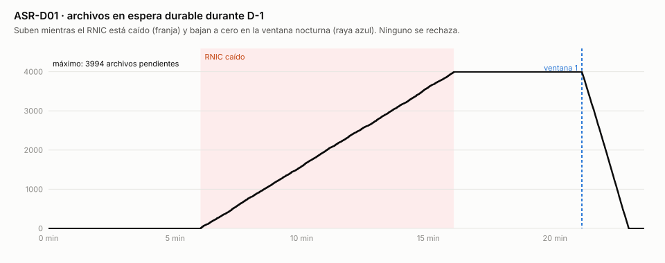
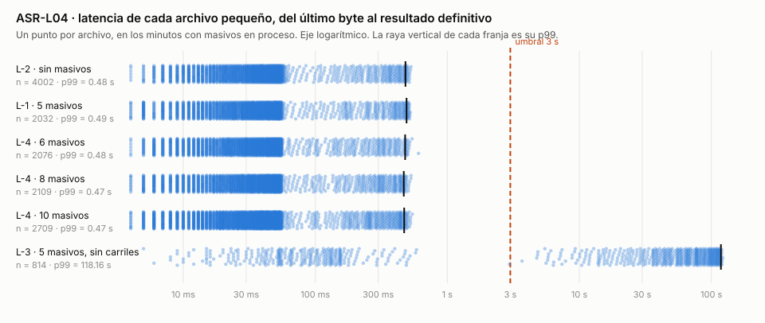

# Resultados del experimento de los tres ASR críticos

Esta página reporta las ejecuciones del experimento diseñado en [Experimento](experiments.md), corridas el 7 de noviembre de 2026 entre las 16:11 y las 18:46 sobre el prototipo descrito en [PoC del experimento](modelos/poc-experimento.md). Fueron 13 ejecuciones de decisión, una por escenario, y las 13 resultaron válidas.

**En resumen, las tres hipótesis se sostienen.** Con el RNIC caído, lento o caído varios días, el 100 % de los archivos válidos se procesó dentro de los días de reintento y ninguno se rechazó por la caída (ASR-D01). Con 5 masivos en proceso, el p99 de los archivos pequeños fue de 491 ms frente al umbral de 3 s, y siguió por debajo de 0,5 s con 10 masivos; sin carriles subió a 118 s (ASR-L04). Ningún archivo del catálogo criptográfico ni ninguno en verificación pendiente llegó a aceptación (ASR-S06).

| ASR | Escenario | Umbral | Medido | Veredicto |
|---|---|---|---|---|
| [ASR-D01](quality-attributes.md#asr-d01) · disponibilidad | D-1 · RNIC caído 10 min | 100 % de los válidos procesados dentro de los días | 8 462 de 8 462 | **Pasa** |
| ASR-D01 | D-2 · primera ventana con el RNIC caído | 100 % | 3 553 de 3 553 | **Pasa** |
| ASR-D01 | D-3 · RNIC caído más allá de los días | Fuera de la medida: lo notificado se procesa al volver | 2 437 notificados, 2 437 procesados al volver | **Se comporta como se diseñó** |
| ASR-D01 | D-4 · RNIC más lento que el timeout | 100 % | 3 641 de 3 641 | **Pasa** |
| ASR-D01 | D-5 · reenvíos y eventos repetidos | 100 %; 0 duplicados | 3 670 de 3 670; 50 de 50 reenvíos rechazados; 0 resultados escritos dos veces | **Pasa** |
| [ASR-L04](quality-attributes.md#asr-l04) · latencia | L-1 · 5 masivos en proceso | p99 ≤ 3 s por pequeño | 491 ms (2 032 pequeños) | **Pasa** |
| ASR-L04 | L-2 · línea base sin masivos | Referencia del 10 % de BCR | 482 ms; L-1 queda 1,9 % por encima | **Dentro del margen** |
| ASR-L04 | L-3 · control sin carriles | Se espera que falle | 118 s | **Falla, como se esperaba** |
| ASR-L04 | L-4 · 6, 8 y 10 masivos | p99 ≤ 3 s | 478, 468 y 471 ms | **Pasa: sin quiebre** |
| [ASR-S06](quality-attributes.md#asr-s06) · seguridad | S-1 · catálogo con la carga normal | 0 aceptados sin verificación completa | 0 de 27; cada uno con su causa | **Pasa** |
| ASR-S06 | S-2 · ECD caída y CRL vencida | 0 aceptados antes de verificar | 0 de 2 048 | **Pasa** |
| ASR-S06 | S-3 · evidencia de cada aceptado | Entrada firmada con el hash de lo procesado | 100 % en todas las ejecuciones | **Pasa** |

## Cómo se midió

**Las cifras salen del registro de eventos, no de los tableros.** Cada servicio anota en una tabla el instante de cada hecho y la llave del archivo: el envío, el último byte recibido, el acuse, el paso a pendientes, cada ventana y el resultado definitivo. El veredicto es una consulta SQL que cruza esos hechos archivo por archivo (`analisis/d01.sql`, `l04.sql` y `s06.sql`). Prometheus y Grafana sirvieron para ver cada ejecución mientras corría, pero agregan los datos y pierden la llave, así que no deciden.

**El remitente simulado anota qué espera de cada archivo antes de enviarlo.** Un 5 % de las declaraciones lleva una cédula con un nombre que no le corresponde; el remitente anota cuántas lleva cada archivo y qué resultado tendría con el RNIC disponible (total, parcial o rechazo). Un archivo cuenta como procesado si su resultado es ese y tiene exactamente tantas declaraciones rechazadas como inválidas llevaba.

**Cada ejecución siguió el mismo ciclo**: preparación con la base y las colas vacías, 1 min de calentamiento fuera de la medición, la carga de fondo de 400 pequeños por minuto con arribo estocástico, los estímulos en el segundo que fija el plan, las ventanas nocturnas, el cierre con la auditoría de la evidencia y el veredicto. El orquestador invalida una ejecución si la carga tiene un hueco de más de 30 s, si el equipo se suspende o si k6 pasa del 1 % de solicitudes fallidas. Ninguna lo hizo: el hueco máximo fue de 1,5 s y no hubo solicitudes fallidas.

| Supuesto | Valor | Por qué |
|---|---|---|
| Costo de las reglas cambiarias | 1 ms de CPU por declaración | Sin él, un masivo dura segundos y el aislamiento no se prueba. Con él, un masivo de 100 000 registros dura 1 min 42 s en un hilo |
| Umbral entre carriles | 30 000 bytes | Un pequeño de 50 registros pesa unos 27 KB. BCR no lo ha fijado |
| Carriles | A: 8 hilos y 2 CPU · B: 5 hilos y 3 CPU | Un hilo por masivo de L-1 en el carril B |
| Timeout del adaptador del RNIC | 1 s | La lentitud de D-4 (3 s) lo supera |
| Monitor | Sondeo cada 1 s, timeout de 800 ms, caído con 3 fallos seguidos | Una llamada vencida de un adaptador cuenta como un fallo |
| Días de reintento | 2 ventanas | Valor de prueba del diseño. BCR no lo ha fijado |
| Ventana nocturna | La dispara el orquestador | Una «noche» dura lo que tarda la prueba en llamarla |

## ASR-D01 · Ningún archivo se rechaza por la caída de un sistema externo

**La recepción siguió acusando con el RNIC caído, y todo lo que lo necesitaba quedó pendiente, no rechazado.** En los cinco escenarios, ningún archivo válido terminó con un resultado distinto del que habría tenido con el RNIC disponible. Los archivos con cédulas erradas se rechazaron por la regla, con el número exacto de declaraciones inválidas.

| Escenario | Válidos | Pasaron por pendientes | Detección de la caída | Ventanas | Resultado |
|---|---|---|---|---|---|
| D-1 · caída de 10 min | 8 462 | 3 990 | 221 ms | 1 (RNIC de vuelta): resolvió 3 994 en 1 min 51 s | 8 462 procesados |
| D-2 · ventana con el RNIC caído | 3 553 | 2 393 | 519 ms | 1 (caído): reprogramó 2 394 en 0,8 s · 2 (de vuelta): resolvió 2 394 en 1 min 6 s | 3 553 procesados |
| D-3 · caída más allá de los días | 3 686 | 2 437 | 513 ms | 1 y 2 (caído): reprogramó; la 2 notificó 2 438 · 3 (de vuelta): resolvió 2 438 | 1 249 en carril; 2 437 notificados y procesados al volver |
| D-4 · RNIC lento (3 s) | 3 641 | 1 642 | 1 440 ms | 1 (de vuelta): resolvió 1 645 en 45 s | 3 641 procesados |
| D-5 · reenvíos y repeticiones | 3 670 | 2 451 | 420 ms | 1 (de vuelta): resolvió 2 453 en 1 min 7 s | 3 670 procesados |

Las ventanas resolvieron unos archivos más que los válidos que pasaron por pendientes: son archivos en que todas las declaraciones eran inválidas y que la regla rechazó entera.

**La detección (ADR-002) fue de 0,2 a 0,5 s con el RNIC cortado y de 1,4 s con el RNIC lento.** Con el corte, el monitor declaró la caída antes de su tercer sondeo, porque los adaptadores le reportaron sus llamadas vencidas: alcanzaron a fallar tres llamadas antes de la declaración. Con la lentitud, la detección esperó tres sondeos vencidos de 800 ms. El regreso se detectó entre 8 y 815 ms después de restablecer el RNIC. En D-4 el regreso aparece en −8 ms: el inyector anotaba el restablecimiento después de aplicarlo. Ya anota antes, como hace con la falla, pero D-4 corrió con la versión anterior.

**El reproceso sin duplicados (ADR-004) se sostuvo.** En D-5, los 50 reenvíos de archivos pendientes con la misma llave recibieron «duplicado» sin tocar el original, y los 50 archivos nuevos enviados en el mismo momento se acusaron. Los 50 mensajes de archivos ya resueltos que el inyector repitió directo en la cola no escribieron un segundo resultado: la escritura del resultado definitivo los rechazó todos. En las 13 ejecuciones, ningún archivo tuvo dos resultados.

**Decisión.** Se aceptan ADR-001, ADR-002, ADR-003 y ADR-004 tal como están. El experimento no midió una ventana real con días de pendientes acumulados (R-003a).

## ASR-L04 · Aislamiento de carga entre archivos masivos y pequeños

**Los carriles aislaron por completo a los pequeños.** Con 5 masivos de 49 MB en proceso, el p99 de los pequeños fue de 491 ms, casi el mismo que sin masivos (482 ms). La diferencia, de 1,9 %, queda dentro del margen de 10 % que propuso BCR. Con 6, 8 y 10 masivos el p99 no subió.

| Ejecución | Masivos | Pequeños medidos | p50 | p99 | Pequeños sobre 3 s |
|---|---|---|---|---|---|
| L-2 · línea base | 0 | 4 002 | 36 ms | 482 ms | 0 |
| L-1 | 5 | 2 032 | 34 ms | 491 ms | 0 |
| L-4 | 6 | 2 076 | 34 ms | 478 ms | 0 |
| L-4 | 8 | 2 109 | 35 ms | 468 ms | 0 |
| L-4 | 10 | 2 709 | 35 ms | 471 ms | 0 |
| L-3 · sin carriles | 5 | 814 | 28,9 s | 118 s | 512 |

En cada fila con masivos se miden los pequeños que terminaron de llegar mientras algún masivo estaba en proceso.

**El control sin carriles (L-3) muestra qué sostiene el resultado.** Con un solo tópico y un solo pool de 8 hilos, los 5 masivos ocuparon 5 hilos durante 2 minutos y los pequeños esperaron detrás de ellos. El p99 de los pequeños llegó a 118 s, unas 240 veces el de L-1, y solo 302 de 814 se resolvieron en menos de 3 s. Fuera de esos 2 minutos, el p99 volvió a 521 ms.

**El acuse quedó lejos de la referencia de 1 s.** El p99 del acuse de los pequeños fue de 7 ms. Cada masivo de 49 MB subió en unos 2 s, y su acuse salió entre 2 y 114 ms después del último byte, con la verificación en streaming ya hecha.

**Hallazgo: los masivos esperan turno dentro del carril B.** Con 5 hilos, dos masivos que caen en particiones del mismo hilo se procesan uno detrás de otro. Los masivos duraron 1 min 42 s, 3 min 23 s o 5 min 5 s según les tocara el primer, el segundo o el tercer turno, y con 10 masivos uno llegó a 6 min 47 s. Uno de cada tanda pasó la referencia de 5 min en L-1, L-4 con 6 y L-4 con 8, y tres pasaron en L-4 con 10. Esto contesta R-005a: con más masivos que hilos, el carril B se satura y el carril A no lo nota. Sin carriles (L-3), los masivos terminaron en 2 min porque tuvieron más hilos, que es el precio que acepta ADR-005.

**Decisión.** Se acepta ADR-005, con un ajuste para el carril B: repartir los masivos entre los hilos libres en vez de por la llave del archivo, o dimensionar el carril B con al menos un hilo por masivo esperado en el pico. El ajuste no toca el carril A ni la medida de ASR-L04.

## ASR-S06 · Ningún archivo se acepta sin validación criptográfica completa

**Ningún archivo inválido o sin verificar llegó a aceptación.** En S-1, cada uno de los nueve casos del catálogo se envió tres veces, mezclado con la carga normal, y los 27 se rechazaron en la recepción, con su causa, en 5 ms o menos.

| Caso del catálogo | Causa de rechazo |
|---|---|
| Firma alterada (cambia una declaración) | Resumen no coincide |
| Resumen recalculado sin volver a firmar | Firma inválida |
| Firma envuelta (declaraciones sin firmar después de la firma) | Estructura inválida |
| Entidad externa (XXE) | Estructura inválida |
| Firmante distinto del remitente | Firmante no es el remitente |
| Certificado de una autoridad no aceptada | Cadena no aceptada |
| Certificado revocado | Certificado revocado |
| Estampa desfasada (1 h en el futuro) | Estampa desfasada |
| Estampa vencida (48 h) | Estampa vencida |

**Con la ECD caída y la copia de la CRL vencida (S-2), la recepción acusó sin aceptar.** Los 2 048 archivos válidos que llegaron en ese lapso se acusaron en «verificación pendiente» y ninguno llegó a resultado antes de verificarse. La primera ventana corrió con la ECD caída y los reprogramó; la segunda, con la ECD de vuelta, verificó la revocación de los 2 048, anexó su evidencia y los liberó a su carril. La espera fue de 10 s a 5 min 24 s. Los 3 archivos con certificado revocado que llegaron en el mismo lapso quedaron pendientes igual que los demás y se rechazaron en la ventana.

**Cada archivo aceptado tiene su evidencia (S-3).** Al cerrar cada ejecución se auditó el registro de evidencia completo: la firma de BCR de cada entrada es válida y el hash de la entrada es el de los bytes que procesó el carril. En S-1 fueron 2 379 de 2 379 aceptados, en S-2, 2 842 de 2 842, y en las ejecuciones de D01, todos los aceptados.

**Decisión.** Se aceptan ADR-006, ADR-007 y ADR-008 tal como están.

## Lo que el experimento no prueba

- **Tiempos de producción.** Todo corrió en un solo equipo, sin saltos de red. Un p99 de 491 ms en local no garantiza 3 s en producción; el margen frente a la línea base, que compara dos corridas en el mismo equipo, es el dato que mejor se traslada.
- **La firma de producción.** El prototipo firma con ECDSA sobre los bytes del documento, no con XMLDSig canonicalizado. Mide el costo de verificar en streaming (SUP-01), no el de canonicalizar.
- **Las reglas cambiarias reales.** Su costo es un supuesto de 1 ms de CPU por declaración. Con otro costo, la duración de los masivos cambia en la misma proporción.
- **Caídas reales de horas.** Las caídas duraron minutos y la ventana se disparó a mano. No se midió una ventana con días de pendientes acumulados ni el estallido sobre la base al volver un tercero (C-04).
- **La caída de la cola o de la base.** Kafka y PostgreSQL corrieron en un nodo y no se cayeron en ninguna prueba.
- **Un tercero que responde mal.** El monitor detecta la caída y la lentitud, no las respuestas erradas (R-002a).

## Evidencia de cada ejecución

Cada ejecución dejó en `analisis/resultados/<ejecución>/` su veredicto completo (`veredicto.txt`), la salida de k6, el plan con que corrió y el enlace al tablero de Grafana fijado en su ventana de tiempo. Los eventos crudos se exportaron a CSV y no se versionan.

| Ejecución | Escenario | Horario | Medición |
|---|---|---|---|
| d1 | D-1 | 16:11–16:35 | 20 min |
| d2 | D-2 | 16:35–16:45 | 8 min |
| d3 | D-3 | 16:46–16:56 | 8 min |
| d4 | D-4 | 16:57–17:07 | 8 min |
| d5 | D-5 | 17:07–17:18 | 8 min |
| l1 | L-1 | 17:18–17:30 | 10 min |
| l2 | L-2 | 17:30–17:42 | 10 min |
| l3 | L-3 | 17:42–17:53 | 10 min |
| l4-6 | L-4 · 6 masivos | 17:53–18:05 | 10 min |
| l4-8 | L-4 · 8 masivos | 18:05–18:17 | 10 min |
| l4-10 | L-4 · 10 masivos | 18:17–18:29 | 10 min |
| s1 | S-1 | 18:29–18:35 | 5 min |
| s2 | S-2 | 18:35–18:46 | 6 min |
